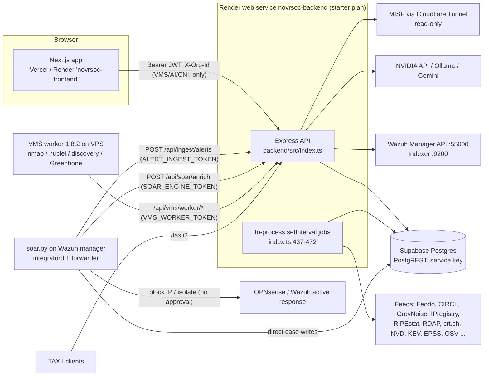
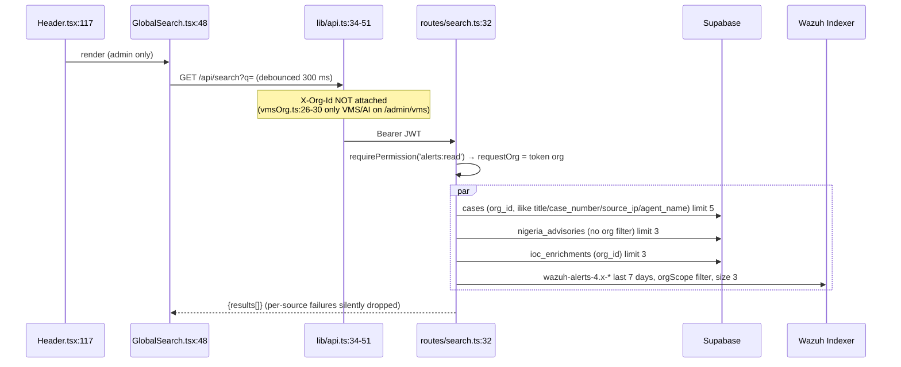

# NovrSOC — Deep Technical Audit V2

**Baseline audited:** `origin/main` at `3bd3a6e83bc30bb5520649b435899c39fc879eb2` (P27 onboarding frontend). The audit read a detached, read-only checkout of that commit. Every `file:line` reference below is at that commit.

**Method:**
- **Source reading.** Code was read directly; README claims were not trusted.
- **Generated inventories.** Scripts produced the route, API and table inventories (Appendices A–C) by parsing the source.
- **What was not done.** No code, database, environment variable or deployment was changed, and no scan was run. Live production behaviour was not observed. Anything that depends on it is marked **UNKNOWN**.

**How this differs from V1.** V1 described what NovrSOC is. This report says what to change, where, and in what order. Findings are numbered (`F-01`…) so the roadmap in §17 can refer to them.

**Labels used:**

| Label | Meaning |
|---|---|
| **CONFIRMED** | The defect follows directly from the code cited. |
| **LIKELY** | The code makes it probable; it needs a test or live check. |
| **MISSING** | The capability does not exist. |
| **UI-ONLY** | The problem is in presentation; the backend is correct. |
| **CONFIG** | The problem depends on production configuration. |
| **UNKNOWN** | It cannot be established from source. |

**Complexity scale:**
- **S**: under a day.
- **M**: 1–3 days.
- **L**: about a week.
- **XL**: more than a week, or multi-phase.

---

## 1. Executive summary

NovrSOC has solid foundations:
- **Tenant resolution.** [backend/src/lib/resolveOrg.ts](backend/src/lib/resolveOrg.ts) handles which organisation a request acts on.
- **Permission map.** [backend/src/lib/permissions.ts](backend/src/lib/permissions.ts) maps roles to permissions.
- **Asset and finding model.** The VMS asset/finding model and its explainable risk engine are sound.
- **Scan authorisation.** P27's evidence-backed authorisation is well designed.
- **CNII.** CNII is built as an overlay on VMS and TI, not a parallel store.
- **AI.** The grounded AI service (`services/ai.ts`) has a purpose registry and structured, evidence-checked output.

These should be kept.

The problems are concentrated in the **older modules that predate the permission model**: Brand Protection, URL/Web scan, the legacy portal proxy and the dashboard map. They also sit in **the shell and dashboard**, which mix real data with hardcoded status indicators and invented geographic precision.

**Ten highest-priority engineering findings:**

| # | Finding | Type | Fix size |
|---|---|---|---|
| 1 | **F-01** Brand Protection keeps every tenant's monitored executives, social accounts, apps, code signatures and brand assets in shared module-level arrays. Any staff or *client executive* token can read and change them, and they are lost on restart. | CONFIRMED cross-tenant + data loss | L |
| 2 | **F-02** `/api/urlscan/history` and `/api/webscan/history` return every organisation's scan history, with no org filter. | CONFIRMED cross-tenant | S |
| 3 | **F-03** `/api/portal/scan` is unauthenticated and spends server-side AbuseIPDB/URLhaus quota. `/api/portal/scan/history` forwards an *unverified* JWT org claim. | CONFIRMED exposure | S |
| 4 | **F-04** The dashboard Nigeria map places IPs that have no region on Lagos/FCT via a hardcoded ASN table. Its per-state "attack" counters are cumulative and re-incremented every hourly run, with no deduplication. | CONFIRMED fabricated precision / inflated data | M |
| 5 | **F-05** There is no global organisation context. The only switcher is VMS-scoped (sessionStorage, VMS/AI calls only). Global search, Email Security, the dashboard and notifications always act on the token's organisation. | CONFIRMED missing capability | L |
| 6 | **F-06** The Executive Report and several dashboard KPIs call endpoints the viewer's role is refused. They then render "0%", "0" or empty instead of "unavailable". The Executive Report is unusable for the `executive` role. | CONFIRMED | M |
| 7 | **F-07** The SOAR engine on the Wazuh manager blocks IPs (tier 2) and isolates hosts (tier 3) **without** the platform's Response Approval workflow, which every in-platform path must use. | CONFIRMED policy inconsistency | L |
| 8 | **F-08** The VMS risk formula is a global constant with no policy version. `recomputeRisk` silently overwrites historical scores, and only priority changes are logged. Per-organisation parameters are impossible without a schema change. | CONFIRMED / MISSING | L |
| 9 | **F-09** P27 approval is a multi-step, non-transactional write sequence. A failure midway can revoke the old scope without activating the new one, leaving schedules pointed at a pending scope. | LIKELY (needs fault-injection test) | M |
| 10 | **F-10** 15 of the 26 client-portal pages call APIs a portal token is always refused (403). All of them are still shown in the client sidebar, which ignores the `status` metadata in `nav.ts`. | CONFIRMED | S (hide) / XL (build) |

**Recommended sprint order** (detail in §17):
1. **S0, isolation hotfixes:** F-01 containment, F-02, F-03, F-11, F-12.
2. **S1, honesty pass on shell and dashboard:** F-04, F-06, F-13, F-14, F-10 hide.
3. **S2, global organisation context and real global search:** F-05, F-15.
4. **S3, unified asset inventory views over `vms_assets`:** §6.
5. **S4, versioned risk policy plus P27 transaction:** F-08, F-09.
6. **S5, SOAR and approvals merge:** F-07.
7. **S6, reporting engine:** §13.
8. **S7, CNII hierarchy and geolocation pipeline:** §8.
9. **S8, AI investigation agent:** §12.
10. **S9, Brand Protection persistence:** F-01 completion.

---

## 2. Current architecture



**Facts that matter for the redesign:**

| Area | Fact | Evidence |
|---|---|---|
| Size | 137 page routes, 389 API routes across 67 route files, 39 SQL migrations. Table counts: 80 created by repo SQL, 79 referenced by backend `.from()`, 13 referenced but not created in repo SQL (Appendix C). | generated inventories |
| Auth | One JWT (`JWT_SECRET`) for every role. `requireAuth` confines `portal_user` to `/api/client/*`. | [middleware/auth.ts:28-58](backend/src/middleware/auth.ts#L28-L58) |
| Roles | `super_admin`, `soc_manager`, `analyst`, `executive`, `portal_user`. **There is no Level-1 analyst role.** `executive` is a *client* role (`CLIENT_ROLES`). | [middleware/auth.ts:22](backend/src/middleware/auth.ts#L22), [lib/resolveOrg.ts:26-27](backend/src/lib/resolveOrg.ts#L26-L27) |
| Org identity | Mostly the `organisations.slug` (`org_id TEXT`). Compliance resolves a UUID instead; urlscan/webscan default to the UUID `00000000-…-0001`; cases default to `'cybernovr'`. | [routes/compliance.ts:91-110](backend/src/routes/compliance.ts#L91-L110), [routes/urlscan.ts:17](backend/src/routes/urlscan.ts#L17), [services/cases.ts:14](backend/src/services/cases.ts#L14) |
| Jobs | 12 scheduled jobs run with `setInterval` inside the web process. There is no leader election, so scaling the Render service beyond one instance would duplicate every job. A runtime guard decides whether *mutating* jobs run (`NOVRSOC_ENV`, set in render.yaml). | [index.ts:437-472](backend/src/index.ts#L437-L472), [lib/runtimeEnv.ts:1-23](backend/src/lib/runtimeEnv.ts#L1-L23), [render.yaml:18](render.yaml#L18) |
| In-memory state | Brand stores, domain-suite list, org CTI store, team presence, collector last-run and supplemental caches all live in process memory and are lost on restart or deploy. | [routes/brand.ts:93](backend/src/routes/brand.ts#L93), [routes/domainSuite.ts:90](backend/src/routes/domainSuite.ts#L90), [lib/orgCtiStore.ts:4](backend/src/lib/orgCtiStore.ts#L4), [services/presence.ts:19-20](backend/src/services/presence.ts#L19-L20) |
| Deploy | render.yaml defines the backend **and** a frontend service; `frontend/vercel.json` also exists. The frontend falls back to a deleted Railway URL when `NEXT_PUBLIC_BACKEND_URL` is unset at build time. | [render.yaml:6-14,120-137](render.yaml#L120-L137), [frontend/src/lib/api.ts:20](frontend/src/lib/api.ts#L20) |
| CI | There is no `.github/` and no CI. There are 66 backend test files, 4 Python test files, and **0 frontend tests**. | `find` |

**Service readiness:**

| Service / module | State | Basis |
|---|---|---|
| Alert ingest + stored alerts (P24) | Production-ready | Token-guarded ingest, quarantine, org-scoped reads |
| VMS (assets, findings, scans, schedules, worker API, P27 authorisation) | Production-ready core; reporting partial | §7 |
| CNII Watch | Production-ready overlay; hierarchy partial | §8 |
| Threat Intelligence V1 (P25/P26) | Ready, with live-dependency unknowns (MISP) | §10 |
| Cases, Response Approvals | Ready | §11 |
| SOAR engine (soar.py) | Runs outside the platform's approval model | F-07 |
| Email Security | Persistent and role-checked; no organisation switching | F-11 |
| Brand Protection | **Not production-safe** | F-01 |
| URL/Web scan | Cross-tenant history | F-02 |
| Cloud assets | Placeholder (blurred example data, explicitly labelled) | [CloudAssets.tsx:8-21](frontend/src/components/features/CloudAssets.tsx#L8-L21) |
| Compliance module | Deferred (per brief) | — |
| Client portal | VMS and dashboard work; 15 pages broken | F-10 |
| Legacy portal proxy `/api/portal/*` (except sign-in and status) | Dead or unsafe | F-03 |

---

## 3. Confirmed tenant-isolation and exposure risks (prioritised)

The routes below run with `requireAuth` only. `requireAuth` refuses `portal_user` outside `/api/client/` but **admits `executive`**, a client organisation's role, and every staff role. Any such route that does not scope by organisation inside the handler leaks across tenants.

| ID | Route(s) | What leaks / risk | Evidence | Status |
|---|---|---|---|---|
| **F-01** | `/api/brand/*` (20 routes) and `/api/brand/domains/*` | One shared list per resource for all tenants: monitored socials, **executives (names, masked emails, breach results)**, apps, code signatures, brand assets. Any staff or executive token can read **and write** them. The domain suite is pre-seeded with Cybernovr's own domains, which every tenant sees. Everything resets on restart. | [routes/brand.ts:93,190,394,536,663](backend/src/routes/brand.ts#L190), [routes/domainSuite.ts:90-111](backend/src/routes/domainSuite.ts#L90-L111), [index.ts:316-317](backend/src/index.ts#L316-L317) | CONFIRMED |
| **F-02** | `GET /api/urlscan/history`, `GET /api/webscan/history` | Every organisation's URL and website scans, unfiltered. | [routes/urlscan.ts:165-176](backend/src/routes/urlscan.ts#L165-L176), [routes/webscan.ts:208-219](backend/src/routes/webscan.ts#L208-L219) | CONFIRMED |
| **F-03** | `POST /api/portal/scan`, `GET /api/portal/scan/history`, legacy proxies `/api/portal/{dashboard,incidents,assets,advisories}` | `scan` is unauthenticated and runs `runScan`, which spends the server's AbuseIPDB/URLhaus keys. It has only the global API rate limit, while `/api/public/scan` has its own `scanLimiter`. `scan/history` takes `orgId` from an **unverified** JWT payload and forwards it to `APP_API_BASE_URL`. No frontend calls these proxies (only `/api/portal/status` and `/auth/signin` are used). | [routes/portal.ts:13-21,117-156](backend/src/routes/portal.ts#L117-L156), [lib/scan.ts](backend/src/lib/scan.ts), [routes/public.ts:73](backend/src/routes/public.ts#L73) | CONFIRMED (history exposure depends on whether `APP_API_BASE_URL` is set: **UNKNOWN**, not in render.yaml) |
| **F-12** | `POST /api/dashboard/nigeria-threats/collect` | Any authenticated non-portal role, including a client executive, can trigger the external collector: GreyNoise/Feodo/CIRCL/IPregistry/FOFA quota, writes to `nigeria_state_threats`, and MISP pushes when writes are enabled. | [routes/dashboard.ts:277-289](backend/src/routes/dashboard.ts#L277-L289), [index.ts:383](backend/src/index.ts#L383) | CONFIRMED |
| F-16 | `GET /api/admin/team/presence` | Cybernovr staff names and activity history are visible to client `executive` accounts. | [routes/team.ts:9](backend/src/routes/team.ts#L9) | CONFIRMED (low) |
| F-17 | `/api/geo/*`, `/api/dns/lookup`, `/api/threat/*`, `/api/cti/feed\|pulses\|stats\|leakix` | No tenant data leaks: these are global or reference data. They are open to client executives and spend external API quota, with no permission check. | Appendix B | CONFIRMED (low) |
| F-18 | `GET /api/search` advisories | `nigeria_advisories` is queried without an org filter. That is acceptable only while advisories stay global; P25 TI reports with TLP markings must never be added to this query without TLP filtering. | [routes/search.ts:47-51](backend/src/routes/search.ts#L47-L51) | Design risk |

**Isolation that is correct and must be preserved:**
- `requirePermission` + `resolveOrg`, including analyst assignment, which fails closed ([lib/permissions.ts:96-107](backend/src/lib/permissions.ts#L96-L107)).
- Wazuh routes scoped through `orgScope` ([routes/wazuh.ts:25-38](backend/src/routes/wazuh.ts#L25-L38)).
- Search filters ([routes/search.ts:27,43,53,57-72](backend/src/routes/search.ts#L27)).
- NovrAI telemetry ([routes/novr-ai.ts:66-93](backend/src/routes/novr-ai.ts#L66-L93)).
- Response-approval isolation re-check ([services/responseApprovals.ts:17-28](backend/src/services/responseApprovals.ts#L17-L28)).
- The M365 callback's signed state and tenant-claim check ([routes/emailSecurity.ts:83-133](backend/src/routes/emailSecurity.ts#L83-L133)).

**Recommended control:** add a test, `routes/__tests__/tenantGuard.test.ts`, that loads the API inventory and fails for any route that:
- is mounted with `requireAuth` only;
- has no `requirePermission`/`requireOrg`; and
- is not on an explicit allow-list of global/reference routes.

This turns F-01/F-02-type regressions into build failures. Complexity M.

---

## 4. Global UI

### 4.1 Right rail: exact dependencies and removal

| Item | Detail |
|---|---|
| Files | [frontend/src/components/dashboard/RightRail.tsx](frontend/src/components/dashboard/RightRail.tsx) (188 lines). Mounted only in [frontend/src/app/admin/layout.tsx:8,17,23,36-46,58,63-88](frontend/src/app/admin/layout.tsx#L58-L88). |
| Current behaviour | **Account Overview:** organisation, `Plan` **hardcoded "Enterprise"** (RightRail.tsx:22,27), agent count from `/api/wazuh/status` (37-46), role. **Settings shortcuts:** Team, Billing. **Quick Actions:** "⚡ Run Security Scan" goes to `/admin/threat/cti` (146), an IOC lookup page, not a scan; "Export Report" produces a PDF of account metadata only (131-143). |
| Other consumers | `RightRail` takes `portal: 'client'`, but the client layout does not mount it (grep: the only importer is admin/layout.tsx). `RAIL_STORAGE_KEY` (`novrsoc_rail_open`) is read only in the admin layout. |
| Impact of removal | **Nothing else depends on it.** Remove the import and lines 63-88 from admin/layout.tsx, and change `xl:mr-[280px]/[48px]` on line 58 to no margin. Delete RightRail.tsx and the localStorage key. Team and Billing are already reachable from the sidebar (Settings group). The agent count is already on the dashboard KPI. |
| Tests | Playwright smoke test that `/admin/dashboard` renders at 1280px and 1920px with no right margin. There is no frontend test harness yet (§16). |
| Risk / size | Low / **S** |

### 4.2 Header: current state and proposed structure

[frontend/src/components/layout/Header.tsx](frontend/src/components/layout/Header.tsx):

- **Fake status indicators — CONFIRMED (F-13).** The "Telemetry Online" pill (122-125) and the "Cloud Node" green dot (130-133) are **static**. They show green even when Wazuh, the indexer or the backend is down, which contradicts the platform's own "no fake status" rule.
- **Page title** comes from the last URL segment (29-36). A route like `/admin/vms/assets/[uuid]` shows a UUID, and there is no breadcrumb.
- **Search** is admin-only (114-118).
- **Notifications** poll `/api/notifications` every 60 s (62-73). Read state is per browser and resets on reload (55-59). The endpoint needs `alerts:read`, so an executive's bell is always silently empty.
- **There is no organisation switcher, no user menu, and a bare "Sign Out" text button.**
- **Colours** are hardcoded (`bg-white`, `text-grey-*`) instead of semantic tokens (`bg-card`, `text-foreground`). The header and right rail therefore do not follow dark mode. Nine shell/shared/dashboard files use this pattern.

**Proposed structure:**

| Zone | Content | Source |
|---|---|---|
| Left | Menu (below lg), logo, breadcrumb. Breadcrumbs are derived from `nav.ts` and `vmsSections.ts` labels, with entity names resolved through a small `useBreadcrumbLabel(route)` registry (VMS asset name, case number). | `config/nav.ts`, `config/vmsSections.ts` |
| Centre | Global search (§4.3), ⌘K | new `/api/search` v2 |
| Right | Organisation switcher (staff only; §4.4) · platform status dot driven by `/api/platform/health` (super_admin) or the alert-feed freshness already returned by `/api/alerts/stats` (`last_received_at`, `stale_after_minutes`) · notifications · theme · user menu (profile, sign out) | existing endpoints |

**Files:** Header.tsx; admin/layout.tsx; a new `components/layout/OrgSwitcher.tsx` and `Breadcrumbs.tsx`. **API:** none for the header itself. **Size: M.**

### 4.3 Global search: end-to-end trace



**Confirmed defects:**

| Defect | Evidence |
|---|---|
| **F-15a** Staff results are always the staff member's own organisation (Cybernovr), never the client they are working on. | [lib/api.ts:39-40](frontend/src/lib/api.ts#L39-L40), [lib/vmsOrg.ts:26-30](frontend/src/lib/vmsOrg.ts#L26-L30) |
| **F-15b** Alerts are read from the Wazuh indexer, not the stored `alerts` table (P24) that the Alerts page uses. Results can differ, and an alert result links to `/admin/secops/alerts` with no id. | [search.ts:57-72,101](backend/src/routes/search.ts#L57-L72) |
| **F-15c** An advisory result links to `/admin/threat/nigeria`, which now redirects to the **map** (`/admin/ti/map`), not to the advisory. | [search.ts:84](backend/src/routes/search.ts#L84), [app/admin/threat/nigeria/page.tsx](frontend/src/app/admin/threat/nigeria/page.tsx) |
| **F-15d** Source failures are dropped without any signal. The UI shows "No results" when the indexer or a table is down. | [search.ts:74-104](backend/src/routes/search.ts#L74-L104), [GlobalSearch.tsx:124-125](frontend/src/components/layout/GlobalSearch.tsx#L124-L125) |
| **F-15e** `pgSafe` strips `_` and `%`, so searching for identifiers containing `_` fails silently. That is acceptable, but it should be documented in the UI hint. | [search.ts:27](backend/src/routes/search.ts#L27) |

**Searchable today:** cases, advisories, cached IOC lookups, indexer alerts.

**Missing entities, with the permission each should require:**

| Entity | Table | Permission | Deep link |
|---|---|---|---|
| VMS assets | `vms_assets` (value, hostnames, ips) | `vms:read` | `/admin/vms/assets/{id}` |
| VMS findings | `vms_findings` (title, rule_id, cve_ids) | `vms:read` | `/admin/vms/findings?id=` |
| Stored alerts | `alerts` (rule_description, agent_name, src_ip) | `alerts:read` | `/admin/secops/alerts?id=` |
| TI indicators | `ti_indicators` (value) + TLP ceiling (`services/tiPolicy.ts`) | `intel:read` | `/admin/ti/indicators?q=` |
| TI reports / actors | `ti_reports` | `intel:read` + TLP | `/admin/ti/actors` |
| CVEs | `cve_intel` (global) | any staff | `/admin/ti/vulnerabilities?cve=` |
| Organisations | `organisations` | staff; analysts limited to `staff_org_assignments` | `/admin/customers/{id}` |
| CNII submissions | `cnii_submissions` | `cnii:sector` | `/admin/cnii/...` |
| Wazuh endpoints | `vms_assets` where `asset_type='endpoint'` | `alerts:read` or `vms:read` | asset page |
| Navigation | `nav.ts` items filtered by role | client-side | route |

**Recommended change (F-15):**
- Restructure `/api/search` as a provider registry: `{ entity, permission, query(org,q) }`.
- Run only the providers the role holds.
- Return `{ results, sources: [{entity, ok, error?}] }`.
- Honour the global org context (§4.4).
- Add Postgres `pg_trgm` GIN indexes on the searched columns, as an additive migration.
- Add client-side navigation results with no backend call.

Details:
- **Files:** `backend/src/routes/search.ts`, `frontend/src/components/layout/GlobalSearch.tsx`, `lib/api.ts`.
- **DB:** `CREATE EXTENSION IF NOT EXISTS pg_trgm`, plus indexes on `vms_assets.value`, `vms_findings.title`, `alerts.rule_description`, `ti_indicators.value` and `cases.title`.
- **Tests:** extend [routes/__tests__/search.test.ts]. Cover: per-permission providers, no cross-org results for an analyst who isn't assigned, the TLP ceiling, and degraded sources reported.
- **Risk:** M. **Size: L.**

### 4.4 Organisation switcher (F-05)

- **What exists.** The only switcher is in `VmsShell` (`components/features/vms/VmsShell.tsx`), backed by `lib/vmsOrg.ts`: sessionStorage key `novrsoc_vms_org`. `apiFetch` attaches the value as `X-Org-Id` **only** when the page path starts with `/admin/vms` and the URL is `/api/vms*` or `/api/ai*`.
- **Other pages pass the header per call.** CNII (`lib/cnii-types.ts:69,75`), Customer Detail (`CustomerDetail.tsx:146`), Security Report Card (`SecurityReportCard.tsx:71`) and the dashboard client table (`GeneralDashboard.tsx:391`) each set it themselves.
- **Email Security, the dashboard, notifications, search, SOAR and Cases** have no way to act on another organisation (§14 for Email Security).

**Recommendation:** keep the VMS switcher UI, but promote its store to `lib/orgContext.ts` (same API: `get/set/subscribe`):
- `apiFetch` attaches `X-Org-Id` for **every** `/api/*` call made by a staff session, except an explicit deny-list (`/api/auth`, `/api/admin/*`, `/api/platform`).
- Mount the switcher in the header.
- Show a persistent "Viewing: <org>" chip.

The backend already authorises and audits the header for staff and ignores it for client roles (`resolveOrg.ts`). So the change is safe, *provided F-01/F-02 are fixed first*: routes that ignore the organisation would otherwise appear to "switch" while still showing global data.

- **Files:** lib/vmsOrg.ts → lib/orgContext.ts, lib/api.ts, Header.tsx, VmsShell.tsx.
- **API:** none.
- **Tests:** a header-attachment unit test; a backend test that client roles ignore `X-Org-Id` (this exists for VMS: extend it to the other routers).
- **Risk:** medium (behaviour change on every page). **Size: L.**

### 4.5 Navigation, broken links and inconsistent designs

**Pages not reachable from any navigation or link (CONFIRMED, by grep):**
- `/admin/secops/hunting` (ThreatHunting)
- `/admin/secops/vulnerabilities` (VulnerabilityManagement)
- `/admin/secops/alert-comms` (AlertCommunication)
- `/admin/brand/copyid`
- `/admin/brand/mobile`
- `/admin/email/monitoring`

**Duplicates:**
- `components/features/ThreatActors.tsx` (`/api/threats/actors`, a curated static list) is imported by no page. `/admin/ti/actors` replaced it ([routes/threatManagement.ts:591-597](backend/src/routes/threatManagement.ts#L591-L597)).
- Nine legacy routes now redirect (Appendix A).

**Sidebar:**
- [Sidebar.tsx:76](frontend/src/components/layout/Sidebar.tsx#L76) filters by role only.
- `nav.ts` already labels 17 client items `BROKEN` ([config/nav.ts:221-280](frontend/src/config/nav.ts#L221-L280)), but they are still rendered.
- **Change:** hide `BROKEN`/`PLANNED` items for non-super_admin and show them to super_admin with a badge. S.

**Two component families:**

| Family | Location | Notes |
|---|---|---|
| Legacy shared | `components/shared/{KpiCard,EmptyState,PageHeader,ChartWrapper}` | Hardcoded colours, used by the dashboard and older feature pages |
| VMS kit | `components/features/vms/{kit,ui,table,charts,data}` | Semantic tokens and `--vz-*` data-viz tokens (32 in globals.css), reduced-motion support, CSV export, drawers, confirm dialogs, error states with retry. Already reused by TI (`TiMap.tsx:15-17`) and CNII: 26 feature files import it. |

**Recommended design-system architecture:**
- Promote `features/vms/{kit,ui,table,charts}` to `components/ds/*` as re-exports first, so no VMS file changes.
- Migrate `shared/*` callers to the DS.
- Delete `shared/KpiCard`, `shared/EmptyState` and `shared/PageHeader`.
- Add a lint rule (`no-restricted-syntax` on `bg-white|text-grey-\d`) for files under `components/layout|ds`.

Tokens stay in `globals.css` (`:root` and `.dark`).

**Size: L.** This is incremental and should be done per page, never as a big bang.

---

## 5. Main SOC dashboard: widget-by-widget data flow

The component is [frontend/src/components/dashboards/GeneralDashboard.tsx](frontend/src/components/dashboards/GeneralDashboard.tsx) (698 lines), mounted at `/admin/dashboard`.

**Global facts:**
- There is **no organisation selector**. Every widget except "Onboarded Clients" reads the **token's** organisation. For staff that is Cybernovr's own tenant, not the MSSP portfolio.
- Only the alert KPIs and the alert feed poll (60 s, [line 556](frontend/src/components/dashboards/GeneralDashboard.tsx#L556)). Everything else loads once.

| # | Widget (line) | API | Backend | Source | Org filter | Refresh | Empty / error | Data truth | Defect |
|---|---|---|---|---|---|---|---|---|---|
| 1 | KPI Agents (598-605) | `/api/wazuh/status` | [wazuh.ts:44-67](backend/src/routes/wazuh.ts#L44-L67) | Wazuh Manager via `orgScope` | token org | once | "Agent inventory unavailable" | Real (demo mode returns `DEMO_AGENTS` if `isDemoMode()`) | Analyst fine; **executive: 403 → shows "—"** without saying why |
| 2 | KPI Open Cases (606) | `/api/cases?exclude_auto_closed=true&limit=50` | routes/cases.ts:56 | `cases` | token org | once | **error → `0`** (line 520) | Real | **F-14: failure renders as 0** |
| 3 | KPI Critical Alerts (607) | `/api/alerts/stats?range=24h` (lib/alerts.ts) | [alertStore.ts:172-175](backend/src/routes/alertStore.ts#L172-L175) | `alerts` table | token org | 60 s | "—" + reason | Real | — |
| 4 | KPI Alerts Level 7+ (608) | same | same | same | same | 60 s | "—" | Real; computed as critical + high + medium. That equals level ≥ 7 because `SEVERITY_MIN_LEVEL.medium = 7` ([lib/severity.ts:35](backend/src/lib/severity.ts#L35)) | — |
| 5 | KPI Clients Protected (609) | `/api/customers` | routes/customers.ts:28 | `organisations` (all rows) | super_admin / soc_manager only | once | **error → `"0"`** | **Overstated**: includes Cybernovr itself (the table special-cases it at line 444) | F-14; analyst → 403 → "0" |
| 6 | KPI MTTD / MTTR (610-611) | none | — | — | — | — | always "—" | **Hardcoded placeholder** | MISSING: compute from `cases.created_at` and the first status change / `resolved_at` (timeline) |
| 7 | KPI Platform Health (612) | `/api/platform/health` | routes/platform (super_admin only) | probes | — | once | — | Real for super_admin | **F-06: any other role gets 403 → `overall` undefined → renders `0%` red** (line 588) |
| 8 | Header critical badge (622-624) | from #3 | | | | | | Real | — |
| 9 | AlertFeedStatus (627) | from #3 | | | | | stale / not connected | Real | — |
| 10 | Nigeria map (637) | `/api/dashboard/nigeria-threats` (+ POST `/collect`) | [dashboard.ts:165-241](backend/src/routes/dashboard.ts#L165-L241) | `nigeria_state_threats` cumulative counters | **none** (global) | once | error banner | **Mis-modelled**: see F-04 | F-04, F-12 |
| 11 | Active Case Queue (641) | from #2 | | `cases` | token org | once | "No open cases" also shown on error | Real | Rows link to the list, not to `?id=` (line 127) |
| 12 | MITRE ATT&CK (646) | `/api/wazuh/mitre-stats` | [wazuh.ts:173-200](backend/src/routes/wazuh.ts#L173-L200) | Indexer terms aggregation on `rule.mitre.tactic`, last 24 h, `orgScope` | token org | once | "No data" | **Genuine Wazuh rule mappings**. Counts are alert *events*, not distinct detections or techniques | Shows only **8 of 14** Enterprise tactics (line 176): Reconnaissance, Resource Development, Defense Evasion, Discovery, Collection and Impact are dropped. Discovery and Defense Evasion are among Wazuh's most frequent mappings |
| 13 | Threat Intelligence (647) | `/api/org-cti/stats` | routes/orgCTI.ts (in-memory `lib/orgCtiStore.ts`) | Wazuh-sighted IOCs accumulated in memory | token org | once | errors swallowed → 0/0/0 | Real but volatile (reset on deploy); the platform-wide box is static "Not connected" | Should use P25 TI: `ti_matches` for the org, `ti_feeds` freshness |
| 14 | SOAR Automation (652) | `/api/soar/stats` | [soar.ts:20](backend/src/routes/soar.ts#L20) | `cases` counts | token org | once | "—" | Real | Candidate for replacement by AI entry point (§5.2) |
| 15 | Compliance (653) | **`/api/compliance?orgId=1`** | [compliance.ts:91](backend/src/routes/compliance.ts#L91) | `compliance_assessments` by org UUID | super_admin / soc_manager | once | `[]` | Real counts; **`orgId=1` is a leftover numeric id**, and non-managers get 403 → empty | F-14; Compliance is deferred: remove the widget or link out |
| 16 | Recent Alerts (657) | `/api/alerts?limit=10` | alertStore.ts | `alerts` | token org | 60 s | explicit | Real | "Investigate" links lack an alert id |
| 17 | Global threat map (660) | `/api/threats/global-map` | [threatManagement.ts:478-575](backend/src/routes/threatManagement.ts#L478-L575) | **GreyNoise global scanning stats when keyed**, else Wazuh source IPs | GreyNoise branch is not org data | once | — | Mixed semantics: the same map shows either internet-wide scanning or this org's attackers | **Remove** (brief) |
| 18 | Onboarded Clients (662) | `/api/customers` + per-client `/api/wazuh/agents`, `/api/alerts/stats` with `X-Org-Id` | | | per client, audited | once | "—" | Real | Fans out 2 calls × 5 clients on every load; each writes `org_access_audit` rows (resolveOrg.ts). Replace with one `/api/dashboard/portfolio` aggregate |
| 19 | Trend chart (664-695) | `/api/wazuh/trend?range=` | [wazuh.ts:469-520](backend/src/routes/wazuh.ts#L469-L520) | Indexer date histogram | token org | on range change | "No trend data" | Real | Tooltip says "high severity" but the filter is ≥ medium; uses the indexer while the KPIs use the stored table, so counts can disagree |

### 5.1 Reusing the TI Nigeria map on the dashboard

[components/features/ti/TiMap.tsx](frontend/src/components/features/ti/TiMap.tsx):
- It is a **page** component: it renders its own `PageHeader`, period and sector selectors and drawer (lines 41-49).
- It reads `/api/ti/map?days=&sector=`, which is backed by `services/tiMap.ts` and `ti_indicator_geo`. The precision rules are correct: state only when the provider named one; hosting ≠ attack origin ([tiGeo.ts:1-8](backend/src/services/tiGeo.ts#L1-L8)).

**Change:**
1. Extract `components/features/ti/NigeriaStateMap.tsx`: SVG choropleth from `nigeriaPaths.ts`, plus legend, plus an `onSelect(state)` callback, with props `{ counts, layer, max }`. Have `TiMap` use it, which changes nothing visually.
2. Add `components/dashboards/DashboardNigeriaMap.tsx`. It calls `/api/ti/map?days=30`, shows the *hosted* and *exposure* layers with the "country-level / state unknown" counts, and links "Open in Threat Intelligence →" to `/admin/ti/map`.
3. In GeneralDashboard, replace line 637 and delete the `GlobalThreatMap` block (660). Then retire `components/geo/NigeriaThreatMap.tsx`, `NigeriaMap2.tsx` (694 lines) and `GlobalThreatMap.tsx` once no other importer remains. `NigeriaMap2` is imported only by `NigeriaThreatMap`.
4. Backend: make `/collect` `requirePermission('intel:manage')` (F-12). Stop writing `nigeria_state_threats` from the collector, or keep the collector only for advisories (§9).

- **Permission:** `/api/ti/map` needs `intel:read`. Executives have it; analysts have it.
- **Tests:** TiMap snapshot unchanged; a dashboard map test with `states: []` shows the "no state-level data" state.
- **Size: M.**

### 5.2 Replacing the Automation widget with an AI chat entry point

- SOAR numbers are already on the SOAR page.
- An "Ask NovrAI" card with 3 suggested, grounded prompts would open the investigation assistant (§12), pre-scoped to the current organisation. Examples: "Summarise today's critical alerts", "What changed in my attack surface this week", "Which P1 findings are overdue".
- The prompts must route to `services/ai.ts` purposes (structured, logged), **not** the legacy free-form `/api/novr-ai` route (F-19).
- **Size: M**, after S8.

---

## 6. Infrastructure and the unified asset model

### 6.1 What exists

| Source | Store | Identity / dedup | Ownership | Evidence |
|---|---|---|---|---|
| Wazuh agents (live) | none; read live via `orgScope` | Wazuh agent id | `wazuh_group_org_map` (group→org). An agent in two orgs' groups is ambiguous and excluded | [lib/orgScope.ts](backend/src/lib/orgScope.ts), [routes/assets.ts:12-20](backend/src/routes/assets.ts#L12-L20) |
| Wazuh endpoints (synced) | `vms_assets` `asset_type='endpoint'` | **by `wazuh_agent_id`, then by name** | org of the mapped group | [services/wazuhVulnSync.ts:121-137](backend/src/services/wazuhVulnSync.ts#L121-L137) |
| VMS discovery / scans | `vms_assets` (`domain`, `host`, `ip`, `cidr`, `asn`) | unique `(org_id, asset_type, value)` | scope's org | [sql/2026-10-14_p4_vms_asm.sql:60-80](backend/sql/2026-10-14_p4_vms_asm.sql#L60-L80) |
| P27 manual / CSV / Wazuh-group import | `vms_assets` (+ import records) | in-batch dedup + against inventory; never widens scope | importing org; group must map to it | [services/vmsImport.ts:1-15](backend/src/services/vmsImport.ts#L1-L15) |
| CNII passive (P9) | `vms_assets` (`confidence='probable'`) + `vms_observations` | as above; names added only under an authorised domain | org | [services/cniiPassive.ts:1-21](backend/src/services/cniiPassive.ts#L1-L21) |
| CNII legacy | `cnii_assets` (`ip UNIQUE` **globally**, free-text `org`) | per IP across all tenants | none (free text) | [sql/2026-10-cnii-assets.sql:6-27](backend/sql/2026-10-cnii-assets.sql#L6-L27). Importable into `vms_assets` only inside active scope (`/api/cnii/legacy/:id/import`) |
| Cloud | none | — | — | placeholder ([CloudAssets.tsx:8-21](frontend/src/components/features/CloudAssets.tsx#L8-L21)); no AWS/Azure/GCP code in the backend |
| Domains (Brand) | in-memory `monitoredDomains` | — | **none** | F-01 |
| Email domains | `email_domains` (email-security db) | per org | token org | emailsec |

**Conclusion:** `vms_assets` **is already the canonical asset model**, and it already carries:
- Wazuh linkage: `wazuh_agent_id`, `agent_status`, `agent_groups`, `agent_last_keepalive`;
- scan eligibility: `scan_eligibility`, `next_scan_at`;
- provenance: `discovery_sources`, `confidence`;
- risk inputs: `exposure`, `criticality`.

**Do not create a second asset table.**

### 6.2 Deduplication and IP changes: current gaps

1. **Endpoint and IP are two rows by design.** A Wazuh endpoint (`endpoint`, keyed by agent) and the scanned IP of the same machine (`ip`) are separate assets. They are linked only by an *inferred* `same_address` relationship ([vmsCorrelation.ts:9-15,35](backend/src/services/vmsCorrelation.ts#L9-L15); `vmsGraph.ts:61`). This is correct (NAT/DHCP), but the UI needs a "same machine?" merge suggestion with human confirmation, not automatic merging.
2. **IP change.** An endpoint's `ips` are updated and `vms_asset_events` gets `asset_changed` ([wazuhVulnSync.ts:126-134](backend/src/services/wazuhVulnSync.ts#L126-L134)). The old `ip` asset row stays `active` until a scan marks it gone. That is acceptable, but nothing re-evaluates the `same_address` link: it is derived on read, so it updates automatically. That is good.
3. **Renamed agent.** It keeps its asset, unless another endpoint already holds the name. The rename is then silently skipped (line 131 ignores `ren.error`). **LIKELY** two endpoints with drifting names. Test needed.
4. **Cross-tenant.** `cnii_assets.ip UNIQUE` is global, which blocks two organisations from recording the same shared-hosting IP. This is legacy only; freeze the table after import.

### 6.3 Proposed unified inventory (no duplicate assets)

The four user-facing categories are **views (filters) over `vms_assets` plus one join table**, not new tables:

| Category | Definition (SQL predicate) |
|---|---|
| Wazuh Assets | `asset_type='endpoint' AND wazuh_agent_id IS NOT NULL` |
| Vulnerability Assets | assets with any `vms_findings` row, or `last_assessed_at IS NOT NULL`, or covered by an active scope (via `scan_eligibility`) |
| Cloud Assets | `asset_type IN ('cloud_resource')` **or** `cloud_ref IS NOT NULL` (new) |
| Other Assets | `asset_type IN ('domain','host','cidr','asn')` and none of the above |

An asset can be in several categories, because the categories are predicates, not exclusive types.

**Additive migration** `sql/2026-11-xx_p28_unified_inventory.sql`:

```sql
-- cloud linkage (nullable; no backfill)
ALTER TABLE public.vms_assets ADD COLUMN IF NOT EXISTS cloud_provider TEXT CHECK (cloud_provider IN ('aws','azure','gcp','oci','other'));
ALTER TABLE public.vms_assets ADD COLUMN IF NOT EXISTS cloud_ref TEXT;          -- ARN / resource id
ALTER TABLE public.vms_assets ADD COLUMN IF NOT EXISTS cloud_account TEXT;
ALTER TABLE public.vms_assets DROP CONSTRAINT IF EXISTS vms_assets_asset_type_check;
ALTER TABLE public.vms_assets ADD CONSTRAINT vms_assets_asset_type_check
  CHECK (asset_type IN ('domain','host','ip','endpoint','asn','cidr','cloud_resource','application'));
CREATE UNIQUE INDEX IF NOT EXISTS vms_assets_cloud_ref_key ON public.vms_assets (org_id, cloud_provider, cloud_ref) WHERE cloud_ref IS NOT NULL;
-- human-confirmed "same machine" links (never automatic)
CREATE TABLE IF NOT EXISTS public.vms_asset_links (
  id UUID PRIMARY KEY DEFAULT gen_random_uuid(),
  org_id TEXT NOT NULL,
  asset_a UUID NOT NULL REFERENCES public.vms_assets(id) ON DELETE CASCADE,
  asset_b UUID NOT NULL REFERENCES public.vms_assets(id) ON DELETE CASCADE,
  relation TEXT NOT NULL CHECK (relation IN ('same_machine','serves','resolves_to')),
  basis TEXT NOT NULL CHECK (basis IN ('confirmed','inferred')),
  confirmed_by TEXT, confirmed_at TIMESTAMPTZ, note TEXT,
  UNIQUE (org_id, asset_a, asset_b, relation)
);
CREATE OR REPLACE VIEW public.vms_inventory_categories AS
SELECT a.id, a.org_id,
  (a.asset_type = 'endpoint' AND a.wazuh_agent_id IS NOT NULL) AS is_wazuh,
  (a.last_assessed_at IS NOT NULL OR EXISTS (SELECT 1 FROM public.vms_findings f WHERE f.asset_id = a.id)) AS is_vulnerability,
  (a.cloud_ref IS NOT NULL OR a.asset_type = 'cloud_resource') AS is_cloud
FROM public.vms_assets a;
```

**API:**
- `GET /api/vms/assets?category=wazuh|vulnerability|cloud|other` (`vms:read`). Extend the existing assets list in `routes/vms.ts` rather than adding a router.
- `POST /api/vms/asset-links` (`vms:manage`) to confirm or reject a suggested link.

**UI:**
- Add a category `Segmented` control to the existing VMS Assets page (`VmsAssetMgmt.tsx`). This keeps the VMS design.
- `/admin/infra/assets` (DigitalAssets) becomes a redirect to `/admin/vms/assets?category=wazuh`, after verifying it adds nothing.
- `/admin/infra/cloud` stays a labelled placeholder until a real connector exists.

**Preserve:**
- Wazuh group import (`vmsImport.ts`, `wazuh_group_org_map`);
- the manual/CSV import and dry run;
- "imports never widen scope".

**Tests:**
- category predicates;
- cloud_ref uniqueness;
- link confirmation needs `vms:manage` and the same org;
- no category query crosses orgs.

**Risk:** low (additive). **Size: L.**

**Global filtering by organisation:** VMS endpoints already honour `X-Org-Id`. A *portfolio* view ("all my clients") does **not** exist by design (`resolveOrg.ts`: "There is no 'all orgs' mode"). If wanted, add `GET /api/portfolio/assets` that iterates the caller's permitted orgs (super_admin: all; analyst: `staff_org_assignments`) and audits once per call. **M.**

---

## 7. VMS assessment

Preserve every VMS page and component (`components/features/vms/*`, 23 files) and the IA in `config/vmsSections.ts`. The findings below are backend and automation changes behind the existing UI.

### 7.1 Exact risk formula (F-08)

From [backend/src/lib/riskScore.ts:1-72](backend/src/lib/riskScore.ts#L1-L72) and [services/vmsFindings.ts:87-107](backend/src/services/vmsFindings.ts#L87-L107):

```
technical    = CVSS×10 (max CVSS across the finding's CVEs in cve_intel, or the scanner's CVSS)
               else scanner severity points {critical 95, high 75, medium 50, low 25, info 0}
exploitation = 100 if any CVE is in CISA KEV (only counted once kev_checked_at is set)
               else max EPSS × 100, else 0 (shown as "unknown")
exposure     = asset.exposure {internet 100, unknown 60, internal 30}
criticality  = asset.criticality {critical 100, high 75, medium 50, low 25}   (default medium)
score        = round(0.45·technical + 0.30·exploitation + 0.15·exposure + 0.10·criticality)
priority     = P4 if info with no CVSS
             = P1 if (KEV ∧ internet) ∨ score ≥ 80;  P2 ≥ 60;  P3 ≥ 35;  else P4
             capped at P3 when evidence_class ∈ {version_match, intelligence}
due          = first_seen + {P1 2d, P2 7d, P3 30d, P4 90d} unless due_manual
```

**Inputs the formula does not use:**

| Factor | Used? |
|---|---|
| CVSS | yes |
| EPSS | yes |
| KEV | yes |
| Exploit evidence beyond KEV/EPSS (Metasploit, ExploitDB, PoC) | **no** |
| Asset criticality | yes |
| Exposure | yes |
| Threat intelligence (`ti_matches` on the asset) | **no** |
| Business impact (separate from criticality) | **no** |
| Remediation age / SLA breach | **no** (affects only `due_at`) |
| CNII designation | **no** |

**Defects:**
- **No versioning.** `risk_factors` stores the inputs and weights but not a policy id or version.
- **Silent overwrites.** `recomputeRisk` overwrites `risk_score`/`priority` whenever intelligence changes ([vmsFindings.ts:112-128](backend/src/services/vmsFindings.ts#L112-L128)). It writes a `vms_finding_events` row **only if the priority changes** (line 127), so a historical score is not reconstructible except through daily snapshots.
- **Global weights.** Weights are module constants (riskScore.ts:38-42), so per-organisation weights are impossible.

**Proposed versioned, auditable risk policy:**

```sql
CREATE TABLE IF NOT EXISTS public.vms_risk_policies (
  id UUID PRIMARY KEY DEFAULT gen_random_uuid(),
  org_id TEXT,                         -- NULL = platform default
  version INT NOT NULL,
  status TEXT NOT NULL CHECK (status IN ('draft','active','retired')),
  weights JSONB NOT NULL,              -- {technical, exploitation, exposure, criticality, threat_intel?, age?}
  thresholds JSONB NOT NULL,           -- {P1, P2, P3}
  due_days JSONB NOT NULL,
  rules JSONB NOT NULL DEFAULT '{}',   -- {kev_internet_p1: true, unconfirmed_cap: 'P3', ...}
  created_by TEXT NOT NULL, created_at TIMESTAMPTZ NOT NULL DEFAULT now(),
  activated_by TEXT, activated_at TIMESTAMPTZ,
  UNIQUE (org_id, version)
);
CREATE UNIQUE INDEX IF NOT EXISTS vms_risk_policies_one_active ON public.vms_risk_policies (coalesce(org_id,'*')) WHERE status = 'active';
ALTER TABLE public.vms_findings ADD COLUMN IF NOT EXISTS risk_policy_id UUID;
CREATE TABLE IF NOT EXISTS public.vms_risk_history (
  finding_id UUID NOT NULL, org_id TEXT NOT NULL, at TIMESTAMPTZ NOT NULL DEFAULT now(),
  policy_id UUID, score INT, priority TEXT, factors JSONB, reason TEXT,  -- 'intel_change' | 'policy_change' | 'asset_change' | 'new_evidence'
  PRIMARY KEY (finding_id, at)
);
```

**Rules:**
- **Seed version 1 with today's exact constants** so nothing changes on deploy.
- Activating a new version needs `vms:manage` plus a second person (four-eyes). Activation is audited and offered as a dry-run diff showing which findings would change priority.
- Recomputation writes `vms_risk_history` for **every** score change.
- Reports state the policy version used.
- `riskScore()` takes the policy as a parameter, with a default of the v1 constants, which keeps it pure and testable.

Details:
- **Files:** lib/riskScore.ts, services/vmsFindings.ts, routes/vmsAdmin.ts (policy CRUD), VmsRisk.tsx (a "Policy" tab, using VMS kit components).
- **Tests:** v1 equality across the existing riskScore tests; history row per change; an org policy overrides the default; the cap still applies.
- **Risk:** M (hot path). **Size: L.**

### 7.2 P27 authorisation (scopes)

**Lifecycle**, from [services/vmsAuthorisation.ts](backend/src/services/vmsAuthorisation.ts) and [routes/vms.ts:160-230](backend/src/routes/vms.ts#L160-L230):
- A request (`vms:scope`, soc_manager) creates entries with `status='pending'` and a `request_group_id`.
- The organisation's `executive` approves in the platform. Alternatively a super_admin records an offline signed document. Approval requires the typed organisation name, the declaration version `vms-scan-authority-v1`, and an authority name and title. It writes an immutable `vms_scope_approvals` row with the declaration SHA-256 and a snapshot (lines 107-131), then sets the entries `active`.
- **Rejection** → `rejected`.
- **Expiry:** `expires_at` is enforced at approval (line 113) and in scope checks.
- **Revocation:** `POST /api/vms/scopes/:id/revoke`, by `vms:authorize` or `vms:scope` ([routes/vms.ts:307-316](backend/src/routes/vms.ts#L307-L316)).
- **Passive-only entries** (`asn`, or `allow_discovery=false` with no port or vuln scanning) are registered active at once (lines 17-19).

**Interactions:**

| With | Behaviour |
|---|---|
| Wazuh / manual imports | Add assets only; a row outside an active scope is marked `not_authorised` and never scanned ([vmsImport.ts:2-3](backend/src/services/vmsImport.ts#L2-L3)). |
| Legacy (pre-P27) scopes | **Grandfathered.** The migration keeps existing scopes `active` and labels them `approval_method='legacy'` (or `'cnii'`) ([sql/2026-11-01_p27_vms_onboarding.sql:10,48-49](backend/sql/2026-11-01_p27_vms_onboarding.sql#L48-L49)). They authorise active scanning **without** a P27 declaration until they expire or are revoked. **F-21:** add a re-attestation queue: list `legacy` active scopes per organisation and require P27 approval before a set date, with a "renew" action that creates a pending request group from the existing entries. **M.** How many legacy scopes production holds is **UNKNOWN**: an earlier runbook mentioned 23 unverified entries. |
| Expiry | There is no `expired` status. The status set is `pending/active/revoked/rejected` (p27 sql:18-19). Expiry is evaluated from `expires_at` at check time, so UI filters must compute "expired" the same way. |
| Schedules | Re-checked when each schedule is queued (`runDueSchedules` → `queueScan`, same checks as manual). A schedule whose scope is inactive is disabled with the reason. On renewal, schedules move to the new scope or are disabled (lines 146-150). |
| Scan windows / job limits | `scan_windows` (≤ 14 windows) and `max_active_jobs` per scope; org limit 50 and scope limit 20 by default ([routes/vms.ts:417-428,453](backend/src/routes/vms.ts#L417-L453)). A schedule held back retries in 30 min (`LIMIT_RETRY_MS`). |
| OpenVAS | Additional backend gate `VMS_OPENVAS_ENABLED=true` plus a scope-id allowlist (`lib/openvasPolicy.ts`). The worker advertises kinds from `VMS_WORKER_KINDS` (currently without `vuln_openvas`). |
| Worker | Re-checks each target against the job's scopes (`job_target_allowed`, infra/vms-worker/worker.py); CIDR targets only when they exactly equal an approved CIDR. |

**Findings:**
- **F-09: not atomic. LIKELY.** The approval record is inserted (127), then old scopes are revoked and schedules moved (140-151), then the new entries are activated (153). Each step is a separate PostgREST call.
  - **Failure** between 144 and 153 leaves the target **with no active scope**, and its schedules point at a pending scope (or are disabled).
  - **Concurrent approval** of the same group: both pass `pendingGroup`, both insert approval rows, and both run the supersede loop.
  - **Fix:** a `SECURITY DEFINER` Postgres function `vms_approve_scope_group(...)` that does all of this in one transaction, with `SELECT … FOR UPDATE` on the group, called via `.rpc` (like `vms_claim_job`). **M.**
- **F-20: segregation-of-duties gap.** The self-approval check applies only to `in_platform` (line 91). A super_admin can request a scope (super_admin holds `vms:scope`) **and** record its offline approval. Require `requested_by ≠ decider` for both methods, or require a different super_admin. **S.**
- **Low-friction scanning (brief).** Already true: once active, a scope permits recurring scans with no per-scan approval (lines 20-21). For "assets the organisation already authorised", the missing piece is **UX**: on Import, offer "request scope for these N unauthorised assets", pre-filled as one request group. That is still one approval by the organisation, so the backend is not bypassed. **M** (VmsOnboarding.tsx).

### 7.3 Engines and automation

| Area | Current | Gap |
|---|---|---|
| Nmap (ports) | Worker kind `ports`; host-level outcomes (`reachable_open`, `unreachable`, `no_route`…); evidence (1.8.2 fixes the target contract) | — |
| Nuclei (`vuln_nuclei`) | Worker 1.8.x, rate `VMS_NUCLEI_RATE`, severities filter | No template-version pinning recorded per finding (UNKNOWN; check `tool_versions` in the job summary) |
| Discovery | subfinder → dnsx → httpx, in-scope only | — |
| Greenbone / OpenVAS | Full integration (tasks `novrsoc-<job>`, report parsing, `--health`); **disabled** by policy and kinds | Enablement is a governance decision (runbook); nothing to build |
| Schedules | `vms_scan_schedules`, `interval_hours` 24..2160 ([p7 sql:15](backend/sql/2026-10-16_p7_vms_continuous.sql#L15)); due check every 5 min; missed runs are not caught up | **No weekly default**: a schedule must be created per scope. Add "create weekly discovery + ports when a scope is approved", as opt-in on the approval form. **M** |
| Concurrency | Org / scope active-job limits; one job per worker | — |
| Retry / stale | `MAX_RELEASES=3`; stale-job recovery (P26) | — |
| Heartbeat | Worker presence (P10), job heartbeat | — |
| Discovery → assessment | Assessment policies (`vmsPolicies.ts`, created **disabled**, hourly, capped) | The workflow exists; it needs a UI toggle per scope ("assess new assets automatically"). **S–M** |
| Finding dedup | `dedupe_key` per asset + port + issue; risk_accepted / false_positive kept on re-sight | — |
| Verification rescans | `vmsVerification.ts`, verification schedules (P27), Findings → Request verification | — |
| Single-instance jobs | in-process | §16 |

### 7.4 VMS reporting

- `GET /api/vms/report` (`vms:read`) returns **JSON** `periodReport` ([routes/vmsContinuous.ts:131-133](backend/src/routes/vmsContinuous.ts#L131-L133)).
- `GET /api/client/vms/report` is the client equivalent.
- CSV export is client-side (`kit.tsx ExportCsvButton`, used in 10 VMS files).
- PDF is `lib/exportPDF.ts`: `html2canvas` screenshots via jsPDF. Text is not selectable, there is no pagination control, and charts are rasterised.
- **There is no server-side PDF, no scheduled delivery and no report archive.** See §13 for the shared engine.

---

## 8. CNII Watch

### 8.1 Data model and hierarchy

| Level | Exists? | How |
|---|---|---|
| National | yes | `GET /api/cnii/national` ([cniiNational.ts:140](backend/src/routes/cniiNational.ts#L140)), `cnii:sector` |
| Sector | yes | 13 sectors in `frontend/src/lib/cnii-sectors.ts` (+ backend `lib/cnii-sectors.ts`); `cnii_org_profiles.sector_id`; `GET /national/sectors/:sector` |
| **Subsector** | **partial** | `cnii_org_profiles.subfield TEXT`, one per organisation, validated against the sector's `subfields` list ([cnii.ts:289-299](backend/src/routes/cnii.ts#L289-L299)). **No aggregation endpoint and no UI level.** The list mixes real subsectors ("Oil & Gas") with *named organisations* ("NCC", "Galaxy Backbone", "NIMC"), so it is not a clean taxonomy. |
| Organisation | yes | `/national/orgs/:org`; manager classification `PUT /api/cnii/profile` |
| Assets | yes | the organisation's `vms_assets` (no CNII store; [cnii.ts:1-4](backend/src/routes/cnii.ts#L1-L4)) |
| Findings | yes | `vms_findings`; `/national/orgs/:org/assets/:id` |

**Risk aggregation:**
- `infrastructure_risk` is the **mean** risk score of open non-informational findings on monitored assets, with the maximum shown beside it ([cniiNational.ts:132-137](backend/src/routes/cniiNational.ts#L132-L137)).
- A mean understates concentrated risk: one P1 among 200 P4s reads as low. Report **P1/P2 open count**, **KEV count** and **max** first, and the mean second.

**Authorisation versus VMS:**
- CNII intake creates scope entries with `origin='cnii'` through its own workflow (`/intake/:id/authorise`, `cnii:manage` + `vms:scope`, expiry ≤ 90 days, domains pinned to approved addresses).
- These **bypass the P27 executive approval** by design (vmsAuthorisation.ts:18-19).
- Acceptable for regulator-designated monitoring, but the report should say so explicitly. CNII active scans must carry `authorization_reference` evidence.

### 8.2 Subsector hierarchy using existing structures

1. **Taxonomy.** Move sectors and subsectors to one backend source:
   - `cnii_sectors(id, label)`;
   - `cnii_subsectors(id, sector_id, label)`;
   - an additive migration seeded from the current list.
   - Named entities in `subfields` ("NIMC", "NCC") become **organisations**, not subsectors, after a mapping review with the CNII owner (UNKNOWN: needs a domain decision).
2. **Profile.** Add `cnii_org_profiles.subsector_id` (nullable), backfilled from `subfield` where it matches. Keep `subfield` for one release.
3. **API.** `GET /api/cnii/national/sectors/:sector/subsectors/:sub` (same shape as the sector endpoint, filtered).
4. **UI.** Add one breadcrumb level and a subsector table to the existing `CniiSector.tsx`, built from the existing components. Do not rebuild.

**Size: M–L.**

### 8.3 Passive enrichment without active scans

**Already integrated:** SpiderFoot passive modules, crt.sh, DNS, RIPEstat, OpenCTI ([cniiPassive.ts:1-21](backend/src/services/cniiPassive.ts#L1-L21)); RDAP for domains (`services/rdap.ts`).

**Can be added without touching targets:**

| Source | Value | Status |
|---|---|---|
| RIPEstat `prefix-overview`, `bgp-state`, `routing-history` | Prefix origin changes, hijack or MOAS signals | Code exists for ASN holder and prefixes (`services/ripeStat.ts`); add calls |
| AFRINIC RDAP (IP/ASN registration objects) | Authoritative registrant and country of allocation | **External, verify.** The repo comment says there is no AFRINIC JSON API ([ripeStat.ts:4-7](backend/src/services/ripeStat.ts#L4-L7)); AFRINIC publishes an RDAP service, so confirm the endpoint and terms before relying on it |
| Certificate expiry / weak TLS from CT logs | Hygiene findings (passive) | crt.sh exists |
| Shodan / Censys historical banners (via SpiderFoot) | Exposed services, version claims → `version_match` (P3 cap) | exists |
| DNS hygiene (SPF/DMARC/DNSSEC, dangling CNAME) | Takeover risk | emailsec has DMARC; dangling CNAME not present |
| KEV/EPSS on version claims | Prioritisation | exists via `cve_intel` |

### 8.4 State and geopolitical-zone maps without invented precision

**Two different questions must never share a layer:**
- **Registration location** (RIR/RDAP: where the address block is registered, often the ISP's head office).
- **Physical location** (where the facility is).

**Data pipeline:**

```mermaid
flowchart LR
  IP[IP / prefix] --> RDAP[RDAP / RIR registration<br/>country, registrant]
  IP --> GEO[GeoIP provider<br/>country, region, accuracy radius]
  ORG[Verified facility records<br/>cnii_org_sites (new): address, state, source, verified_by]
  RDAP --> L1[Layer: registration country]
  GEO -->|region named & radius small| L2[Layer: estimated state<br/>label 'GeoIP estimate']
  GEO -->|else| U[Unknown state bucket]
  ORG --> L3[Layer: verified physical location]
  L2 & L3 --> Z[Zone roll-up<br/>NC / NE / NW / SE / SS / SW]
```

Rules:
1. **Verified sites first.** A state is *verified* only from an organisation's recorded site: add an additive table `cnii_org_sites(org_id, state, lga?, address?, source, verified_by, verified_at)`.
2. **GeoIP is an estimate.** A GeoIP region is an *estimate*, shown with its provider and, where available, accuracy radius. It is **never** inferred from the ASN.
3. **Delete the ASN→state fallback.** Delete the table in [services/nigeriaGeo.ts:15-32](backend/src/services/nigeriaGeo.ts#L15-L32) and the fallback at line 61. This fallback is F-04.
4. **Count unknowns.** "State unknown" and "country only" are first-class buckets with counts.
5. **Zones are a pure roll-up.** The six geopolitical zones are a deterministic roll-up of states (a constant map of 36 states + FCT → zone, FCT in North Central). A zone is shaded only from state-level data, and the share that is unknown is shown.
6. **Reuse the TI precision model.** `ti_indicator_geo.precision ∈ {state, country, unknown}` ([tiGeo.ts:6-8](backend/src/services/tiGeo.ts#L6-L8)) is the model; reuse it for CNII assets.

**Size: M** (zones + unknown buckets + removing the ASN fallback); **L** (verified sites + UI).

---

## 9. Nigerian threat maps and geolocation

| | Dashboard map (`components/geo/NigeriaThreatMap.tsx` + `NigeriaMap2.tsx`) | TI map (`components/features/ti/TiMap.tsx`) |
|---|---|---|
| API | `/api/dashboard/nigeria-threats` | `/api/ti/map` |
| Source | `nigeria_state_threats` counters written by `nigerianIntelCollector.ts` (Feodo, CIRCL, ngCERT (403), FOFA, GreyNoise), IPs → state via `getNigerianState` | `ti_indicators` + `ti_indicator_geo` + `ti_reports` + `ti_matches` |
| Geo method | IPregistry region, **else ASN→state table** | source-stated country, else `enrichIP` (IPregistry → AFRINIC → RIPEstat); state only when named |
| Time window | **none**: cumulative; `?range` ignored ([dashboard.ts:160-164](backend/src/routes/dashboard.ts#L160-L164)) | 7 / 30 / 90 days |
| Dedup | **none**: `bumpStateThreat` adds the increment every run for every IP seen ([nigerianIntelCollector.ts:224-245](backend/src/services/nigerianIntelCollector.ts#L224-L245), called at 305, 338, 353, 377, 399) | per indicator |
| Semantics | Labels counts as "threats" / "attacks" with a heuristic `threat_score = min(critical×10 + total×0.5, 100)` (line 197) | "hosted infrastructure", "your exposure", "reported targeting"; never attack origin |
| Org filtering | none | exposure layer per org |
| Coordinates | pre-seeded state rows | SVG state paths only |

**F-04, CONFIRMED.** The dashboard map has three problems:
- (a) it attributes region-less IPs to Lagos or FCT from a hardcoded ASN table;
- (b) it inflates counts by re-counting the same feed IPs every hour;
- (c) it presents botnet C2 hosting as "attacks" per state.

**Recommendation:** retire the dashboard map and its counters (§5.1). Keep the collector only for advisories, or point it at `ti_indicators` through the TI feed framework, which already has idempotent storage, provenance and TLP.

---

## 10. Threat Intelligence

### 10.1 What is sound

- **Indicators.** One record per `(type, value)` (`ti_indicators_type_value_key`, [sql/2026-10-15_p6_threat_info.sql:54](backend/sql/2026-10-15_p6_threat_info.sql#L54)). Provenance per feed and reference is kept in `ti_indicator_sources` (line 68).
- **Org matches.** Org-specific matches are unique per `(org_id, indicator_id, entity_type, entity_id)` (line 85).
- **TLP 2.0 marking per source record.** Feeds default to `amber`; public feeds are `clear` ([sql/2026-10-30_p25_ti_v1.sql:29-41](backend/sql/2026-10-30_p25_ti_v1.sql#L29-L41)).
  - Client roles never see AMBER+STRICT or RED ([routes/threatInfo.ts:29,59-60,126-129](backend/src/routes/threatInfo.ts#L59-L60)).
  - Export rules (TLP plus MISP distribution) are in [services/tiPolicy.ts:1-20](backend/src/services/tiPolicy.ts#L1-L20).
- **MISP is read-only by construction.** The MISP client refuses non-read calls ([services/misp.ts:228-230,343-354](backend/src/services/misp.ts#L343-L354)), so the collector's `pushToMISP` ([nigerianIntelCollector.ts:255-258](backend/src/services/nigerianIntelCollector.ts#L255-L258)) does nothing unless `MISP_WRITE_ENABLED=true`.
- **Feed health.** `GET /api/ti/feeds` shows fetched/new/updated/duplicates/invalid/errors. `POST /api/ti/sources/misp/check` runs a read-only compatibility check (P26).

### 10.2 Why MISP may report failed ingestion

**Code-level causes:**

| # | Cause | Evidence | Class |
|---|---|---|---|
| 1 | A run that hits `MISP_MAX_PAGES` (default 20 × 1000) is recorded with `last_error` and **does not advance** `last_success_at`. The next run re-reads the same window and hits the limit again, so the feed reports failure **permanently** until the limit is raised or a shorter backfill is run. | [threatInfo.ts:405-408](backend/src/services/threatInfo.ts#L405-L408), [mispSync.ts:23-37](backend/src/services/mispSync.ts#L23-L37) | Code (a design that sticks); **fix:** advance by the newest attribute timestamp actually read (`timestamp` order), not by run start. **M** |
| 2 | Cloudflare Access service-token headers (`MISP_CF_ACCESS_CLIENT_ID/SECRET`) or a pinned CA (`MISP_CA_CERT`) misconfigured | misp.ts env list | Live configuration (UNKNOWN) |
| 3 | The API key role lacks `perm_auth` / read on restSearch | compatibility check reports this | Live (UNKNOWN) |
| 4 | Event-report feed (`tiReports.ts:107`) has the same truncation semantics as #1 | | Code |

**Which feed is failing, and why, needs `ti_feeds.last_error` and `ti_feed_runs` from production. UNKNOWN.**

### 10.3 Gaps

- **Nigerian coverage:**
  - ngCERT returns **403** to this egress ([nigerianIntelCollector.ts:7-11](backend/src/services/nigerianIntelCollector.ts#L7-L11)), so it contributes nothing.
  - NITDA arrives only through Serper search results (`services/nitdaFeed.ts`).
  - No NCC-CSIRT or CBN feed is ingested as structured data.
  - **Recommendation:** register each as a `ti_feeds` source with honest status. Prefer RSS/Atom where it exists (verify per agency). Store advisories as `ti_reports` with TLP CLEAR, and retire `nigeria_advisories`, which search still reads (F-18).
- **Two Nigeria advisory stores.** `nigeria_advisories` (legacy collector) and `ti_reports` (P25) both exist, so search and the TI pages can disagree.
- **Threat actors.** `/admin/ti/actors` uses TI data. The old curated `/api/threats/actors` list is dead code ([threatManagement.ts:591-597](backend/src/routes/threatManagement.ts#L591-L597); `ThreatActors.tsx` is imported nowhere). Delete it. **S.**
- **Org CTI widget.** It still reads the in-memory `lib/orgCtiStore.ts` rather than `ti_matches` (F-22).

---

## 11. SecOps, cases and analyst automation

| Area | Current | Evidence |
|---|---|---|
| Alerts | Stored and org-scoped (P24); triage `alerts:triage`; `alerts.assigned_to` column exists | [sql/2026-10-14_p3_secops_ai.sql:6,11](backend/sql/2026-10-14_p3_secops_ai.sql#L6) |
| Cases | CRUD, notes, tasks, escalate, execute-step (`response:contain`), Markdown report | [routes/cases.ts:56-552](backend/src/routes/cases.ts#L56) |
| Assignment | `POST /:id/assign` looks up the analyst in `platform_users` and stores their **name** (not their id) in `assigned_to`. `PATCH /:id` accepts **any free-text** `assigned_to` | [cases.ts:217-229,272-295](backend/src/routes/cases.ts#L217-L229) |
| Skills / workload / shifts | **MISSING.** No skills model, no workload counter, no on-shift state. Presence is in-memory heartbeats only (online, away, offline) | [services/presence.ts:1-20](backend/src/services/presence.ts#L1-L20) |
| Response approvals | Pending request → `response:approve` (soc_manager / super_admin), with no self-approval unless `RESPONSE_ALLOW_SELF_APPROVAL`. Result recorded exactly as the remote system reported it. Isolation re-checks agent ownership | [services/responseApprovals.ts:1-28](backend/src/services/responseApprovals.ts#L1-L28) |
| SOAR engine | `soar.py` on the Wazuh manager. Tier 2 (level 10–12) **blocks the source IP at OPNsense**; tier 3 (≥ 13) blocks and **isolates** the agent (T1486/T1021/T1055/T1210), **with no platform approval** | [infra/soar/README.md:59-67](infra/soar/README.md), `soar.py` `block_ip` (265), `isolate_agent` (313) |
| Playbooks | CRUD manager-only, run analyst+; steps route through approvals | [routes/playbooks.ts:162-290](backend/src/routes/playbooks.ts#L162) |
| Weekly Insights | `GET /api/insights/weekly` + AI purpose `weekly_insights` | routes/insights.ts:13 |
| Security Assessment | `/api/admin/security-assessment/overview`, client report card | routes |
| Audit | `audit_log` table with an in-memory buffer fallback | [lib/audit.ts:1-7](backend/src/lib/audit.ts#L1-L7) |

### F-07: merge SOAR Automation and Response Approvals into one workflow

- **Today**, the most consequential actions (firewall block, host isolation) happen **automatically** off-platform for level ≥ 10, while every in-platform path requires an approval.
- **Target:** soar.py stops executing block and isolate directly. It creates a `response_approvals` request through a new token-guarded endpoint, `POST /api/soar/response-requests` (`SOAR_ENGINE_TOKEN`, same pattern as `/api/soar/enrich`).
- **Optional pre-approval.** Allow a per-org, per-action **standing approval policy**, e.g. "auto-approve block-ip for tier 3 from public sources, max 24 h TTL". It is created by a manager, versioned and audited, and every automatic execution references it. That keeps the speed without unaccountable automation.
- **Page merge.** Merge the two pages into one "Response" page with tabs: Pending, Automated (with policy), History.

Details:
- **Files:** infra/soar/soar.py (+ tests), routes/soar.ts, services/responseApprovals.ts, `SOARAutomation.tsx` + `ResponseApprovals.tsx`.
- **DB:** additive `response_auto_policies(org_id, action, conditions jsonb, ttl, created_by, active, version)`; `response_approvals.policy_id`.
- **Tests:** a tier-3 alert creates a request and runs nothing without a policy; a policy run records `policy_id`; an expired policy is refused.
- **Risk: high** (a change in operational behaviour). Roll out per org with a flag. **Size: L.**

### F-23: human-approved assignment recommendations

**Additive tables:**
- `analyst_profiles(user_id, skills text[], tiers text[], max_concurrent int, org_slugs via staff_org_assignments)`;
- `analyst_shifts(user_id, starts_at, ends_at)`.

**Workload** is derived, never stored: the count of the user's open cases and assigned alerts.

**Recommendation service** `services/caseAssignment.ts` ranks eligible analysts. To be eligible, an analyst must be assigned to the case's org, on shift or online, and under capacity. Ranking is by skill match on the case's MITRE tactics, rule groups and source type, then by workload. It returns explanations and **never assigns**.

**UI:** a "Suggested: <name> (why)" chip in CaseWorkbench; one click assigns through the existing `/assign` endpoint.

**Fix the data first:** store `assigned_to_user_id` alongside the name, as an additive column with backfill from `platform_users`. Today's free-text names cannot be counted reliably.

**Level-1 analyst:** not a role today. Add `analyst_l1` with `alerts:read`, `alerts:triage`, `cases:read`, `cases:write` and no `cases:close` or `response:contain`, or model it as an `analyst_profiles.tier`. The second option is preferred: no change to the permission map.

**Size: L.**

**Where AI adds value in SecOps:**
- Alert explanation grounded in the alert record. The purpose `alert_summary` exists.
- Investigation chat over the case (§12).
- Weekly Insights narrative. The purpose `weekly_insights` exists.
- Shift handover. The purpose `case_handover` exists.

All of these already produce draft artifacts that a person accepts. Keep that model.

---

## 12. NovrAI and AI agents

### 12.1 Verified current architecture

| Path | Provider | Grounding | Logging | Isolation | Evidence |
|---|---|---|---|---|---|
| **Grounded AI service** `services/ai.ts`, `/api/ai/generate`, `/api/ai/artifacts` | NVIDIA (`nvidia/nemotron-3-super-120b-a12b` default, `AI_MODEL`), optional `AI_FALLBACK_MODEL`; **Ollama** when `AI_PROVIDER=ollama` or `TI_AI_PROVIDER=ollama` for TI purposes | Per-purpose context builders, records wrapped as data, max 120 000 chars; JSON-schema-constrained output validated by zod; evidence refs checked against what was sent | `ai_requests` (metadata, tokens, latency; no prompt text); `ai_artifacts` draft → accept or reject | Purpose permission + `requireOrg`; context built for one org | [services/ai.ts:1-60](backend/src/services/ai.ts#L1-L60), [services/nvidia.ts:15-17](backend/src/services/nvidia.ts#L15-L17), [services/ollama.ts:1-30](backend/src/services/ollama.ts#L1-L30) |
| **16 purposes** | — | alert_summary, case_summary, case_handover, incident_report (cases/alerts); finding_explanation, remediation_plan, rescan_interpretation, asset_assessment (VMS); indicator_assessment, threat_briefing, nigeria_briefing, investigation_summary, ti_question (TI); cnii_sector_briefing, cnii_intake_classification (CNII); weekly_insights | | each names a permission | `registerAiPurpose(...)` in services/aiPurposes*.ts |
| **Legacy NovrAI chat** `POST /api/novr-ai` | NVIDIA, then **Gemini `gemini-3.6-flash` fallback** | 5 latest level-7+ indexer alerts for the org (staff with `alerts:read` only), **plus client-supplied `context` numbers injected into the system prompt** | **none** (console only) | org-scoped telemetry | [routes/novr-ai.ts:21,66-93,137-193](backend/src/routes/novr-ai.ts#L137-L193) |

**Capabilities:**
- **Tool calling:** none in either path.
- **Retrieval:** deterministic context builders, no vector store.
- **Memory:** none across turns, beyond what the browser resends.
- **Token / cost:** recorded in `ai_requests` for the grounded path only.

**F-19, CONFIRMED.** The chat path bypasses every rule the grounded service enforces:
- it has no request log or token accounting;
- it accepts an unbounded number of messages (only the default 100 kB JSON limit);
- it injects client-supplied "context" figures as trusted system text;
- its fallback sends tenant telemetry to Google Gemini, which is a separate data-processing decision: residency and DPA are **UNKNOWN**.

**Change:**
- Route chat through `services/ai.ts` as a `chat` purpose (permission `alerts:read`), with message and length caps and `ai_requests` logging.
- Drop the client `context`.
- Make the Gemini fallback opt-in with `AI_ALLOW_THIRD_PARTY_FALLBACK=true`.

**Size: M.**

### 12.2 Recommended agent architecture

**Principle:** a general model grounded in verified platform records, using **read-only tools** that call the same permission-checked services, beats a "security-tuned" model without grounding. **Every operational change stays a draft or an approval request.**

```mermaid
flowchart TB
  U[Analyst / Manager / Executive] --> UI[Investigation panel<br/>(case, alert, finding, org)]
  UI --> ORCH[Agent runner services/agentRunner.ts<br/>bounded loop: max N tool calls, token budget]
  ORCH --> POL{Tool policy<br/>role → allowed tools<br/>org from resolveOrg}
  POL --> T1[searchAlerts / getAlert]
  POL --> T2[getCase / caseTimeline]
  POL --> T3[getAssetFindings / riskFactors]
  POL --> T4[lookupIndicator (TLP ceiling)]
  POL --> T5[getAttackSurfaceChanges]
  POL --> T6[draftResponseRequest → response_approvals (pending)]
  ORCH --> LLM[(Provider: NVIDIA / Ollama<br/>via services/ai.ts)]
  ORCH --> LOG[(ai_requests + ai_tool_calls<br/>args hash, result refs, latency)]
  ORCH --> ART[(ai_artifacts draft → accept/reject)]
```

| Agent | Value (measurable) | Tools | Output |
|---|---|---|---|
| SOC investigation | Time-to-triage per alert; % of alerts with a documented rationale | alerts, cases, asset context, TI lookup, MITRE | Case summary, hypotheses, next steps; draft containment request (approval) |
| TI analyst | Exists as `ti_question` and briefings | TI indicators, reports, matches (TLP-filtered) | Briefing artifacts |
| Vulnerability prioritisation | % of P1/P2 with an explained "why now" | findings, risk factors, KEV/EPSS, exposure, TI matches | Ranked list, with no score changes (scores belong to the risk policy) |
| Remediation planning | Exists as `remediation_plan` | findings, services, tasks | Draft tasks; a person creates them |
| Executive reporting | Report preparation time | report engine data (§13) | Narrative section in the report, cited to numbers |
| Assignment assistant | §11 F-23 | analyst profiles, workload | Suggestion only |

**Frameworks and serving.** These are external options to evaluate; **none is in the repo**.

| Option | Use | Notes |
|---|---|---|
| Own bounded tool loop in TypeScript on `services/ai.ts` | **Recommended first.** NVIDIA's API is OpenAI-compatible and supports tool calling for many catalog models (verify for the chosen model); Ollama supports tool calling for some models | Smallest change; reuses logging, permissions, schema validation |
| LangGraph (JS/TS) | If multi-step, stateful workflows with checkpoints and human-interrupt nodes are needed | Fits approval gates; adds a dependency |
| OpenAI Agents SDK / Vercel AI SDK | Tool-calling helpers over OpenAI-compatible endpoints | Verify compatibility with NVIDIA and Ollama endpoints |
| CrewAI / AutoGen (Python) | Multi-agent experiments | Python service; not aligned with the TS backend |
| Serving: Ollama (exists), vLLM, NVIDIA NIM self-hosted, llama.cpp | Data-residency option for TI / client data | Ollama behind an authenticating proxy is already the documented pattern |
| Models: Llama 3.x / Qwen 2.5 / Mistral instruct (general); security-tuned models (e.g. Cisco Foundation-Sec) | Evaluate on a **NovrSOC eval set** (real, anonymised alerts and findings with expected outputs) before choosing | Do not assume security tuning improves grounded accuracy |

**DB:** additive `ai_tool_calls(id, request_id, tool, args_sha256, result_refs, ok, ms, at)`.

**Tests:**
- every tool refuses an org other than `requestOrg`;
- the TLP ceiling is applied;
- the loop stops at the budget;
- a "containment" tool only writes a `pending` approval.

**Size: XL** in phases (chat purpose → tools for one agent → others).

---

## 13. Reporting, compliance mappings, roles and client portal

### 13.1 Current reporting

| Report | Endpoint | Format | Evidence |
|---|---|---|---|
| VMS period report | `GET /api/vms/report?days=` (`vms:read`) | JSON → page (`VmsReport.tsx`) | [routes/vmsContinuous.ts:131-133](backend/src/routes/vmsContinuous.ts#L131-L133) |
| Client VMS report | `GET /api/client/vms/report` | JSON | routes/vmsClient.ts:157 |
| Case report | `GET /api/cases/:id/report` | Markdown | [routes/cases.ts:552-600](backend/src/routes/cases.ts#L552) |
| Incident report | AI purpose `incident_report` | artifact | — |
| Executive report | `ExecutiveReport.tsx` (client-side aggregation) | page | **F-06**: calls `/api/compliance?orgId=1`, `/api/customers` (manager-only), `/api/wazuh/*` (`alerts:read`), all of which are **403 for the `executive` role** that the nav shows it to ([ExecutiveReport.tsx:26-38](frontend/src/components/features/ExecutiveReport.tsx#L26-L38); nav.ts:86 `MANAGER_PLUS_EXEC`) |
| CSV | client-side `ExportCsvButton` (VMS kit) in 10 VMS files, AuditLog, CTI | CSV | kit.tsx |
| PDF | `lib/exportPDF.ts` (jsPDF + html2canvas screenshots) | raster PDF | [lib/exportPDF.ts:1-12](frontend/src/lib/exportPDF.ts#L1-L12) |
| Vendor export API | `/api/export/v1/events` (token) | JSON | routes/exportApi.ts |
| Compliance mapping | `services/complianceMapping.ts`: a deterministic table from vulnerabilities to **real clause references** (ISO 27001:2022 A.8.8 / A.5.7, PCI-DSS v4.0 6.3.1 / 6.3.3, NDPA 2023 s.39, CBN framework), explicitly "not an assessment" | — | [services/complianceMapping.ts:1-20](backend/src/services/complianceMapping.ts#L1-L20) |

**There is no server-side PDF, no scheduled or emailed report, and no stored report archive or version.** NCC and NIST mappings are not in the table.

### 13.2 Shared reporting engine

```mermaid
flowchart LR
  REQ[Report request<br/>type, org, period, audience, policy versions] --> COL[Collectors<br/>vms, cnii, secops, ti]
  COL --> SNAP[(report_runs: frozen JSON dataset<br/>+ sha256 + source versions)]
  SNAP --> SEC[Section renderers<br/>audience-aware]
  SEC --> HTML[HTML template]
  HTML --> PDF[Server PDF (headless Chromium / Playwright)]
  HTML --> CSV[CSV per table]
  SNAP --> AI[AI narrative (draft, cited to dataset paths)]
```

- **Datasets are frozen.** `report_runs(id, org_id, type, audience, period_from, period_to, dataset jsonb, dataset_sha256, risk_policy_id, created_by, created_at, status)` and `report_files(run_id, format, storage_path, sha256)` use Supabase Storage. A report can always be regenerated identically.
- **Audience templates:**

| Audience | Template content |
|---|---|
| L1 analyst | Queue, SLA breaches, open tasks |
| SOC analyst | Plus evidence, CVEs, services/ports, verification status |
| SOC manager | Plus trends, remediation progress, scan history, audit evidence |
| Executive | Summary, risk trend, critical and overdue items, coverage; no raw evidence |

- **Regulatory implications** come from `complianceMapping.ts`, worded as "*may bear on* control X". Never "non-compliant". Each mapping cites its rule id. Add NCC and NIST CSF 2.0 mappings only from verified clause texts (UNKNOWN until sourced).
- **API:** `POST /api/reports` (permission per type: `vms:read`, `cnii:sector`, `cases:read`); `GET /api/reports/:id`; `GET /api/reports/:id/file?format=pdf|csv`. Client portal: `/api/client/reports/*` limited to its own org and the executive template.
- **Dependency:** a headless browser on Render needs a larger plan or a separate worker. **CONFIG risk.** An alternative is `@react-pdf/renderer` (no browser).
- **Tests:** dataset determinism; audience redaction (no evidence in the executive PDF); org isolation; the policy version stated.
- **Size: XL** (engine **L**, plus one template per audience **M** each).

### 13.3 Client portal (F-10) and onboarding

Static analysis of each client page's API calls (Appendix A, "portal API check"):
- **OK:** `/client/dashboard`, and the VMS pages (`/client/vms*`) except one shared call to `/api/vms/report`, which is refused (it should be `/api/client/vms/report`).
- **PARTIAL:** `/client/infra/assets`, `/client/secops/threats`, `/client/secops/security-assessment`. These components call both client and admin endpoints; the branches may be role-conditional, so they need a runtime check.
- **BROKEN** (every call refused, because `requireAuth` confines `portal_user` to `/api/client/`; [middleware/auth.ts:51-53](backend/src/middleware/auth.ts#L51-L53)): all six `/client/brand/*`, `/client/threat/{cti,advisory,urlscan,webscan}`, `/client/secops/{cases,alerts}`, `/client/infra/dns`, `/client/data/recovery`.

**Essential corrections only:**
1. **Hide BROKEN client items** (Sidebar status filter, §4.5) and redirect their routes to `/client/dashboard` with a notice. **S.**
2. **Fix the VMS report call** in `ClientVms.tsx` (`/api/vms/report` → `/api/client/vms/report`). **S.**
3. **Client cases (read-only)** are the most-requested missing view. Add `/api/client/secops/cases` (`secops:client`, own org, no internal notes). **M.**

**Safe to defer:** Brand, CTI, URL/Web scan, DNS, Data Recovery, Billing, Settings for clients.

**Onboarding:**

| Step | Exists | Evidence |
|---|---|---|
| Organisation creation | yes | `OnboardingWizard` (`/admin/onboarding/new`, linked from Customers), `organisations` + `org_setup` (not in repo SQL) |
| Wazuh group mapping | yes | `/admin/settings/wazuh-groups` → `/api/admin/wazuh-group-map` (super_admin) |
| Syslog sources | yes | P24 |
| Analyst assignment | yes | `/api/admin/org-assignments` (super_admin) |
| Scope request → executive approval | yes | P27 `VmsOnboarding.tsx` |
| Client portal accounts | **UNKNOWN** | Portal sign-in checks accounts (`checkAccountPassword` in routes/auth.ts); whether the wizard creates them was not traced |

**Missing:** one checklist view per organisation ("groups mapped / alerts flowing / scope approved / first scan done") built from those existing records. **M.**

---

## 14. Email Security and Brand Protection (keep the UI designs)

### 14.1 Email Security

- **Persistence:** real tables (`email_domains`, `phishing_domains`, `messaging_connections`, `dmarc_*`) through `services/emailsec/db.ts`, and a background job. Sound.
- **Permissions:**
  - read is `super_admin`, `soc_manager`, `analyst`, `executive`;
  - writes are `MANAGER` or `ANALYST` ([routes/emailSecurity.ts:37-39,229-354](backend/src/routes/emailSecurity.ts#L37-L39)).
- **F-11, CONFIRMED: no organisation switching.**
  - The organisation is always `req.user.org_id` (`orgOf`, line 49), and `resolveOrg` is never called ([emailSecurity.ts:135-143](backend/src/routes/emailSecurity.ts#L135-L143)).
  - Staff therefore always read and write **Cybernovr's** tenant. A client's DMARC domain added by an analyst is stored under Cybernovr, which is data in the wrong tenant.
  - Analyst assignment (`staff_org_assignments`) is not applied either.
  - **Minimum fix:** replace the tenant middleware with `requireOrg` (lib/permissions.ts) and replace `orgOf(req)` with `requestOrg(req)` in all non-callback routes. The M365 callback keeps its signed `state.org`. Then the global org switcher (§4.4) works here too.
  - **Data check:** run a read-only query in production for `email_domains`/`phishing_domains` rows under `cybernovr` whose domains belong to clients. **UNKNOWN.**
  - **Tests:** extend the emailSecurity tests: staff with X-Org-Id reach the target org; an unassigned analyst gets 403; an executive ignores the header.
  - **Size: S–M.**

### 14.2 Brand Protection

- **F-01 (critical).** All data is in memory, shared by every tenant, and lost on restart ([brand.ts:60-65,93,190,394,536,663](backend/src/routes/brand.ts#L60-L65); domain suite [domainSuite.ts:90-111](backend/src/routes/domainSuite.ts#L90-L111)).
- **Minimum fixes, in order:**
  1. **Containment (S0, S):**
     - Mount `/api/brand*` with `requireRole('super_admin','soc_manager','analyst')` so client executives are out.
     - Remove the Cybernovr seed domains.
     - Show a banner "Brand Protection is not tenant-isolated yet; data resets on restart" on the admin pages.
  2. **Persistence (S9, L):**
     - Tables `brand_monitored_socials`, `brand_executives` (email encrypted or hashed, masked in API), `brand_apps`, `brand_code_signatures`, `brand_profiles` (exists in SQL, unused), `brand_domains`, all with `org_id`.
     - Routes get `requireOrg` + `requestOrg`.
     - Personal data (executive emails, breach results) needs a retention period and a lawful-basis note (NDPA).
  3. Reuse `email-security`'s `phishing_domains` for lookalike domains instead of a second domain list, after confirming the overlap.

---

## 15. Reusable UI component inventory

| Component | Path | Keep / replace | Why |
|---|---|---|---|
| PageHeader, KpiCard, SeverityBadge, PriorityBadge, RiskScore, Tag, EmptyState, ErrorState, Notice, Segmented, Toggle, Select, SearchBox, Drawer, ConfirmDialog, Timeline, ExportCsvButton, EvidenceViewer | `components/features/vms/kit.tsx` | **Keep → promote to `components/ds`** | Token-based, accessible, already shared by TI and CNII |
| Card, SectionTitle, Skeleton, Unavailable, StatusPill, CountUp, SegmentBar, Tip | `features/vms/ui.tsx` | **Keep → ds** | Reduced-motion aware |
| Data table | `features/vms/table.tsx` | **Keep → ds** | Standard list pattern |
| Charts | `features/vms/charts.tsx` | **Keep → ds** | Uses `--vz-*` tokens |
| `useVmsData`, `useVmsOrg`, `useVmsCan` | `features/vms/data.ts` | **Keep; generalise** to `useApi`, `useOrgContext`, `useCan` | Loading, error and status handling already standard |
| NigeriaStateMap (to extract) | `features/ti/TiMap.tsx` + `nigeriaPaths.ts` | **Keep; extract** | §5.1 |
| TlpBadge, Limitations | `features/ti/common.tsx` | Keep | |
| AlertFeedStatus | `shared/AlertFeedStatus.tsx` | Keep | Honest pipeline state |
| `usePolling` | `lib/usePolling.ts` | Keep | Visibility-aware |
| KpiCard, EmptyState, PageHeader, ChartWrapper | `components/shared/*` | **Replace** with ds equivalents | Duplicates; hardcoded colours |
| RightRail | `components/dashboard/RightRail.tsx` | **Remove** | §4.1 |
| Header | `components/layout/Header.tsx` | **Rework** | §4.2 |
| NigeriaThreatMap, NigeriaMap2, GlobalThreatMap | `components/geo/*` | **Remove** after the dashboard swap | F-04 |
| NigeriaLoginMap | `components/auth/NigeriaLoginMap.tsx` | Keep (login decoration; verify it shows no data) | |
| ThreatActors | `features/ThreatActors.tsx` | **Delete** (unused) | |
| HelpAssistant, AiPanel | `shared/*` | Keep AiPanel (grounded artifacts); fold HelpAssistant into the AI entry point | |

**Pages with inconsistent design** (legacy `shared/*` and hardcoded colours): the dashboard, Header, RightRail, Brand suites, URL/Web scanners, CTI Platform, Customers, Settings pages.

**Pages on the consistent kit:** VMS (all), TI (all), CNII (all), Email Security (own `shared.tsx` with tokens).

---

## 16. Security, testing and production readiness

| Class | Item | Evidence |
|---|---|---|
| Confirmed defect | F-01, F-02, F-03, F-04, F-06, F-11, F-12, F-14, F-15, F-19 | above |
| Likely risk (test needed) | F-09 approval atomicity; endpoint rename collision ([wazuhVulnSync.ts:131](backend/src/services/wazuhVulnSync.ts#L131)); MISP sticky failure (§10.2) | above |
| Missing feature | Global org context, unified search, risk policy versions, report engine, assignment, cloud connectors, subsector aggregation | above |
| UI-only | Hardcoded header indicators (F-13), MITRE 8-tactic list, case-queue links without id, Plan "Enterprise" | above |
| Production configuration | **F-24:** frontend falls back to a deleted Railway URL ([lib/api.ts:20](frontend/src/lib/api.ts#L20)); CORS still allows it ([index.ts:153](backend/src/index.ts#L153)). Change the fallback to fail loudly at build (throw if unset in production). In-process jobs on one instance (scaling duplicates them). Two frontend deploy targets (Render + Vercel). `APP_API_BASE_URL` unknown (F-03) | |
| Schema provenance | **F-25:** 13 tables used by the backend have **no CREATE in repo SQL**: `organisations`, `platform_users`, `org_setup`, `ioc_enrichments`, `nigeria_state_threats`, `compliance_frameworks`, `compliance_assessments`, `email_logs`, `email_proxy_domains`, `handover_logs`, `backup_jobs`, `url_scans`, `website_scans`. A fresh environment cannot be built from the repo. Dump their DDL from production (`pg_dump --schema-only -t …`) into `backend/sql/0000_baseline.sql`. **M** | Appendix C |
| Org identity | **F-26:** org identifiers are mixed: slug (most), UUID (compliance, urlscan/webscan default `00000000-…-0001`), numeric (`?orgId=1` in the dashboard and Executive Report). Standardise on slug at the API boundary; resolve to UUID internally where tables need it | §2 |
| Tests | 66 backend test files. **No tests** for routes brand, urlscan, webscan, dashboard, geo, dns, threat (the defect areas). **0 frontend tests.** No CI. Add a GitHub Actions workflow: backend `npm test` + `tsc`, frontend `lint` + `build`, worker `unittest`. **M** | `find` |
| Dependencies | `npm audit` / `pip-audit` not run (network). **UNKNOWN** | — |
| Secrets | No secrets found in the source reviewed. Earlier hardcoded credentials were removed ([wazuh.ts:69-76](backend/src/routes/wazuh.ts#L69-L76)). `.env` is local and not reviewed | — |
| Observability | Console logs; `lastVmsContinuousRun`, collector status and `pipelineHealth.ts` in memory and API. No metrics or alerting on job failures. **MISSING** | — |

---

## 17. Dependency-ordered implementation plan for Claude Code

Each task is sized for one branch and PR, with tests. Branch from `main`; never commit to the shared working tree.

| Sprint | Tasks (finding) | Depends on | Migration | Size |
|---|---|---|---|---|
| **S0: isolation hotfixes** | 1. `/api/brand*` → staff-only role guard; remove seed domains; banner (F-01 containment). 2. Org-filter `url_scans`/`website_scans` history, and write `org_id` from `requestOrg` (F-02). 3. Delete `/api/portal/{scan,scan/history,dashboard,incidents,assets,advisories}` or put them behind auth + `scanLimiter` (F-03). 4. `/collect` → `intel:manage` (F-12). 5. `/api/admin/team/presence` → staff only (F-16). 6. Route-guard inventory test (§3) | — | none | M total |
| **S1: honesty pass** | 1. Header: remove static "Telemetry Online" / "Cloud Node"; status dot from health/freshness (F-13). 2. Dashboard: failures render "—" + reason, not 0 (F-14); Platform Health only for super_admin (F-06); remove compliance widget or link out; MITRE: all 14 tactics. 3. Dashboard map → TI map component (§5.1), remove global map (F-04). 4. Remove the ASN→state fallback; stop collector state counters (F-04). 5. Executive Report: endpoints the executive role can read (`/api/vms/*` executive summary, `/api/client/*`-style aggregates) or hide it for executives (F-06). 6. Sidebar hides BROKEN; client VMS report call (F-10). 7. Remove the right rail (§4.1) | S0 | none | L |
| **S2: org context + search** | 1. `lib/orgContext.ts` + header switcher + `apiFetch` for all staff calls (F-05). 2. Email Security `requireOrg` (F-11). 3. Search provider registry, new entities, source status (F-15) + `pg_trgm` indexes. 4. Breadcrumbs | S0 (else the switcher "works" on unscoped routes) | additive indexes | L |
| **S3: unified inventory** | P28 migration (§6.3); category filter on VMS Assets; asset-link suggestions + confirmation; `/admin/infra/assets` redirect; endpoint-rename collision test | S2 | additive | L |
| **S4: VMS governance** | 1. `vms_approve_scope_group` RPC (F-09). 2. Self-approval for offline documents (F-20). 3. Legacy-scope re-attestation queue (F-21). 4. Versioned risk policy v1 = today's constants, risk history (F-08). 5. Opt-in weekly schedules on approval; "assess new assets" toggle | S3 (optional) | additive + RPC | L–XL |
| **S5: response workflow** | SOAR creates approval requests; standing auto-approval policies; merged Response page (F-07) | S0 | additive | L |
| **S6: reporting engine** | `report_runs`/`report_files`; server PDF; VMS, CNII, SecOps templates per audience; regulatory "may bear on" section; client report download | S4 (policy version in reports) | additive + storage bucket | XL |
| **S7: CNII hierarchy + geo** | Sector/subsector tables, `subsector_id`, subsector endpoint and table; `cnii_org_sites`; zone roll-up; unknown buckets; RIPEstat BGP passive signals | S1 (geo cleanup) | additive | L |
| **S8: AI** | Chat via `services/ai.ts` purpose (F-19); `ai_tool_calls`; bounded tool loop; SOC investigation agent; dashboard AI entry card (§5.2); assignment recommendations (F-23) | S2 (org context), S5 (approval requests) | additive | XL |
| **S9: Brand persistence** | Tables + org-scoped routes + retention (F-01 completion); TI/Nigeria feeds as `ti_feeds` (§10.3); retire `nigeria_advisories` | S0 | additive | L |
| **Continuous** | Baseline schema dump (F-25); CI (§16); org-id normalisation (F-26); frontend build-time URL guard (F-24) | — | baseline file only | M |

**Rules for every sprint:**
- Additive migrations only.
- Each migration has a verification query and a rollback note.
- No route may ship without a permission and an org decision recorded in the route-guard test allow-list.
- VMS and CNII pages are changed only through the shared design-system re-exports.
- No change to scope enforcement, worker-side checks or OpenVAS gating.

### Preservation plan for VMS and CNII

| Keep unchanged | Change only behind it |
|---|---|
| `config/vmsSections.ts` IA; all 23 `features/vms/*` components; VmsShell switcher UI (store moves to `orgContext`) | Asset category filter (S3), Policy tab in Risk (S4), Report downloads (S6) |
| `lib/riskScore.ts` formula, as **policy v1** | Policy table and history (S4) |
| Scope model, P27 declaration and approvals, worker contract (`/api/vms/worker/*`), OpenVAS gate | Atomic RPC (S4), re-attestation (S4) |
| CNII as an overlay on VMS/TI (no CNII asset store); intake and authorisation workflow; all 8 `features/cnii/*` components | Subsector level (S7), zone map (S7), report templates (S6) |

---

## 18. Finding register

Columns:
- **Cur** = current behaviour;
- **Chg** = recommended change;
- **API** = API change;
- **DB/Mig** = database change and migration;
- **Tests** = tests needed;
- **Risk** = implementation risk;
- **Cx** = complexity.

File references are in the sections cited.

| ID | § | Type | Cur | Chg | Files | API | DB/Mig | Tests | Risk | Cx |
|---|---|---|---|---|---|---|---|---|---|---|
| F-01 | 3, 14.2 | CONFIRMED | Shared in-memory brand data, any staff or executive | Containment now; org-scoped tables later | routes/brand.ts, domainSuite.ts, Brand*Suite.tsx | role guard; later `requestOrg` | later: 5 tables | per-org isolation, persistence | M | S + L |
| F-02 | 3 | CONFIRMED | Scan history unfiltered | `.eq('org_id', requestOrg)`; write the slug | urlscan.ts, webscan.ts | `requireOrg` | backfill `org_id` UUID→slug (UNKNOWN volume) | cross-org history | L | S |
| F-03 | 3 | CONFIRMED | Unauthenticated scan + unverified history proxy | Delete the dead proxies; auth + limiter | routes/portal.ts | remove 6 routes | none | 401/404 | L | S |
| F-04 | 5, 8.4, 9 | CONFIRMED | ASN→state, cumulative counters, "attacks" label | TI map on the dashboard; remove the fallback and counters | GeneralDashboard.tsx, geo/*, nigeriaGeo.ts, nigerianIntelCollector.ts, dashboard.ts | `/api/dashboard/nigeria-threats` deprecated | none (stop writes) | map shows unknown buckets | L | M |
| F-05 | 4.4 | MISSING | VMS-only org switcher | Global `orgContext` | lib/vmsOrg.ts, lib/api.ts, Header.tsx | none | none | header attach; client ignore | M | L |
| F-06 | 5, 13.1 | CONFIRMED | 403 renders as 0% or empty; Executive Report unusable for executives | Role-aware widgets; executive-readable endpoints | GeneralDashboard.tsx, ExecutiveReport.tsx | maybe `/api/dashboard/executive` (`vms:read`) | none | per-role render | L | M |
| F-07 | 11 | CONFIRMED | SOAR auto-blocks and isolates | Requests + standing policies | soar.py, soar.ts, responseApprovals.ts | `POST /api/soar/response-requests` | `response_auto_policies` | tier-3 no-run without policy | **H** | L |
| F-08 | 7.1 | CONFIRMED/MISSING | Global constants, silent overwrite | Versioned policy + history | riskScore.ts, vmsFindings.ts, vmsAdmin.ts, VmsRisk.tsx | policy CRUD | 2 tables + column | v1 equality | M | L |
| F-09 | 7.2 | LIKELY | Non-atomic approval | Postgres RPC | vmsAuthorisation.ts | none | function | fault injection, concurrency | M | M |
| F-10 | 13.3 | CONFIRMED | 15 broken client pages visible | Hide; fix the VMS report call; client cases later | Sidebar.tsx, ClientVms.tsx | later `/api/client/secops/cases` | none | sidebar filter | L | S |
| F-11 | 14.1 | CONFIRMED | Email Security pinned to token org | `requireOrg`/`requestOrg` | routes/emailSecurity.ts | header honoured | data check | staff X-Org-Id, analyst assignment | M | S–M |
| F-12 | 3 | CONFIRMED | Any role triggers the collector | `intel:manage` | dashboard.ts | permission | none | 403 for executive | L | S |
| F-13 | 4.2 | CONFIRMED | Static green status | Real status | Header.tsx | none | none | — | L | S |
| F-14 | 5 | CONFIRMED | Errors render 0 | "—" + reason | GeneralDashboard.tsx | none | none | — | L | S |
| F-15 | 4.3 | CONFIRMED | Narrow search, wrong links, silent failures | Provider registry | search.ts, GlobalSearch.tsx | response adds `sources` | `pg_trgm` | permission, TLP, org | M | L |
| F-16 | 3 | CONFIRMED | Staff presence visible to executives | Staff only | routes/team.ts | role list | none | 403 | L | S |
| F-17 | 3 | CONFIRMED (low) | Reference APIs open to executives | `intel:read` or staff | geo, dns, threat, cti routes | permissions | none | — | L | S |
| F-18 | 3, 10.3 | Design | Search reads global advisories | Use `ti_reports` with TLP | search.ts | — | — | TLP | L | S |
| F-19 | 12.1 | CONFIRMED | Chat outside AI governance | `chat` purpose; opt-in third-party fallback | novr-ai.ts, services/ai.ts, NovrAI.tsx | same path, new body caps | none | logging, caps | M | M |
| F-20 | 7.2 | CONFIRMED | Requester can record an offline approval | `requested_by ≠ decider` always | vmsAuthorisation.ts | 403 | none | self-approval | L | S |
| F-21 | 7.2 | CONFIRMED | Legacy scopes active without declaration | Re-attestation queue | vms.ts, VmsOnboarding.tsx | list/renew | none | — | M | M |
| F-22 | 5, 10.3 | CONFIRMED | Org CTI widget from in-memory store | Use `ti_matches` | GeneralDashboard.tsx, orgCTI.ts | `/api/ti/matches/summary` | none | org isolation | L | S |
| F-23 | 11 | MISSING | No skills or workload; free-text assignee | Profiles, shifts, suggestions | cases.ts, CaseWorkbench.tsx, new service | `GET /api/cases/:id/assignment-suggestions` | 2 tables + `assigned_to_user_id` | eligibility, explanation | M | L |
| F-24 | 16 | CONFIG | Dead Railway fallback | Fail the build if unset | lib/api.ts, index.ts CORS | none | none | build check | L | S |
| F-25 | 16 | CONFIRMED | 13 tables without repo DDL | Baseline schema file | backend/sql | none | baseline (no prod change) | fresh-DB boot test | L | M |
| F-26 | 16 | CONFIRMED | Mixed org ids | Slug at the boundary | compliance.ts, urlscan.ts, webscan.ts, dashboard callers | params | possible backfill | — | M | M |

---

## Appendix A — Frontend route inventory (137 page routes)

Generated from `frontend/src/app/**/page.tsx` and `frontend/src/config/nav.ts`. "Not in nav" is expected for detail pages (`[id]`) and for VMS pages, which are reached through `config/vmsSections.ts` and the VMS shell. The admin pages with **no** link anywhere are listed in §4.5. The portal API check is static analysis of the API paths each client page's component tree calls (role-conditional branches show as PARTIAL).

| Route | Component / behaviour | Nav item | Status | Roles | Note |
|---|---|---|---|---|---|
| `/` | LandingNav, HomepageScanner | — not in nav |  |  |  |
| `/admin/brand/brand` | BrandSuite | Brand Suite (nav.ts:147) | PARTIAL | all |  |
| `/admin/brand/copyid` | CopyIdSuite | — not in nav |  |  |  |
| `/admin/brand/darkweb` | DarkWebMonitor | Dark Web Monitor (nav.ts:149) | WORKING | all |  |
| `/admin/brand/domain` | DomainIntelligence | Domain Intelligence (nav.ts:145) | PARTIAL | all |  |
| `/admin/brand/executive` | ExecutiveMonitor | Executive Monitoring (nav.ts:148) | PARTIAL | all |  |
| `/admin/brand/mobile` | MobileAppSuite | — not in nav |  |  |  |
| `/admin/brand/social` | SocialSuite | Social Suite (nav.ts:146) | PARTIAL | all |  |
| `/admin/cnii/[sector]` | CniiNational | — not in nav |  |  |  |
| `/admin/cnii/authorisations` | CniiAuthorisations | CNII Scan Authorisations (nav.ts:135) | WORKING |  |  |
| `/admin/cnii/ip/[ip]` | CniiLookup | — not in nav |  |  |  |
| `/admin/cnii/manage` | CniiOverview | — not in nav |  |  |  |
| `/admin/cnii/org/[org]/asset/[id]` | CniiAsset, CniiNational | — not in nav |  |  |  |
| `/admin/cnii/org/[org]/manage` | CniiOrg | — not in nav |  |  |  |
| `/admin/cnii/org/[org]` | CniiOrg, CniiNational | — not in nav |  |  |  |
| `/admin/cnii` | CniiNational | Overview (nav.ts:133) | PARTIAL | NOT_EXEC |  |
| `/admin/compliance/cbn` | ComplianceFramework | CBN Framework (nav.ts:178) | BROKEN | MANAGER_PLUS_EXEC |  |
| `/admin/compliance/iso27001` | ComplianceFramework | ISO 27001 (nav.ts:177) | PARTIAL | MANAGER_PLUS_EXEC |  |
| `/admin/compliance/ncc` | ComplianceFramework | NCC Framework (nav.ts:180) | BROKEN | MANAGER_PLUS_EXEC |  |
| `/admin/compliance/ndpa` | ComplianceFramework | NDPA (nav.ts:176) | PARTIAL | MANAGER_PLUS_EXEC |  |
| `/admin/compliance/pcidss` | ComplianceFramework | PCI-DSS (nav.ts:179) | PARTIAL | MANAGER_PLUS_EXEC |  |
| `/admin/compliance` | ComplianceDashboard | Compliance Dashboard (nav.ts:175) | PARTIAL | MANAGER_PLUS_EXEC |  |
| `/admin/customers/[id]` | CustomerDetail | — not in nav |  |  |  |
| `/admin/customers` | AllCustomers | All Clients (nav.ts:198) | WORKING | SUPER_ADMIN |  |
| `/admin/dashboard/executive` | ExecutiveReport | Executive Report (nav.ts:86) | WORKING | MANAGER_PLUS_EXEC |  |
| `/admin/dashboard` | GeneralDashboard | Dashboard (nav.ts:85) | PARTIAL | all |  |
| `/admin/data/recovery` | DataLossRecovery | Data Loss Recovery (nav.ts:192) | PARTIAL | MANAGER_PLUS_EXEC |  |
| `/admin/email/alerts/[id]` | EmailAlertDetail | — not in nav |  |  |  |
| `/admin/email/dmarc/[domain]` | DmarcDomainDetail | — not in nav |  |  |  |
| `/admin/email/dmarc` | DmarcSaas | DMARC SaaS (nav.ts:165) | WORKING | all |  |
| `/admin/email/messaging/[messageId]` | EmailEventDetail | — not in nav |  |  |  |
| `/admin/email/messaging` | MessagingSuite | Messaging Suite (nav.ts:167) | WORKING | all |  |
| `/admin/email/monitoring` | inline | — not in nav |  |  |  |
| `/admin/email/phishid/[id]` | inline | — not in nav |  |  |  |
| `/admin/email/phishid/investigate/[domain]` | PhishInvestigation | — not in nav |  |  |  |
| `/admin/email/phishid` | PhishId | Intellicode Phish ID (nav.ts:166) | WORKING | all |  |
| `/admin/email/setup` | EmailSetup | Setup & Configuration (nav.ts:168) | WORKING | all |  |
| `/admin/email` | EmailSecurityOverview | Overview (nav.ts:164) | WORKING | all |  |
| `/admin/infra/assets/[id]` | AssetDetail | — not in nav |  |  |  |
| `/admin/infra/assets` | DigitalAssets | Wazuh Endpoints (nav.ts:157) | WORKING | NOT_EXEC |  |
| `/admin/infra/cloud` | CloudAssets | Cloud Assets (nav.ts:158) | PARTIAL | NOT_EXEC |  |
| `/admin/novrail` | NovrAI | NovrAI (nav.ts:186) | PARTIAL | all |  |
| `/admin/onboarding/new` | OnboardingWizard | — not in nav |  |  |  |
| `/admin/secops/alert-comms` | AlertCommunication | — not in nav |  |  |  |
| `/admin/secops/alerts` | AlertQueue | Alerts (nav.ts:94) | PARTIAL | NOT_EXEC |  |
| `/admin/secops/approvals` | ResponseApprovals | Response Approvals (nav.ts:99) | WORKING | NOT_EXEC |  |
| `/admin/secops/cases` | CaseWorkbench | Cases (nav.ts:93) | WORKING | NOT_EXEC |  |
| `/admin/secops/hunting` | ThreatHunting | — not in nav |  |  |  |
| `/admin/secops/insights` | WeeklyInsights | Weekly Insights (nav.ts:100) | WORKING | NOT_EXEC |  |
| `/admin/secops/management` | SecOpsManagement | Sec Ops Management (nav.ts:102) | PARTIAL | MANAGER_ONLY |  |
| `/admin/secops/mitre` | MitreIntelligence | MITRE Intelligence (nav.ts:96) | PARTIAL | NOT_EXEC |  |
| `/admin/secops/playbooks` | Playbooks | Playbooks (nav.ts:97) | PARTIAL | NOT_EXEC |  |
| `/admin/secops/security-assessment/report` | SecurityReportCard | — not in nav |  |  |  |
| `/admin/secops/security-assessment` | SecurityAssessmentAdmin, TeamPresence | Security Assessment (nav.ts:101) | WORKING | MANAGER_PLUS_EXEC |  |
| `/admin/secops/soar` | SOARAutomation | SOAR Automation (nav.ts:98) | WORKING | NOT_EXEC |  |
| `/admin/secops/threats` | ThreatBoard | Threats (nav.ts:95) | WORKING | NOT_EXEC |  |
| `/admin/secops/vulnerabilities` | VulnerabilityManagement | — not in nav |  |  |  |
| `/admin/settings/analytics` | PlatformAnalytics | Analytics (nav.ts:206) | WORKING | SUPER_ADMIN |  |
| `/admin/settings/audit` | AuditLog | Audit Log (nav.ts:207) | PARTIAL | SUPER_ADMIN |  |
| `/admin/settings/billing` | inline | Billing (nav.ts:205) | PARTIAL | SUPER_ADMIN |  |
| `/admin/settings/export-clients` | ExportClients | Export Clients (nav.ts:208) | WORKING | SUPER_ADMIN |  |
| `/admin/settings/health` | PlatformHealth | Platform Health (nav.ts:210) | WORKING | MANAGER_ONLY |  |
| `/admin/settings/team` | TeamPresence | Team (nav.ts:204) | WORKING | SUPER_ADMIN |  |
| `/admin/settings/wazuh-groups` | WazuhGroups | Wazuh Groups (nav.ts:209) | WORKING | SUPER_ADMIN |  |
| `/admin/threat/actors` | redirect → `/admin/ti/actors` | — not in nav |  |  |  |
| `/admin/threat/advisory` | redirect → `/admin/ti/vulnerabilities` | — not in nav |  |  |  |
| `/admin/threat/cti` | CtiPlatform | — not in nav |  |  |  |
| `/admin/threat/live-ioc` | redirect → `/admin/ti/indicators` | — not in nav |  |  |  |
| `/admin/threat/nigeria` | redirect → `/admin/ti/map` | — not in nav |  |  |  |
| `/admin/threat/urlscan` | UrlWebScanner | — not in nav |  |  |  |
| `/admin/threat/webscan` | WebsiteScanning | — not in nav |  |  |  |
| `/admin/ti/actors` | TiActors | Threat Actors (nav.ts:120) | WORKING | VMS_READ |  |
| `/admin/ti/analyst` | TiAnalyst | AI Intelligence Analyst (nav.ts:123) | WORKING | VMS_READ |  |
| `/admin/ti/indicators` | TiIndicators | Indicators & Investigation (nav.ts:119) | WORKING | VMS_READ |  |
| `/admin/ti/kev` | redirect → `/admin/ti/vulnerabilities` | — not in nav |  |  |  |
| `/admin/ti/map` | TiMap | Nigeria Threat Map (nav.ts:118) | WORKING | VMS_READ |  |
| `/admin/ti/matches` | TiMatches | Organisation Matches (nav.ts:121) | WORKING | VMS_READ |  |
| `/admin/ti/sources` | TiSources | Sources & Exchange (nav.ts:124) | WORKING | VMS_READ |  |
| `/admin/ti/vulnerabilities` | TiVulnerabilities | Vulnerabilities & Advisories (nav.ts:122) | WORKING | VMS_READ |  |
| `/admin/ti` | TiOverview | Overview (nav.ts:117) | WORKING | VMS_READ |  |
| `/admin/vms/admin` | redirect → `/admin/vms/operations` | — not in nav |  |  |  |
| `/admin/vms/assessments` | redirect → `/admin/vms/scans` | — not in nav |  |  |  |
| `/admin/vms/assets/[id]` | VmsAssetMgmt | — not in nav |  |  |  |
| `/admin/vms/assets` | VmsAssetMgmt | Asset Inventory (nav.ts:156) | WORKING | VMS_READ |  |
| `/admin/vms/attack-surface` | VmsAssetMgmt | — not in nav |  |  |  |
| `/admin/vms/audit` | VmsAudit | — not in nav |  |  |  |
| `/admin/vms/authorisation` | VmsOnboarding | — not in nav |  |  |  |
| `/admin/vms/discovery` | VmsAssetMgmt | — not in nav |  |  |  |
| `/admin/vms/endpoints` | redirect → `/admin/vms/assets?view=endpoints` | — not in nav |  |  |  |
| `/admin/vms/findings` | VmsFindings | — not in nav |  |  |  |
| `/admin/vms/import` | VmsOnboarding | — not in nav |  |  |  |
| `/admin/vms/monitoring/changes` | VmsMonitorOps | — not in nav |  |  |  |
| `/admin/vms/monitoring/schedules` | VmsMonitorOps | — not in nav |  |  |  |
| `/admin/vms/monitoring` | VmsMonitorOps | — not in nav |  |  |  |
| `/admin/vms/operations/config` | VmsMonitorOps | — not in nav |  |  |  |
| `/admin/vms/operations/workers` | VmsMonitorOps | — not in nav |  |  |  |
| `/admin/vms/operations` | VmsMonitorOps | — not in nav |  |  |  |
| `/admin/vms/remediation/ai` | VmsRemediationPlus | — not in nav |  |  |  |
| `/admin/vms/remediation/verification` | VmsRemediationPlus | — not in nav |  |  |  |
| `/admin/vms/remediation` | VmsRemediation | — not in nav |  |  |  |
| `/admin/vms/report` | VmsReport | — not in nav |  |  |  |
| `/admin/vms/risk/exposure` | VmsRisk | — not in nav |  |  |  |
| `/admin/vms/risk` | VmsRisk | — not in nav |  |  |  |
| `/admin/vms/scans/history` | VmsScanning | — not in nav |  |  |  |
| `/admin/vms/scans` | VmsScanning | — not in nav |  |  |  |
| `/admin/vms/scope` | redirect → `/admin/vms/discovery` | — not in nav |  |  |  |
| `/admin/vms/services` | VmsServices | — not in nav |  |  |  |
| `/admin/vms` | VmsDashboard | — not in nav |  |  |  |
| `/client/billing` | FeatureStub | Billing & Subscription (nav.ts:280) | BROKEN | all | portal API check: static / stub |
| `/client/brand/brand` | BrandSuite | Brand Suite (nav.ts:240) | BROKEN | all | portal API check: BROKEN (every call refused) |
| `/client/brand/copyid` | CopyIdSuite | Intelli CODE copyID (nav.ts:243) | BROKEN | all | portal API check: BROKEN (every call refused) |
| `/client/brand/domain` | DomainSuite | Domain Suite (nav.ts:238) | BROKEN | all | portal API check: BROKEN (every call refused) |
| `/client/brand/executive` | ExecutiveMonitor | Executive Monitor (nav.ts:241) | BROKEN | all | portal API check: BROKEN (every call refused) |
| `/client/brand/mobile` | MobileAppSuite | Mobile App Suite (nav.ts:242) | BROKEN | all | portal API check: BROKEN (every call refused) |
| `/client/brand/social` | SocialSuite | Social Suite (nav.ts:239) | BROKEN | all | portal API check: BROKEN (every call refused) |
| `/client/dashboard` | PortalDashboard | Dashboard (nav.ts:221) | PARTIAL | all | portal API check: OK |
| `/client/data/recovery` | DataLossRecovery | Data Loss Recovery (nav.ts:274) | BROKEN | all | portal API check: BROKEN (every call refused) |
| `/client/infra/assets` | DigitalAssets | Digital Assets (nav.ts:258) | PARTIAL | all | portal API check: PARTIAL |
| `/client/infra/dns` | DnsSuite | DNS Suite (nav.ts:259) | BROKEN | all | portal API check: BROKEN (every call refused) |
| `/client/login` | AuthField, NigeriaLoginMap, Logo | — not in nav |  |  | portal API check: PARTIAL |
| `/client/secops/alerts` | AlertCommunication | Alert Communication (nav.ts:268) | BROKEN | all | portal API check: BROKEN (every call refused) |
| `/client/secops/cases` | CaseWorkbench | Cases (nav.ts:266) | BROKEN | all | portal API check: BROKEN (every call refused) |
| `/client/secops/security-assessment` | SecurityReportCard | Security Report Card (nav.ts:267) | BROKEN | all | portal API check: PARTIAL |
| `/client/secops/threats` | AlertQueue | Security Alerts (nav.ts:265) | PARTIAL | all | portal API check: PARTIAL |
| `/client/settings` | FeatureStub | — not in nav |  |  | portal API check: static / stub |
| `/client/threat/advisory` | ThreatAdvisory | Threat Advisory (nav.ts:250) | BROKEN | all | portal API check: BROKEN (every call refused) |
| `/client/threat/cti` | CtiPlatform | CTI Platform (nav.ts:249) | BROKEN | all | portal API check: BROKEN (every call refused) |
| `/client/threat/urlscan` | UrlScanSuite | URL Scan Suite (nav.ts:251) | BROKEN | all | portal API check: BROKEN (every call refused) |
| `/client/threat/webscan` | WebsiteScanning | Website Scanning (nav.ts:252) | BROKEN | all | portal API check: BROKEN (every call refused) |
| `/client/vms/assets` | ClientVms | Assets (nav.ts:229) | WORKING | all | portal API check: PARTIAL |
| `/client/vms/findings` | ClientVms | Vulnerabilities (nav.ts:230) | WORKING | all | portal API check: PARTIAL |
| `/client/vms/remediation` | ClientVms | Remediation (nav.ts:231) | WORKING | all | portal API check: PARTIAL |
| `/client/vms/reports` | ClientVms | Reports (nav.ts:232) | WORKING | all | portal API check: PARTIAL |
| `/client/vms` | ClientVms | Overview (nav.ts:228) | WORKING | all | portal API check: PARTIAL |
| `/login` | AuthField, NigeriaLoginMap, Logo | — not in nav |  |  |  |
| `/set-password` | AuthField, Logo | — not in nav |  |  |  |
| `/status` | NovrSOCLogo | — not in nav |  |  |  |

## Appendix B — Backend API and permissions inventory (389 routes)

Generated from `backend/src/index.ts` mounts and each router's `router.<method>(...)` calls. "Mount guard" is the middleware on `app.use`; "Route guard" is what appears on the route line. Router-level guards (`router.use`) also apply: `wazuh.ts:25` and `mitre.ts:30` `requirePermission('alerts:read')`; `emailSecurity.ts:135` `requireAuth` + staff roles (after the M365 callback); `playbooks.ts:27` `requireAuth, requireOrg`; `ai.ts:38`, `cti.ts:14` and `intelligence.ts:12` `requireOrg`; `ingest.ts:76` ingest token; `vmsWorker.ts:62` worker token; `taxii.ts:178` TAXII client auth; `exportApi.ts` its own token. A guard that is applied on a continuation line or inside the handler (for example `organisations.ts`, `cniiNational.ts` `can`) is not detected and shows as "-": check §3 before treating any "-" row as unguarded. Two route files export named routers and are **not listed** below: `orgAccess.ts` (mounted at `/api/admin/org-assignments`, super_admin, and `/api/org-access`, requireAuth; index.ts:373-374) and `securityAssessment.ts` (`/api/admin/security-assessment` and `/api/client/security-assessment`; index.ts:378-379).

| Method | Path | Mount guard | Route guard | Handler |
|---|---|---|---|---|
| POST | `/api/ingest/alerts` | - | - | [backend/src/routes/ingest.ts:171](backend/src/routes/ingest.ts#L171) |
| GET | `/api/ingest/alerts/watermark` | - | - | [backend/src/routes/ingest.ts:291](backend/src/routes/ingest.ts#L291) |
| GET | `/api/export/v1/events` | - | - | [backend/src/routes/exportApi.ts:155](backend/src/routes/exportApi.ts#L155) |
| POST | `/api/vms/worker/heartbeat` | - | - | [backend/src/routes/vmsWorker.ts:95](backend/src/routes/vmsWorker.ts#L95) |
| POST | `/api/vms/worker/claim` | - | - | [backend/src/routes/vmsWorker.ts:130](backend/src/routes/vmsWorker.ts#L130) |
| POST | `/api/vms/worker/jobs/:id/heartbeat` | - | - | [backend/src/routes/vmsWorker.ts:216](backend/src/routes/vmsWorker.ts#L216) |
| POST | `/api/vms/worker/jobs/:id/results` | - | - | [backend/src/routes/vmsWorker.ts:225](backend/src/routes/vmsWorker.ts#L225) |
| POST | `/api/vms/worker/jobs/:id/evidence` | - | - | [backend/src/routes/vmsWorker.ts:256](backend/src/routes/vmsWorker.ts#L256) |
| POST | `/api/vms/worker/jobs/:id/release` | - | - | [backend/src/routes/vmsWorker.ts:285](backend/src/routes/vmsWorker.ts#L285) |
| POST | `/api/vms/worker/jobs/:id/complete` | - | - | [backend/src/routes/vmsWorker.ts:312](backend/src/routes/vmsWorker.ts#L312) |
| GET | `/taxii2` | - | - | [backend/src/routes/taxii.ts:180](backend/src/routes/taxii.ts#L180) |
| GET | `/taxii2/api1/` | - | - | [backend/src/routes/taxii.ts:183](backend/src/routes/taxii.ts#L183) |
| GET | `/taxii2/api1/status/:id/` | - | - | [backend/src/routes/taxii.ts:186](backend/src/routes/taxii.ts#L186) |
| GET | `/taxii2/api1/collections/` | - | - | [backend/src/routes/taxii.ts:187](backend/src/routes/taxii.ts#L187) |
| GET | `/taxii2/api1/collections/:id/` | - | - | [backend/src/routes/taxii.ts:191](backend/src/routes/taxii.ts#L191) |
| GET | `/taxii2/api1/collections/:id/objects/` | - | - | [backend/src/routes/taxii.ts:219](backend/src/routes/taxii.ts#L219) |
| GET | `/taxii2/api1/collections/:id/manifest/` | - | - | [backend/src/routes/taxii.ts:220](backend/src/routes/taxii.ts#L220) |
| GET | `/taxii2/api1/collections/:id/objects/:object_id/` | - | - | [backend/src/routes/taxii.ts:221](backend/src/routes/taxii.ts#L221) |
| GET | `/taxii2/api1/collections/:id/objects/:object_id/versions/` | - | - | [backend/src/routes/taxii.ts:222](backend/src/routes/taxii.ts#L222) |
| POST | `/taxii2/api1/collections/:id/objects/` | - | readOnly | [backend/src/routes/taxii.ts:224](backend/src/routes/taxii.ts#L224) |
| DELETE | `/taxii2/api1/collections/:id/objects/:object_id/` | - | readOnly | [backend/src/routes/taxii.ts:225](backend/src/routes/taxii.ts#L225) |
| GET | `/api/vms/import/wazuh/groups` | requireAuth | requirePermission('vms:read') | [backend/src/routes/vmsImport.ts:26](backend/src/routes/vmsImport.ts#L26) |
| GET | `/api/vms/import/wazuh/groups/:group/preview` | requireAuth | requirePermission('vms:manage') | [backend/src/routes/vmsImport.ts:31](backend/src/routes/vmsImport.ts#L31) |
| POST | `/api/vms/import/wazuh` | requireAuth | requirePermission('vms:manage') | [backend/src/routes/vmsImport.ts:39](backend/src/routes/vmsImport.ts#L39) |
| POST | `/api/vms/import/assets` | requireAuth | requirePermission('vms:manage') | [backend/src/routes/vmsImport.ts:50](backend/src/routes/vmsImport.ts#L50) |
| POST | `/api/vms/import/csv` | requireAuth | requirePermission('vms:manage') | [backend/src/routes/vmsImport.ts:59](backend/src/routes/vmsImport.ts#L59) |
| POST | `/api/public/scan` | - | - | [backend/src/routes/public.ts:73](backend/src/routes/public.ts#L73) |
| POST | `/api/auth/signin` | - | - | [backend/src/routes/auth.ts:97](backend/src/routes/auth.ts#L97) |
| POST | `/api/auth/set-password` | - | - | [backend/src/routes/auth.ts:151](backend/src/routes/auth.ts#L151) |
| POST | `/api/auth/google` | - | - | [backend/src/routes/auth.ts:181](backend/src/routes/auth.ts#L181) |
| POST | `/api/auth/signup` | - | - | [backend/src/routes/auth.ts:198](backend/src/routes/auth.ts#L198) |
| POST | `/api/auth/heartbeat` | - | requireAuth | [backend/src/routes/auth.ts:216](backend/src/routes/auth.ts#L216) |
| GET | `/api/portal/status` | - | - | [backend/src/routes/portal.ts:26](backend/src/routes/portal.ts#L26) |
| POST | `/api/portal/auth/signin` | - | - | [backend/src/routes/portal.ts:38](backend/src/routes/portal.ts#L38) |
| GET | `/api/portal/dashboard` | - | - | [backend/src/routes/portal.ts:68](backend/src/routes/portal.ts#L68) |
| GET | `/api/portal/incidents` | - | - | [backend/src/routes/portal.ts:80](backend/src/routes/portal.ts#L80) |
| GET | `/api/portal/assets` | - | - | [backend/src/routes/portal.ts:93](backend/src/routes/portal.ts#L93) |
| GET | `/api/portal/advisories` | - | - | [backend/src/routes/portal.ts:105](backend/src/routes/portal.ts#L105) |
| POST | `/api/portal/scan` | - | - | [backend/src/routes/portal.ts:117](backend/src/routes/portal.ts#L117) |
| GET | `/api/portal/scan/history` | - | - | [backend/src/routes/portal.ts:145](backend/src/routes/portal.ts#L145) |
| GET | `/api/customers` | requireAuth + requireRole('super_admin', 'soc_manager') | - | [backend/src/routes/customers.ts:19](backend/src/routes/customers.ts#L19) |
| GET | `/api/compliance` | requireAuth + requireRole('super_admin', 'soc_manager') | - | [backend/src/routes/compliance.ts:91](backend/src/routes/compliance.ts#L91) |
| GET | `/api/compliance/controls` | requireAuth + requireRole('super_admin', 'soc_manager') | - | [backend/src/routes/compliance.ts:159](backend/src/routes/compliance.ts#L159) |
| POST | `/api/compliance` | requireAuth + requireRole('super_admin', 'soc_manager') | - | [backend/src/routes/compliance.ts:214](backend/src/routes/compliance.ts#L214) |
| POST | `/api/dns/lookup` | requireAuth | - | [backend/src/routes/dns.ts:6](backend/src/routes/dns.ts#L6) |
| GET | `/api/novr-ai/status` | requireAuth | - | [backend/src/routes/novr-ai.ts:51](backend/src/routes/novr-ai.ts#L51) |
| POST | `/api/novr-ai` | requireAuth | - | [backend/src/routes/novr-ai.ts:137](backend/src/routes/novr-ai.ts#L137) |
| GET | `/api/wazuh/status` | - | - | [backend/src/routes/wazuh.ts:44](backend/src/routes/wazuh.ts#L44) |
| GET | `/api/wazuh/enrollment` | - | requireAuth | [backend/src/routes/wazuh.ts:72](backend/src/routes/wazuh.ts#L72) |
| GET | `/api/wazuh/alerts` | - | - | [backend/src/routes/wazuh.ts:97](backend/src/routes/wazuh.ts#L97) |
| GET | `/api/wazuh/agents` | - | - | [backend/src/routes/wazuh.ts:140](backend/src/routes/wazuh.ts#L140) |
| GET | `/api/wazuh/mitre-stats` | - | - | [backend/src/routes/wazuh.ts:173](backend/src/routes/wazuh.ts#L173) |
| GET | `/api/wazuh/notifications` | - | - | [backend/src/routes/wazuh.ts:204](backend/src/routes/wazuh.ts#L204) |
| GET | `/api/wazuh/network-connections` | - | - | [backend/src/routes/wazuh.ts:259](backend/src/routes/wazuh.ts#L259) |
| GET | `/api/wazuh/vulnerabilities` | - | - | [backend/src/routes/wazuh.ts:338](backend/src/routes/wazuh.ts#L338) |
| GET | `/api/wazuh/alerts-indexer` | - | - | [backend/src/routes/wazuh.ts:430](backend/src/routes/wazuh.ts#L430) |
| GET | `/api/wazuh/trend` | - | - | [backend/src/routes/wazuh.ts:469](backend/src/routes/wazuh.ts#L469) |
| GET | `/api/wazuh/attack-origins` | - | - | [backend/src/routes/wazuh.ts:523](backend/src/routes/wazuh.ts#L523) |
| GET | `/api/wazuh/incidents` | - | - | [backend/src/routes/wazuh.ts:600](backend/src/routes/wazuh.ts#L600) |
| POST | `/api/wazuh/hunt` | - | requirePermission('cases:write') | [backend/src/routes/wazuh.ts:688](backend/src/routes/wazuh.ts#L688) |
| GET | `/api/wazuh/agents/:id` | - | - | [backend/src/routes/wazuh.ts:791](backend/src/routes/wazuh.ts#L791) |
| GET | `/api/wazuh/agents/:id/vulnerabilities` | - | - | [backend/src/routes/wazuh.ts:820](backend/src/routes/wazuh.ts#L820) |
| GET | `/api/wazuh/agents/:id/packages` | - | - | [backend/src/routes/wazuh.ts:887](backend/src/routes/wazuh.ts#L887) |
| GET | `/api/wazuh/agents/:id/alerts` | - | - | [backend/src/routes/wazuh.ts:953](backend/src/routes/wazuh.ts#L953) |
| GET | `/api/geo/enrich` | requireAuth | - | [backend/src/routes/geo.ts:7](backend/src/routes/geo.ts#L7) |
| POST | `/api/geo/enrich/batch` | requireAuth | - | [backend/src/routes/geo.ts:39](backend/src/routes/geo.ts#L39) |
| GET | `/api/geo/nigeria/states` | requireAuth | - | [backend/src/routes/geo.ts:60](backend/src/routes/geo.ts#L60) |
| GET | `/api/brand/domains` | requireAuth | - | [backend/src/routes/domainSuite.ts:117](backend/src/routes/domainSuite.ts#L117) |
| POST | `/api/brand/domains` | requireAuth | - | [backend/src/routes/domainSuite.ts:122](backend/src/routes/domainSuite.ts#L122) |
| POST | `/api/brand/domains/investigate` | requireAuth | - | [backend/src/routes/domainSuite.ts:170](backend/src/routes/domainSuite.ts#L170) |
| DELETE | `/api/brand/domains/:id` | requireAuth | - | [backend/src/routes/domainSuite.ts:208](backend/src/routes/domainSuite.ts#L208) |
| GET | `/api/brand/domains/:id/scan` | requireAuth | - | [backend/src/routes/domainSuite.ts:227](backend/src/routes/domainSuite.ts#L227) |
| GET | `/api/brand/domains/:id/dns` | requireAuth | - | [backend/src/routes/domainSuite.ts:308](backend/src/routes/domainSuite.ts#L308) |
| GET | `/api/brand/socials` | requireAuth | - | [backend/src/routes/brand.ts:95](backend/src/routes/brand.ts#L95) |
| POST | `/api/brand/socials` | requireAuth | - | [backend/src/routes/brand.ts:99](backend/src/routes/brand.ts#L99) |
| GET | `/api/brand/socials/alerts` | requireAuth | - | [backend/src/routes/brand.ts:132](backend/src/routes/brand.ts#L132) |
| GET | `/api/brand/socials/search` | requireAuth | - | [backend/src/routes/brand.ts:139](backend/src/routes/brand.ts#L139) |
| GET | `/api/brand/executives` | requireAuth | - | [backend/src/routes/brand.ts:207](backend/src/routes/brand.ts#L207) |
| POST | `/api/brand/executives` | requireAuth | - | [backend/src/routes/brand.ts:241](backend/src/routes/brand.ts#L241) |
| POST | `/api/brand/executives/:id/socials` | requireAuth | - | [backend/src/routes/brand.ts:276](backend/src/routes/brand.ts#L276) |
| GET | `/api/brand/executives/alerts` | requireAuth | - | [backend/src/routes/brand.ts:292](backend/src/routes/brand.ts#L292) |
| POST | `/api/brand/executives/:id/scan` | requireAuth | - | [backend/src/routes/brand.ts:318](backend/src/routes/brand.ts#L318) |
| GET | `/api/brand/apps` | requireAuth | - | [backend/src/routes/brand.ts:412](backend/src/routes/brand.ts#L412) |
| POST | `/api/brand/apps` | requireAuth | - | [backend/src/routes/brand.ts:416](backend/src/routes/brand.ts#L416) |
| GET | `/api/brand/apps/alerts` | requireAuth | - | [backend/src/routes/brand.ts:439](backend/src/routes/brand.ts#L439) |
| POST | `/api/brand/apps/scan` | requireAuth | - | [backend/src/routes/brand.ts:479](backend/src/routes/brand.ts#L479) |
| GET | `/api/brand/signatures` | requireAuth | - | [backend/src/routes/brand.ts:545](backend/src/routes/brand.ts#L545) |
| POST | `/api/brand/signatures` | requireAuth | - | [backend/src/routes/brand.ts:549](backend/src/routes/brand.ts#L549) |
| POST | `/api/brand/leaks/scan` | requireAuth | - | [backend/src/routes/brand.ts:567](backend/src/routes/brand.ts#L567) |
| POST | `/api/brand/search` | requireAuth | - | [backend/src/routes/brand.ts:617](backend/src/routes/brand.ts#L617) |
| GET | `/api/brand/assets` | requireAuth | - | [backend/src/routes/brand.ts:671](backend/src/routes/brand.ts#L671) |
| PATCH | `/api/brand/assets` | requireAuth | - | [backend/src/routes/brand.ts:675](backend/src/routes/brand.ts#L675) |
| POST | `/api/brand/assets/logo` | requireAuth | - | [backend/src/routes/brand.ts:690](backend/src/routes/brand.ts#L690) |
| GET | `/api/brand/darkweb` | requireAuth | requireAuth | [backend/src/routes/brand.ts:713](backend/src/routes/brand.ts#L713) |
| POST | `/api/contact` | - | - | [backend/src/routes/contact.ts:23](backend/src/routes/contact.ts#L23) |
| POST | `/api/threat/ioc/lookup` | requireAuth | - | [backend/src/routes/threat.ts:23](backend/src/routes/threat.ts#L23) |
| GET | `/api/threat/feeds/circl` | requireAuth | - | [backend/src/routes/threat.ts:47](backend/src/routes/threat.ts#L47) |
| GET | `/api/threat/feeds/otx` | requireAuth | - | [backend/src/routes/threat.ts:48](backend/src/routes/threat.ts#L48) |
| GET | `/api/threat/advisory/recent` | requireAuth | - | [backend/src/routes/threat.ts:53](backend/src/routes/threat.ts#L53) |
| GET | `/api/threat/advisory/cve/:id` | requireAuth | - | [backend/src/routes/threat.ts:80](backend/src/routes/threat.ts#L80) |
| GET | `/api/threat/advisory/kev` | requireAuth | - | [backend/src/routes/threat.ts:109](backend/src/routes/threat.ts#L109) |
| POST | `/api/threat/webscan/ssl` | requireAuth | - | [backend/src/routes/threat.ts:132](backend/src/routes/threat.ts#L132) |
| POST | `/api/cti/lookup` | requireAuth | - | [backend/src/routes/cti.ts:23](backend/src/routes/cti.ts#L23) |
| GET | `/api/cti/feed` | requireAuth | - | [backend/src/routes/cti.ts:88](backend/src/routes/cti.ts#L88) |
| GET | `/api/cti/pulses` | requireAuth | - | [backend/src/routes/cti.ts:122](backend/src/routes/cti.ts#L122) |
| GET | `/api/cti/stats` | requireAuth | - | [backend/src/routes/cti.ts:135](backend/src/routes/cti.ts#L135) |
| GET | `/api/cti/leakix` | requireAuth | - | [backend/src/routes/cti.ts:164](backend/src/routes/cti.ts#L164) |
| POST | `/api/urlscan/submit` | requireAuth | - | [backend/src/routes/urlscan.ts:39](backend/src/routes/urlscan.ts#L39) |
| GET | `/api/urlscan/domain/:domain` | requireAuth | - | [backend/src/routes/urlscan.ts:151](backend/src/routes/urlscan.ts#L151) |
| GET | `/api/urlscan/history` | requireAuth | - | [backend/src/routes/urlscan.ts:165](backend/src/routes/urlscan.ts#L165) |
| POST | `/api/webscan/start` | requireAuth | - | [backend/src/routes/webscan.ts:51](backend/src/routes/webscan.ts#L51) |
| GET | `/api/webscan/history` | requireAuth | - | [backend/src/routes/webscan.ts:208](backend/src/routes/webscan.ts#L208) |
| GET | `/api/email-security/messaging/connections/microsoft365/callback` | - | - | [backend/src/routes/emailSecurity.ts:83](backend/src/routes/emailSecurity.ts#L83) |
| GET | `/api/email-security/overview` | - | - | [backend/src/routes/emailSecurity.ts:146](backend/src/routes/emailSecurity.ts#L146) |
| GET | `/api/email-security/integrations` | - | - | [backend/src/routes/emailSecurity.ts:201](backend/src/routes/emailSecurity.ts#L201) |
| GET | `/api/email-security/dmarc/domains` | - | - | [backend/src/routes/emailSecurity.ts:207](backend/src/routes/emailSecurity.ts#L207) |
| POST | `/api/email-security/dmarc/domains` | - | - | [backend/src/routes/emailSecurity.ts:229](backend/src/routes/emailSecurity.ts#L229) |
| GET | `/api/email-security/dmarc/domains/:id` | - | - | [backend/src/routes/emailSecurity.ts:243](backend/src/routes/emailSecurity.ts#L243) |
| PATCH | `/api/email-security/dmarc/domains/:id` | - | - | [backend/src/routes/emailSecurity.ts:256](backend/src/routes/emailSecurity.ts#L256) |
| DELETE | `/api/email-security/dmarc/domains/:id` | - | - | [backend/src/routes/emailSecurity.ts:265](backend/src/routes/emailSecurity.ts#L265) |
| POST | `/api/email-security/dmarc/domains/:id/inspect` | - | - | [backend/src/routes/emailSecurity.ts:274](backend/src/routes/emailSecurity.ts#L274) |
| POST | `/api/email-security/dmarc/domains/:id/verify` | - | - | [backend/src/routes/emailSecurity.ts:284](backend/src/routes/emailSecurity.ts#L284) |
| POST | `/api/email-security/dmarc/inspect` | - | - | [backend/src/routes/emailSecurity.ts:295](backend/src/routes/emailSecurity.ts#L295) |
| POST | `/api/email-security/dmarc/domains/:id/policy-plan` | - | - | [backend/src/routes/emailSecurity.ts:305](backend/src/routes/emailSecurity.ts#L305) |
| GET | `/api/email-security/dmarc/reports` | - | - | [backend/src/routes/emailSecurity.ts:323](backend/src/routes/emailSecurity.ts#L323) |
| GET | `/api/email-security/dmarc/reports/:id` | - | - | [backend/src/routes/emailSecurity.ts:328](backend/src/routes/emailSecurity.ts#L328) |
| POST | `/api/email-security/dmarc/reports/upload` | - | - | [backend/src/routes/emailSecurity.ts:336](backend/src/routes/emailSecurity.ts#L336) |
| GET | `/api/email-security/dmarc/sources` | - | - | [backend/src/routes/emailSecurity.ts:345](backend/src/routes/emailSecurity.ts#L345) |
| PATCH | `/api/email-security/dmarc/sources/:id` | - | - | [backend/src/routes/emailSecurity.ts:354](backend/src/routes/emailSecurity.ts#L354) |
| GET | `/api/email-security/dmarc/analytics` | - | - | [backend/src/routes/emailSecurity.ts:365](backend/src/routes/emailSecurity.ts#L365) |
| GET | `/api/email-security/phishid/brand` | - | - | [backend/src/routes/emailSecurity.ts:372](backend/src/routes/emailSecurity.ts#L372) |
| PUT | `/api/email-security/phishid/brand` | - | - | [backend/src/routes/emailSecurity.ts:374](backend/src/routes/emailSecurity.ts#L374) |
| POST | `/api/email-security/phishid/discover` | - | - | [backend/src/routes/emailSecurity.ts:383](backend/src/routes/emailSecurity.ts#L383) |
| GET | `/api/email-security/phishid/domains` | - | - | [backend/src/routes/emailSecurity.ts:390](backend/src/routes/emailSecurity.ts#L390) |
| POST | `/api/email-security/phishid/domains` | - | - | [backend/src/routes/emailSecurity.ts:403](backend/src/routes/emailSecurity.ts#L403) |
| GET | `/api/email-security/phishid/domains/:id` | - | - | [backend/src/routes/emailSecurity.ts:410](backend/src/routes/emailSecurity.ts#L410) |
| POST | `/api/email-security/phishid/domains/:id/refresh` | - | - | [backend/src/routes/emailSecurity.ts:425](backend/src/routes/emailSecurity.ts#L425) |
| PATCH | `/api/email-security/phishid/domains/:id` | - | - | [backend/src/routes/emailSecurity.ts:433](backend/src/routes/emailSecurity.ts#L433) |
| POST | `/api/email-security/phishid/domains/:id/notes` | - | - | [backend/src/routes/emailSecurity.ts:444](backend/src/routes/emailSecurity.ts#L444) |
| POST | `/api/email-security/phishid/domains/:id/opencti` | - | - | [backend/src/routes/emailSecurity.ts:452](backend/src/routes/emailSecurity.ts#L452) |
| GET | `/api/email-security/messaging/connections` | - | - | [backend/src/routes/emailSecurity.ts:469](backend/src/routes/emailSecurity.ts#L469) |
| POST | `/api/email-security/messaging/connections/microsoft365/start` | - | - | [backend/src/routes/emailSecurity.ts:471](backend/src/routes/emailSecurity.ts#L471) |
| POST | `/api/email-security/messaging/connections/google_workspace` | - | - | [backend/src/routes/emailSecurity.ts:481](backend/src/routes/emailSecurity.ts#L481) |
| POST | `/api/email-security/messaging/connections/gateway` | - | - | [backend/src/routes/emailSecurity.ts:491](backend/src/routes/emailSecurity.ts#L491) |
| POST | `/api/email-security/messaging/connections/:provider/verify` | - | - | [backend/src/routes/emailSecurity.ts:497](backend/src/routes/emailSecurity.ts#L497) |
| POST | `/api/email-security/messaging/connections/:provider/sync` | - | - | [backend/src/routes/emailSecurity.ts:505](backend/src/routes/emailSecurity.ts#L505) |
| DELETE | `/api/email-security/messaging/connections/:provider` | - | - | [backend/src/routes/emailSecurity.ts:515](backend/src/routes/emailSecurity.ts#L515) |
| GET | `/api/email-security/messaging/events` | - | - | [backend/src/routes/emailSecurity.ts:530](backend/src/routes/emailSecurity.ts#L530) |
| GET | `/api/email-security/messaging/events/:id` | - | - | [backend/src/routes/emailSecurity.ts:551](backend/src/routes/emailSecurity.ts#L551) |
| POST | `/api/email-security/messaging/events/:id/analyze` | - | - | [backend/src/routes/emailSecurity.ts:564](backend/src/routes/emailSecurity.ts#L564) |
| GET | `/api/email-security/alerts` | - | - | [backend/src/routes/emailSecurity.ts:579](backend/src/routes/emailSecurity.ts#L579) |
| GET | `/api/email-security/alerts/:id` | - | - | [backend/src/routes/emailSecurity.ts:590](backend/src/routes/emailSecurity.ts#L590) |
| PATCH | `/api/email-security/alerts/:id` | - | - | [backend/src/routes/emailSecurity.ts:602](backend/src/routes/emailSecurity.ts#L602) |
| POST | `/api/email-security/alerts/:id/case` | - | - | [backend/src/routes/emailSecurity.ts:614](backend/src/routes/emailSecurity.ts#L614) |
| POST | `/api/email-security/url/analyze` | - | - | [backend/src/routes/emailSecurity.ts:625](backend/src/routes/emailSecurity.ts#L625) |
| GET | `/api/email/status` | - | requireAuth requireRole('super_admin', 'soc_manager', 'analyst', 'executive') | [backend/src/routes/email.ts:38](backend/src/routes/email.ts#L38) |
| POST | `/api/email/dmarc-inbound` | - | - | [backend/src/routes/email.ts:76](backend/src/routes/email.ts#L76) |
| POST | `/api/email-proxy/verdict` | - | - | [backend/src/routes/emailProxy.ts:54](backend/src/routes/emailProxy.ts#L54) |
| GET | `/api/email-proxy/logs` | - | requireAuth requireRole('super_admin', 'soc_manager', 'analyst', 'executive') | [backend/src/routes/emailProxy.ts:72](backend/src/routes/emailProxy.ts#L72) |
| GET | `/api/email-proxy/stats` | - | requireAuth requireRole('super_admin', 'soc_manager', 'analyst', 'executive') | [backend/src/routes/emailProxy.ts:82](backend/src/routes/emailProxy.ts#L82) |
| GET | `/api/email-proxy/domains` | - | requireAuth requireRole('super_admin', 'soc_manager', 'analyst', 'executive') | [backend/src/routes/emailProxy.ts:88](backend/src/routes/emailProxy.ts#L88) |
| POST | `/api/email-proxy/domains` | - | requireAuth requireRole('super_admin', 'soc_manager') | [backend/src/routes/emailProxy.ts:95](backend/src/routes/emailProxy.ts#L95) |
| GET | `/api/mitre/techniques` | - | - | [backend/src/routes/mitre.ts:265](backend/src/routes/mitre.ts#L265) |
| GET | `/api/mitre/technique/:id` | - | - | [backend/src/routes/mitre.ts:279](backend/src/routes/mitre.ts#L279) |
| GET | `/api/mitre/defend` | - | - | [backend/src/routes/mitre.ts:478](backend/src/routes/mitre.ts#L478) |
| GET | `/api/recovery/health` | (req, res, next) => (req.method === 'POST' && req.path === '/jobs/report' ? next() : requireAuth(req, res, next)) | - | [backend/src/routes/dataRecovery.ts:49](backend/src/routes/dataRecovery.ts#L49) |
| POST | `/api/recovery/jobs/report` | (req, res, next) => (req.method === 'POST' && req.path === '/jobs/report' ? next() : requireAuth(req, res, next)) | - | [backend/src/routes/dataRecovery.ts:116](backend/src/routes/dataRecovery.ts#L116) |
| GET | `/api/recovery/jobs` | (req, res, next) => (req.method === 'POST' && req.path === '/jobs/report' ? next() : requireAuth(req, res, next)) | - | [backend/src/routes/dataRecovery.ts:160](backend/src/routes/dataRecovery.ts#L160) |
| GET | `/api/alerts/status` | - | requirePermission('alerts:read') | [backend/src/routes/alerts.ts:24](backend/src/routes/alerts.ts#L24) |
| POST | `/api/alerts/test` | - | requireAuth requireRole('super_admin', 'soc_manager') | [backend/src/routes/alerts.ts:40](backend/src/routes/alerts.ts#L40) |
| POST | `/api/alerts/incident` | - | requireAuth requireRole('super_admin', 'soc_manager', 'analyst') | [backend/src/routes/alerts.ts:78](backend/src/routes/alerts.ts#L78) |
| GET | `/api/alerts` | - | requirePermission('alerts:read') | [backend/src/routes/alertStore.ts:89](backend/src/routes/alertStore.ts#L89) |
| GET | `/api/alerts/stats` | - | requirePermission('alerts:read') | [backend/src/routes/alertStore.ts:169](backend/src/routes/alertStore.ts#L169) |
| GET | `/api/alerts/:id` | - | requirePermission('alerts:read') | [backend/src/routes/alertStore.ts:207](backend/src/routes/alertStore.ts#L207) |
| PATCH | `/api/alerts/:id/status` | - | requirePermission('alerts:triage') | [backend/src/routes/alertStore.ts:218](backend/src/routes/alertStore.ts#L218) |
| PATCH | `/api/alerts/:id` | - | requirePermission('alerts:triage') | [backend/src/routes/alertStore.ts:248](backend/src/routes/alertStore.ts#L248) |
| GET | `/api/alerts/:id/events` | - | requirePermission('alerts:read') | [backend/src/routes/alertStore.ts:295](backend/src/routes/alertStore.ts#L295) |
| POST | `/api/alerts/:id/case` | - | requirePermission('cases:write') | [backend/src/routes/alertStore.ts:311](backend/src/routes/alertStore.ts#L311) |
| GET | `/api/threats/alerts` | - | requirePermission('alerts:read') | [backend/src/routes/threatManagement.ts:261](backend/src/routes/threatManagement.ts#L261) |
| GET | `/api/threats/alerts/:id` | - | requirePermission('alerts:read') | [backend/src/routes/threatManagement.ts:302](backend/src/routes/threatManagement.ts#L302) |
| PATCH | `/api/threats/alerts/:id` | - | requirePermission('cases:write') | [backend/src/routes/threatManagement.ts:309](backend/src/routes/threatManagement.ts#L309) |
| POST | `/api/threats/alerts/:id/create-incident` | - | requirePermission('cases:write') | [backend/src/routes/threatManagement.ts:324](backend/src/routes/threatManagement.ts#L324) |
| GET | `/api/threats/global-map` | - | requirePermission('alerts:read') | [backend/src/routes/threatManagement.ts:478](backend/src/routes/threatManagement.ts#L478) |
| GET | `/api/threats/stats` | - | requirePermission('alerts:read') | [backend/src/routes/threatManagement.ts:576](backend/src/routes/threatManagement.ts#L576) |
| GET | `/api/threats/actors` | - | requirePermission('alerts:read') | [backend/src/routes/threatManagement.ts:591](backend/src/routes/threatManagement.ts#L591) |
| GET | `/api/threats/live-ioc` | - | requirePermission('alerts:read') | [backend/src/routes/threatManagement.ts:645](backend/src/routes/threatManagement.ts#L645) |
| GET | `/api/threats` | - | requirePermission('alerts:read') | [backend/src/routes/threatManagement.ts:754](backend/src/routes/threatManagement.ts#L754) |
| POST | `/api/threats/:id/contain` | - | requirePermission('response:contain') | [backend/src/routes/threatManagement.ts:806](backend/src/routes/threatManagement.ts#L806) |
| POST | `/api/threats/:id/escalate` | - | requirePermission('cases:write') | [backend/src/routes/threatManagement.ts:835](backend/src/routes/threatManagement.ts#L835) |
| POST | `/api/threats/:id/resolve` | - | requirePermission('cases:write') | [backend/src/routes/threatManagement.ts:862](backend/src/routes/threatManagement.ts#L862) |
| POST | `/api/threats/:id/assign` | - | requirePermission('cases:write') | [backend/src/routes/threatManagement.ts:871](backend/src/routes/threatManagement.ts#L871) |
| GET | `/api/intelligence/stix` | requireAuth | - | [backend/src/routes/intelligence.ts:23](backend/src/routes/intelligence.ts#L23) |
| GET | `/api/intelligence/stix/summary` | requireAuth | - | [backend/src/routes/intelligence.ts:69](backend/src/routes/intelligence.ts#L69) |
| GET | `/api/cases` | requireAuth | requirePermission('cases:read') | [backend/src/routes/cases.ts:56](backend/src/routes/cases.ts#L56) |
| POST | `/api/cases` | requireAuth | requirePermission('cases:write') | [backend/src/routes/cases.ts:120](backend/src/routes/cases.ts#L120) |
| GET | `/api/cases/:id` | requireAuth | requirePermission('cases:read') | [backend/src/routes/cases.ts:169](backend/src/routes/cases.ts#L169) |
| POST | `/api/cases/:id/assign` | requireAuth | requirePermission('cases:write') | [backend/src/routes/cases.ts:218](backend/src/routes/cases.ts#L218) |
| POST | `/api/cases/:id/close` | requireAuth | requirePermission('cases:close') | [backend/src/routes/cases.ts:239](backend/src/routes/cases.ts#L239) |
| PATCH | `/api/cases/:id` | requireAuth | requirePermission('cases:write') | [backend/src/routes/cases.ts:265](backend/src/routes/cases.ts#L265) |
| POST | `/api/cases/:id/notes` | requireAuth | requirePermission('cases:write') | [backend/src/routes/cases.ts:319](backend/src/routes/cases.ts#L319) |
| POST | `/api/cases/:id/tasks` | requireAuth | requirePermission('cases:write') | [backend/src/routes/cases.ts:345](backend/src/routes/cases.ts#L345) |
| PATCH | `/api/cases/:id/tasks/:taskId` | requireAuth | requirePermission('cases:write') | [backend/src/routes/cases.ts:360](backend/src/routes/cases.ts#L360) |
| POST | `/api/cases/:id/escalate` | requireAuth | requirePermission('cases:write') | [backend/src/routes/cases.ts:388](backend/src/routes/cases.ts#L388) |
| POST | `/api/cases/:id/execute-step` | requireAuth | requirePermission('response:contain') | [backend/src/routes/cases.ts:441](backend/src/routes/cases.ts#L441) |
| GET | `/api/cases/:id/report` | requireAuth | requirePermission('cases:read') | [backend/src/routes/cases.ts:552](backend/src/routes/cases.ts#L552) |
| GET | `/api/soar/stats` | - | requirePermission('alerts:read') | [backend/src/routes/soar.ts:20](backend/src/routes/soar.ts#L20) |
| GET | `/api/soar/cases` | - | requirePermission('alerts:read') | [backend/src/routes/soar.ts:80](backend/src/routes/soar.ts#L80) |
| GET | `/api/soar/log` | - | requirePermission('alerts:read') | [backend/src/routes/soar.ts:137](backend/src/routes/soar.ts#L137) |
| POST | `/api/soar/enrich` | - | - | [backend/src/routes/soar.ts:155](backend/src/routes/soar.ts#L155) |
| GET | `/api/search` | - | requirePermission('alerts:read') | [backend/src/routes/search.ts:32](backend/src/routes/search.ts#L32) |
| POST | `/api/test/email` | - | requireAuth requireRole('super_admin', 'soc_manager') | [backend/src/routes/test.ts:12](backend/src/routes/test.ts#L12) |
| GET | `/api/communications/recipients` | requireAuth | requirePermission('alerts:read') | [backend/src/routes/communications.ts:56](backend/src/routes/communications.ts#L56) |
| GET | `/api/communications` | requireAuth | requirePermission('alerts:read') | [backend/src/routes/communications.ts:61](backend/src/routes/communications.ts#L61) |
| POST | `/api/communications/send` | requireAuth | requirePermission('handover:write') | [backend/src/routes/communications.ts:76](backend/src/routes/communications.ts#L76) |
| GET | `/api/admin/team/presence` | requireAuth | requireRole('super_admin', 'soc_manager', 'executive') | [backend/src/routes/team.ts:9](backend/src/routes/team.ts#L9) |
| GET | `/api/admin/wazuh-group-map` | requireAuth + requireRole('super_admin') | - | [backend/src/routes/wazuhGroupMap.ts:36](backend/src/routes/wazuhGroupMap.ts#L36) |
| PUT | `/api/admin/wazuh-group-map` | requireAuth + requireRole('super_admin') | - | [backend/src/routes/wazuhGroupMap.ts:44](backend/src/routes/wazuhGroupMap.ts#L44) |
| GET | `/api/admin/wazuh-group-map/sources` | requireAuth + requireRole('super_admin') | - | [backend/src/routes/wazuhGroupMap.ts:113](backend/src/routes/wazuhGroupMap.ts#L113) |
| PUT | `/api/admin/wazuh-group-map/sources` | requireAuth + requireRole('super_admin') | - | [backend/src/routes/wazuhGroupMap.ts:122](backend/src/routes/wazuhGroupMap.ts#L122) |
| GET | `/api/admin/wazuh-group-map/quarantine` | requireAuth + requireRole('super_admin') | - | [backend/src/routes/wazuhGroupMap.ts:177](backend/src/routes/wazuhGroupMap.ts#L177) |
| POST | `/api/admin/wazuh-group-map/quarantine/replay` | requireAuth + requireRole('super_admin') | - | [backend/src/routes/wazuhGroupMap.ts:184](backend/src/routes/wazuhGroupMap.ts#L184) |
| GET | `/api/admin/export-clients` | requireAuth + requireRole('super_admin') | - | [backend/src/routes/exportClients.ts:68](backend/src/routes/exportClients.ts#L68) |
| POST | `/api/admin/export-clients` | requireAuth + requireRole('super_admin') | - | [backend/src/routes/exportClients.ts:75](backend/src/routes/exportClients.ts#L75) |
| POST | `/api/admin/export-clients/:id/rotate` | requireAuth + requireRole('super_admin') | - | [backend/src/routes/exportClients.ts:116](backend/src/routes/exportClients.ts#L116) |
| POST | `/api/admin/export-clients/:id/disable` | requireAuth + requireRole('super_admin') | - | [backend/src/routes/exportClients.ts:120](backend/src/routes/exportClients.ts#L120) |
| POST | `/api/admin/export-clients/:id/enable` | requireAuth + requireRole('super_admin') | - | [backend/src/routes/exportClients.ts:121](backend/src/routes/exportClients.ts#L121) |
| PATCH | `/api/admin/export-clients/:id` | requireAuth + requireRole('super_admin') | - | [backend/src/routes/exportClients.ts:123](backend/src/routes/exportClients.ts#L123) |
| GET | `/api/admin/export-clients/:id/access-log` | requireAuth + requireRole('super_admin') | - | [backend/src/routes/exportClients.ts:145](backend/src/routes/exportClients.ts#L145) |
| GET | `/api/admin/push-status` | requireAuth + requireRole('super_admin') | - | [backend/src/routes/pushStatus.ts:21](backend/src/routes/pushStatus.ts#L21) |
| POST | `/api/admin/push-status/dead-letters/retry` | requireAuth + requireRole('super_admin') | - | [backend/src/routes/pushStatus.ts:56](backend/src/routes/pushStatus.ts#L56) |
| POST | `/api/admin/users/:id/password-link` | requireAuth + requireRole('super_admin') | - | [backend/src/routes/users.ts:31](backend/src/routes/users.ts#L31) |
| PATCH | `/api/admin/users/:id` | requireAuth + requireRole('super_admin') | - | [backend/src/routes/users.ts:56](backend/src/routes/users.ts#L56) |
| GET | `/api/response-approvals` | requireAuth | requirePermission('response:contain') | [backend/src/routes/responseApprovals.ts:19](backend/src/routes/responseApprovals.ts#L19) |
| POST | `/api/response-approvals/:id/${path}` | requireAuth | requirePermission('response:approve') | [backend/src/routes/responseApprovals.ts:28](backend/src/routes/responseApprovals.ts#L28) |
| POST | `/api/response-approvals/:id/cancel` | requireAuth | requirePermission('response:contain') | [backend/src/routes/responseApprovals.ts:36](backend/src/routes/responseApprovals.ts#L36) |
| GET | `/api/ai/health` | requireAuth | requireRole('super_admin', 'soc_manager') | [backend/src/routes/ai.ts:34](backend/src/routes/ai.ts#L34) |
| POST | `/api/ai/generate` | requireAuth | - | [backend/src/routes/ai.ts:40](backend/src/routes/ai.ts#L40) |
| GET | `/api/ai/artifacts` | requireAuth | - | [backend/src/routes/ai.ts:59](backend/src/routes/ai.ts#L59) |
| POST | `/api/ai/artifacts/:id/feedback` | requireAuth | - | [backend/src/routes/ai.ts:73](backend/src/routes/ai.ts#L73) |
| GET | `/api/vms/overview` | requireAuth | requirePermission('vms:read') | [backend/src/routes/vms.ts:67](backend/src/routes/vms.ts#L67) |
| GET | `/api/vms/scopes` | requireAuth | requirePermission('vms:read') | [backend/src/routes/vms.ts:147](backend/src/routes/vms.ts#L147) |
| POST | `/api/vms/scopes` | requireAuth | requirePermission('vms:scope') | [backend/src/routes/vms.ts:237](backend/src/routes/vms.ts#L237) |
| POST | `/api/vms/scope-requests` | requireAuth | requirePermission('vms:scope') | [backend/src/routes/vms.ts:246](backend/src/routes/vms.ts#L246) |
| GET | `/api/vms/scope-requests/:group` | requireAuth | requirePermission('vms:read') | [backend/src/routes/vms.ts:255](backend/src/routes/vms.ts#L255) |
| POST | `/api/vms/scope-requests/:group/approve` | requireAuth | requirePermission('vms:authorize') | [backend/src/routes/vms.ts:273](backend/src/routes/vms.ts#L273) |
| POST | `/api/vms/scope-requests/:group/reject` | requireAuth | requirePermission('vms:authorize') | [backend/src/routes/vms.ts:289](backend/src/routes/vms.ts#L289) |
| GET | `/api/vms/scope-approvals` | requireAuth | requirePermission('vms:read') | [backend/src/routes/vms.ts:300](backend/src/routes/vms.ts#L300) |
| POST | `/api/vms/scopes/:id/revoke` | requireAuth | - | [backend/src/routes/vms.ts:310](backend/src/routes/vms.ts#L310) |
| GET | `/api/vms/scans` | requireAuth | requirePermission('vms:read') | [backend/src/routes/vms.ts:327](backend/src/routes/vms.ts#L327) |
| GET | `/api/vms/scans/:id/evidence` | requireAuth | requirePermission('vms:read') | [backend/src/routes/vms.ts:350](backend/src/routes/vms.ts#L350) |
| POST | `/api/vms/scans` | requireAuth | requirePermission('vms:scan') | [backend/src/routes/vms.ts:471](backend/src/routes/vms.ts#L471) |
| POST | `/api/vms/scans/:id/cancel` | requireAuth | requirePermission('vms:scan') | [backend/src/routes/vms.ts:481](backend/src/routes/vms.ts#L481) |
| GET | `/api/vms/assets` | requireAuth | requirePermission('vms:read') | [backend/src/routes/vms.ts:495](backend/src/routes/vms.ts#L495) |
| GET | `/api/vms/assets/:id/graph` | requireAuth | requirePermission('vms:read') | [backend/src/routes/vms.ts:528](backend/src/routes/vms.ts#L528) |
| GET | `/api/vms/assets/:id` | requireAuth | requirePermission('vms:read') | [backend/src/routes/vms.ts:535](backend/src/routes/vms.ts#L535) |
| PATCH | `/api/vms/assets/:id` | requireAuth | requirePermission('vms:manage') | [backend/src/routes/vms.ts:563](backend/src/routes/vms.ts#L563) |
| GET | `/api/vms/events` | requireAuth | requirePermission('vms:read') | [backend/src/routes/vms.ts:575](backend/src/routes/vms.ts#L575) |
| GET | `/api/vms/findings` | requireAuth | requirePermission('vms:read') | [backend/src/routes/vmsFindings.ts:58](backend/src/routes/vmsFindings.ts#L58) |
| GET | `/api/vms/findings/summary` | requireAuth | requirePermission('vms:read') | [backend/src/routes/vmsFindings.ts:88](backend/src/routes/vmsFindings.ts#L88) |
| GET | `/api/vms/findings/:id` | requireAuth | requirePermission('vms:read') | [backend/src/routes/vmsFindings.ts:110](backend/src/routes/vmsFindings.ts#L110) |
| PATCH | `/api/vms/findings/:id` | requireAuth | requirePermission('vms:manage') | [backend/src/routes/vmsFindings.ts:144](backend/src/routes/vmsFindings.ts#L144) |
| POST | `/api/vms/findings/:id/notes` | requireAuth | requirePermission('vms:manage') | [backend/src/routes/vmsFindings.ts:169](backend/src/routes/vmsFindings.ts#L169) |
| POST | `/api/vms/findings/:id/verify` | requireAuth | requirePermission('vms:scan') | [backend/src/routes/vmsFindings.ts:180](backend/src/routes/vmsFindings.ts#L180) |
| POST | `/api/vms/findings/:id/case` | requireAuth | requirePermission('cases:write') | [backend/src/routes/vmsFindings.ts:193](backend/src/routes/vmsFindings.ts#L193) |
| POST | `/api/vms/findings/:id/tasks` | requireAuth | requirePermission('vms:manage') | [backend/src/routes/vmsFindings.ts:215](backend/src/routes/vmsFindings.ts#L215) |
| PATCH | `/api/vms/tasks/:id` | requireAuth | requirePermission('vms:manage') | [backend/src/routes/vmsFindings.ts:229](backend/src/routes/vmsFindings.ts#L229) |
| GET | `/api/vms/remediation` | requireAuth | requirePermission('vms:read') | [backend/src/routes/vmsFindings.ts:243](backend/src/routes/vmsFindings.ts#L243) |
| GET | `/api/vms/wazuh/vulnerabilities` | requireAuth | requirePermission('vms:read') | [backend/src/routes/vmsFindings.ts:265](backend/src/routes/vmsFindings.ts#L265) |
| GET | `/api/vms/schedules` | requireAuth | requirePermission('vms:read') | [backend/src/routes/vmsContinuous.ts:36](backend/src/routes/vmsContinuous.ts#L36) |
| POST | `/api/vms/schedules` | requireAuth | requirePermission('vms:scope') | [backend/src/routes/vmsContinuous.ts:50](backend/src/routes/vmsContinuous.ts#L50) |
| PATCH | `/api/vms/schedules/:id` | requireAuth | requirePermission('vms:scope') | [backend/src/routes/vmsContinuous.ts:89](backend/src/routes/vmsContinuous.ts#L89) |
| DELETE | `/api/vms/schedules/:id` | requireAuth | requirePermission('vms:scope') | [backend/src/routes/vmsContinuous.ts:117](backend/src/routes/vmsContinuous.ts#L117) |
| GET | `/api/vms/trends` | requireAuth | requirePermission('vms:read') | [backend/src/routes/vmsContinuous.ts:127](backend/src/routes/vmsContinuous.ts#L127) |
| GET | `/api/vms/report` | requireAuth | requirePermission('vms:read') | [backend/src/routes/vmsContinuous.ts:131](backend/src/routes/vmsContinuous.ts#L131) |
| GET | `/api/vms/notifications` | requireAuth | requirePermission('vms:read') | [backend/src/routes/vmsContinuous.ts:135](backend/src/routes/vmsContinuous.ts#L135) |
| GET | `/api/vms/assessments` | requireAuth | requirePermission('vms:read') | [backend/src/routes/vmsAssessments.ts:29](backend/src/routes/vmsAssessments.ts#L29) |
| POST | `/api/vms/assessments` | requireAuth | requirePermission('vms:scan') | [backend/src/routes/vmsAssessments.ts:39](backend/src/routes/vmsAssessments.ts#L39) |
| GET | `/api/vms/assessments/:id` | requireAuth | requirePermission('vms:read') | [backend/src/routes/vmsAssessments.ts:63](backend/src/routes/vmsAssessments.ts#L63) |
| POST | `/api/vms/assessments/:id/retry` | requireAuth | requirePermission('vms:scan') | [backend/src/routes/vmsAssessments.ts:72](backend/src/routes/vmsAssessments.ts#L72) |
| POST | `/api/vms/assessments/:id/cancel` | requireAuth | requirePermission('vms:scan') | [backend/src/routes/vmsAssessments.ts:79](backend/src/routes/vmsAssessments.ts#L79) |
| GET | `/api/vms/assessments/:id/report` | requireAuth | requirePermission('vms:read') | [backend/src/routes/vmsAssessments.ts:98](backend/src/routes/vmsAssessments.ts#L98) |
| GET | `/api/vms/admin/status` | requireAuth | requirePermission('vms:scope') | [backend/src/routes/vmsAdmin.ts:40](backend/src/routes/vmsAdmin.ts#L40) |
| POST | `/api/vms/admin/policies` | requireAuth | requirePermission('vms:scope') | [backend/src/routes/vmsAdmin.ts:88](backend/src/routes/vmsAdmin.ts#L88) |
| PATCH | `/api/vms/admin/policies/:id` | requireAuth | requirePermission('vms:scope') | [backend/src/routes/vmsAdmin.ts:100](backend/src/routes/vmsAdmin.ts#L100) |
| POST | `/api/vms/admin/policies/:id/run` | requireAuth | requirePermission('vms:scope') | [backend/src/routes/vmsAdmin.ts:112](backend/src/routes/vmsAdmin.ts#L112) |
| POST | `/api/vms/admin/wazuh/check` | requireAuth | requirePermission('vms:scope') | [backend/src/routes/vmsAdmin.ts:125](backend/src/routes/vmsAdmin.ts#L125) |
| GET | `/api/vms/profiles` | requireAuth | requirePermission('vms:read') | [backend/src/routes/vmsOperations.ts:43](backend/src/routes/vmsOperations.ts#L43) |
| GET | `/api/vms/operations` | requireAuth | requirePermission('vms:read') | [backend/src/routes/vmsOperations.ts:81](backend/src/routes/vmsOperations.ts#L81) |
| GET | `/api/vms/services` | requireAuth | requirePermission('vms:read') | [backend/src/routes/vmsOperations.ts:122](backend/src/routes/vmsOperations.ts#L122) |
| GET | `/api/vms/endpoints` | requireAuth | requirePermission('vms:read') | [backend/src/routes/vmsOperations.ts:150](backend/src/routes/vmsOperations.ts#L150) |
| POST | `/api/vms/eligibility/refresh` | requireAuth | requirePermission('vms:scan') | [backend/src/routes/vmsOperations.ts:195](backend/src/routes/vmsOperations.ts#L195) |
| POST | `/api/vms/scans/:id/retry` | requireAuth | requirePermission('vms:scan') | [backend/src/routes/vmsOperations.ts:205](backend/src/routes/vmsOperations.ts#L205) |
| GET | `/api/vms/dashboard` | requireAuth | requirePermission('vms:read') | [backend/src/routes/vmsInsights.ts:37](backend/src/routes/vmsInsights.ts#L37) |
| GET | `/api/vms/risk` | requireAuth | requirePermission('vms:read') | [backend/src/routes/vmsInsights.ts:162](backend/src/routes/vmsInsights.ts#L162) |
| GET | `/api/vms/audit` | requireAuth | requirePermission('vms:read') | [backend/src/routes/vmsInsights.ts:230](backend/src/routes/vmsInsights.ts#L230) |
| GET | `/api/vms/tasks` | requireAuth | requirePermission('vms:read') | [backend/src/routes/vmsInsights.ts:255](backend/src/routes/vmsInsights.ts#L255) |
| GET | `/api/vms/ai-plans` | requireAuth | requirePermission('vms:read') | [backend/src/routes/vmsInsights.ts:272](backend/src/routes/vmsInsights.ts#L272) |
| GET | `/api/client/vms/summary` | requireAuth | - | [backend/src/routes/vmsClient.ts:38](backend/src/routes/vmsClient.ts#L38) |
| GET | `/api/client/vms/assets` | requireAuth | - | [backend/src/routes/vmsClient.ts:91](backend/src/routes/vmsClient.ts#L91) |
| GET | `/api/client/vms/findings` | requireAuth | - | [backend/src/routes/vmsClient.ts:110](backend/src/routes/vmsClient.ts#L110) |
| GET | `/api/client/vms/findings/:id` | requireAuth | - | [backend/src/routes/vmsClient.ts:122](backend/src/routes/vmsClient.ts#L122) |
| GET | `/api/client/vms/tasks` | requireAuth | - | [backend/src/routes/vmsClient.ts:141](backend/src/routes/vmsClient.ts#L141) |
| GET | `/api/client/vms/report` | requireAuth | - | [backend/src/routes/vmsClient.ts:157](backend/src/routes/vmsClient.ts#L157) |
| GET | `/api/client/secops/summary` | requireAuth | - | [backend/src/routes/clientSecops.ts:33](backend/src/routes/clientSecops.ts#L33) |
| GET | `/api/client/secops/alerts` | requireAuth | - | [backend/src/routes/clientSecops.ts:103](backend/src/routes/clientSecops.ts#L103) |
| GET | `/api/client/secops/agents` | requireAuth | - | [backend/src/routes/clientSecops.ts:136](backend/src/routes/clientSecops.ts#L136) |
| GET | `/api/ti/overview` | requireAuth | requirePermission('intel:read') | [backend/src/routes/threatInfo.ts:66](backend/src/routes/threatInfo.ts#L66) |
| GET | `/api/ti/feeds` | requireAuth | requirePermission('intel:read') | [backend/src/routes/threatInfo.ts:96](backend/src/routes/threatInfo.ts#L96) |
| POST | `/api/ti/feeds/:id/run` | requireAuth | requireRole('super_admin', 'soc_manager') | [backend/src/routes/threatInfo.ts:104](backend/src/routes/threatInfo.ts#L104) |
| GET | `/api/ti/indicators` | requireAuth | requirePermission('intel:read') | [backend/src/routes/threatInfo.ts:134](backend/src/routes/threatInfo.ts#L134) |
| GET | `/api/ti/indicators/:id` | requireAuth | requirePermission('intel:read') | [backend/src/routes/threatInfo.ts:173](backend/src/routes/threatInfo.ts#L173) |
| POST | `/api/ti/indicators/:id/feedback` | requireAuth | requirePermission('intel:manage') | [backend/src/routes/threatInfo.ts:195](backend/src/routes/threatInfo.ts#L195) |
| GET | `/api/ti/matches` | requireAuth | requirePermission('intel:read') | [backend/src/routes/threatInfo.ts:210](backend/src/routes/threatInfo.ts#L210) |
| PATCH | `/api/ti/matches/:id` | requireAuth | requirePermission('intel:manage') | [backend/src/routes/threatInfo.ts:218](backend/src/routes/threatInfo.ts#L218) |
| POST | `/api/ti/matches/:id/case` | requireAuth | requirePermission('cases:write') | [backend/src/routes/threatInfo.ts:228](backend/src/routes/threatInfo.ts#L228) |
| GET | `/api/ti/kev` | requireAuth | requirePermission('intel:read') | [backend/src/routes/threatInfo.ts:251](backend/src/routes/threatInfo.ts#L251) |
| GET | `/api/ti/indicators/:id/related` | requireAuth | requirePermission('intel:read') | [backend/src/routes/threatInfo.ts:271](backend/src/routes/threatInfo.ts#L271) |
| GET | `/api/ti/reports` | requireAuth | requirePermission('intel:read') | [backend/src/routes/threatInfo.ts:318](backend/src/routes/threatInfo.ts#L318) |
| GET | `/api/ti/actors` | requireAuth | requirePermission('intel:read') | [backend/src/routes/threatInfo.ts:331](backend/src/routes/threatInfo.ts#L331) |
| GET | `/api/ti/map` | requireAuth | requirePermission('intel:read') | [backend/src/routes/threatInfo.ts:368](backend/src/routes/threatInfo.ts#L368) |
| GET | `/api/ti/vulnerabilities` | requireAuth | requirePermission('intel:read') | [backend/src/routes/threatInfo.ts:375](backend/src/routes/threatInfo.ts#L375) |
| GET | `/api/ti/sources` | requireAuth | requirePermission('intel:read') | [backend/src/routes/threatInfo.ts:416](backend/src/routes/threatInfo.ts#L416) |
| POST | `/api/ti/sources/misp/check` | requireAuth | requireRole('super_admin', 'soc_manager') | [backend/src/routes/threatInfo.ts:454](backend/src/routes/threatInfo.ts#L454) |
| GET | `/api/ti/exchange/clients` | requireAuth | requireRole('super_admin', 'soc_manager') | [backend/src/routes/threatInfo.ts:461](backend/src/routes/threatInfo.ts#L461) |
| POST | `/api/ti/exchange/clients` | requireAuth | requireRole('super_admin', 'soc_manager') | [backend/src/routes/threatInfo.ts:472](backend/src/routes/threatInfo.ts#L472) |
| POST | `/api/ti/exchange/clients/:id/revoke` | requireAuth | requireRole('super_admin', 'soc_manager') | [backend/src/routes/threatInfo.ts:485](backend/src/routes/threatInfo.ts#L485) |
| GET | `/api/ti/export/stix` | requireAuth | requirePermission('intel:manage') | [backend/src/routes/threatInfo.ts:495](backend/src/routes/threatInfo.ts#L495) |
| POST | `/api/ti/analyst/ask` | requireAuth | requirePermission('intel:read') | [backend/src/routes/threatInfo.ts:513](backend/src/routes/threatInfo.ts#L513) |
| GET | `/api/insights/weekly` | requireAuth | requirePermission('alerts:read') | [backend/src/routes/insights.ts:13](backend/src/routes/insights.ts#L13) |
| GET | `/api/assets` | requirePermission('alerts:read') | - | [backend/src/routes/assets.ts:12](backend/src/routes/assets.ts#L12) |
| GET | `/api/dashboard/nigeria-threats` | requireAuth | - | [backend/src/routes/dashboard.ts:165](backend/src/routes/dashboard.ts#L165) |
| GET | `/api/dashboard/network-info/:ip` | requireAuth | - | [backend/src/routes/dashboard.ts:244](backend/src/routes/dashboard.ts#L244) |
| POST | `/api/dashboard/nigeria-threats/collect` | requireAuth | - | [backend/src/routes/dashboard.ts:277](backend/src/routes/dashboard.ts#L277) |
| GET | `/api/dashboard/nigeria-threats/status` | requireAuth | - | [backend/src/routes/dashboard.ts:292](backend/src/routes/dashboard.ts#L292) |
| GET | `/api/handover` | requireAuth | requirePermission('cases:read') | [backend/src/routes/handover.ts:93](backend/src/routes/handover.ts#L93) |
| POST | `/api/handover` | requireAuth | requirePermission('handover:write') | [backend/src/routes/handover.ts:119](backend/src/routes/handover.ts#L119) |
| GET | `/api/org-cti/iocs` | requireAuth + requireOrg | - | [backend/src/routes/orgCTI.ts:30](backend/src/routes/orgCTI.ts#L30) |
| POST | `/api/org-cti/iocs` | requireAuth + requireOrg | - | [backend/src/routes/orgCTI.ts:79](backend/src/routes/orgCTI.ts#L79) |
| PATCH | `/api/org-cti/iocs/:id` | requireAuth + requireOrg | - | [backend/src/routes/orgCTI.ts:113](backend/src/routes/orgCTI.ts#L113) |
| DELETE | `/api/org-cti/iocs/:id` | requireAuth + requireOrg | - | [backend/src/routes/orgCTI.ts:131](backend/src/routes/orgCTI.ts#L131) |
| GET | `/api/org-cti/shared` | requireAuth + requireOrg | - | [backend/src/routes/orgCTI.ts:142](backend/src/routes/orgCTI.ts#L142) |
| GET | `/api/org-cti/stats` | requireAuth + requireOrg | - | [backend/src/routes/orgCTI.ts:163](backend/src/routes/orgCTI.ts#L163) |
| GET | `/api/org-cti/network/asn/:asn` | requireAuth + requireOrg | - | [backend/src/routes/orgCTI.ts:189](backend/src/routes/orgCTI.ts#L189) |
| GET | `/api/cnii/national` | requireAuth | - | [backend/src/routes/cniiNational.ts:140](backend/src/routes/cniiNational.ts#L140) |
| GET | `/api/cnii/national/sectors/:sector` | requireAuth | - | [backend/src/routes/cniiNational.ts:196](backend/src/routes/cniiNational.ts#L196) |
| GET | `/api/cnii/national/orgs/:org` | requireAuth | - | [backend/src/routes/cniiNational.ts:233](backend/src/routes/cniiNational.ts#L233) |
| GET | `/api/cnii/national/orgs/:org/assets/:id` | requireAuth | - | [backend/src/routes/cniiNational.ts:269](backend/src/routes/cniiNational.ts#L269) |
| GET | `/api/cnii/sectors` | requireAuth | requirePermission('cnii:sector') | [backend/src/routes/cnii.ts:148](backend/src/routes/cnii.ts#L148) |
| GET | `/api/cnii/sectors/:sector` | requireAuth | requirePermission('cnii:sector') | [backend/src/routes/cnii.ts:175](backend/src/routes/cnii.ts#L175) |
| GET | `/api/cnii/organisations` | requireAuth | requirePermission('cnii:sector') | [backend/src/routes/cnii.ts:191](backend/src/routes/cnii.ts#L191) |
| POST | `/api/cnii/lookup` | requireAuth | requirePermission('cnii:sector') | [backend/src/routes/cnii.ts:199](backend/src/routes/cnii.ts#L199) |
| GET | `/api/cnii/legacy` | requireAuth | requirePermission('cnii:sector') | [backend/src/routes/cnii.ts:235](backend/src/routes/cnii.ts#L235) |
| GET | `/api/cnii/profile` | requireAuth | requirePermission('cnii:read') | [backend/src/routes/cnii.ts:273](backend/src/routes/cnii.ts#L273) |
| PUT | `/api/cnii/profile` | requireAuth | requirePermission('cnii:manage') | [backend/src/routes/cnii.ts:295](backend/src/routes/cnii.ts#L295) |
| GET | `/api/cnii/inventory` | requireAuth | requirePermission('cnii:read') | [backend/src/routes/cnii.ts:327](backend/src/routes/cnii.ts#L327) |
| GET | `/api/cnii/assets/:id` | requireAuth | requirePermission('cnii:read') | [backend/src/routes/cnii.ts:348](backend/src/routes/cnii.ts#L348) |
| POST | `/api/cnii/collect` | requireAuth | requirePermission('vms:scan') | [backend/src/routes/cnii.ts:368](backend/src/routes/cnii.ts#L368) |
| POST | `/api/cnii/legacy/:id/import` | requireAuth | requirePermission('cnii:manage') | [backend/src/routes/cnii.ts:376](backend/src/routes/cnii.ts#L376) |
| POST | `/api/cnii/intake` | requireAuth | requirePermission('cnii:sector') | [backend/src/routes/cnii.ts:430](backend/src/routes/cnii.ts#L430) |
| GET | `/api/cnii/intake` | requireAuth | requirePermission('cnii:sector') | [backend/src/routes/cnii.ts:464](backend/src/routes/cnii.ts#L464) |
| GET | `/api/cnii/intake/:id` | requireAuth | requirePermission('cnii:sector') | [backend/src/routes/cnii.ts:489](backend/src/routes/cnii.ts#L489) |
| POST | `/api/cnii/intake/manual` | requireAuth | requirePermission('cnii:sector') | [backend/src/routes/cnii.ts:500](backend/src/routes/cnii.ts#L500) |
| POST | `/api/cnii/intake/:id/decision` | requireAuth | requirePermission('cnii:sector') requirePermission('cnii:manage') | [backend/src/routes/cnii.ts:513](backend/src/routes/cnii.ts#L513) |
| POST | `/api/cnii/intake/:id/assess` | requireAuth | requirePermission('cnii:sector') requirePermission('vms:scan') | [backend/src/routes/cnii.ts:527](backend/src/routes/cnii.ts#L527) |
| POST | `/api/cnii/intake/:id/schedule` | requireAuth | requirePermission('cnii:sector') requirePermission('vms:scope') | [backend/src/routes/cnii.ts:543](backend/src/routes/cnii.ts#L543) |
| POST | `/api/cnii/intake/:id/authorise` | requireAuth | requirePermission('cnii:sector') requirePermission('cnii:manage') requirePermission('vms:scope') | [backend/src/routes/cnii.ts:563](backend/src/routes/cnii.ts#L563) |
| POST | `/api/cnii/intake/:id/authorise/revoke` | requireAuth | requirePermission('cnii:sector') requirePermission('cnii:manage') requirePermission('vms:scope') | [backend/src/routes/cnii.ts:578](backend/src/routes/cnii.ts#L578) |
| GET | `/api/platform/health` | requireAuth + requireRole('super_admin') | - | [backend/src/routes/platform.ts:139](backend/src/routes/platform.ts#L139) |
| GET | `/api/platform/audit-log` | requireAuth + requireRole('super_admin') | - | [backend/src/routes/platform.ts:160](backend/src/routes/platform.ts#L160) |
| GET | `/api/organisations/:id/setup` | requireAuth | requireRole('super_admin', 'soc_manager') | [backend/src/routes/organisations.ts:100](backend/src/routes/organisations.ts#L100) |
| POST | `/api/organisations/:id/setup` | requireAuth | requireRole('super_admin', 'soc_manager') | [backend/src/routes/organisations.ts:117](backend/src/routes/organisations.ts#L117) |
| GET | `/api/organisations` | requireAuth | requireRole('super_admin') | [backend/src/routes/organisations.ts:199](backend/src/routes/organisations.ts#L199) |
| GET | `/api/organisations/:id` | requireAuth | - | [backend/src/routes/organisations.ts:219](backend/src/routes/organisations.ts#L219) |
| POST | `/api/organisations` | requireAuth | requireRole('super_admin') | [backend/src/routes/organisations.ts:246](backend/src/routes/organisations.ts#L246) |
| PATCH | `/api/organisations/:id` | requireAuth | requireRole('super_admin', 'soc_manager') | [backend/src/routes/organisations.ts:321](backend/src/routes/organisations.ts#L321) |
| GET | `/api/organisations/:id/users` | requireAuth | - | [backend/src/routes/organisations.ts:357](backend/src/routes/organisations.ts#L357) |
| POST | `/api/organisations/:id/users` | requireAuth | requireRole('super_admin', 'soc_manager') | [backend/src/routes/organisations.ts:389](backend/src/routes/organisations.ts#L389) |
| POST | `/api/secops/broadcast` | requireAuth | requirePermission('handover:write') | [backend/src/routes/secops.ts:23](backend/src/routes/secops.ts#L23) |
| POST | `/api/secops/hunting/escalate` | requireAuth | requirePermission('cases:write') | [backend/src/routes/secops.ts:53](backend/src/routes/secops.ts#L53) |
| POST | `/api/secops/actions/isolate` | requireAuth | requirePermission('response:contain') | [backend/src/routes/secops.ts:149](backend/src/routes/secops.ts#L149) |
| POST | `/api/secops/actions/block-ip` | requireAuth | requirePermission('response:contain') | [backend/src/routes/secops.ts:162](backend/src/routes/secops.ts#L162) |
| GET | `/api/notifications` | - | requirePermission('alerts:read') | [backend/src/routes/notifications.ts:43](backend/src/routes/notifications.ts#L43) |
| POST | `/api/notifications/send` | - | requirePermission('handover:write') | [backend/src/routes/notifications.ts:105](backend/src/routes/notifications.ts#L105) |
| GET | `/api/playbooks` | - | requireAuth | [backend/src/routes/playbooks.ts:162](backend/src/routes/playbooks.ts#L162) |
| GET | `/api/playbooks/steps` | - | requireAuth | [backend/src/routes/playbooks.ts:196](backend/src/routes/playbooks.ts#L196) |
| POST | `/api/playbooks` | - | requireAuth requireRole('super_admin', 'soc_manager') | [backend/src/routes/playbooks.ts:204](backend/src/routes/playbooks.ts#L204) |
| PUT | `/api/playbooks/:id` | - | requireAuth requireRole('super_admin', 'soc_manager') | [backend/src/routes/playbooks.ts:234](backend/src/routes/playbooks.ts#L234) |
| DELETE | `/api/playbooks/:id` | - | requireAuth requireRole('super_admin', 'soc_manager') | [backend/src/routes/playbooks.ts:266](backend/src/routes/playbooks.ts#L266) |
| POST | `/api/playbooks/:id/run` | - | requireAuth requireRole('super_admin', 'soc_manager', 'analyst') | [backend/src/routes/playbooks.ts:290](backend/src/routes/playbooks.ts#L290) |

## Appendix C — Database table inventory

Generated from `backend/sql/*.sql` (`CREATE TABLE` / `ALTER TABLE`) and backend `.from('table')` references (tests excluded). The one RPC, `vms_claim_job`, is created in repo SQL. Email Security and Brand profile tables are accessed through `services/emailsec/db.ts` (a table-name wrapper), so their reference count shows as 0 even though they are used.

**Key relationships:**
- `organisations.slug` is the `org_id TEXT` in most tables. Compliance uses the organisation UUID.
- `vms_scopes` ← `vms_assets.scope_id`, `vms_scan_schedules.scope_id`, `vms_scope_approvals.scope_ids[]`.
- `vms_assets` ← `vms_services`, `vms_technologies`, `vms_findings.asset_id`, `vms_observations`, `vms_asset_events`.
- `vms_findings` ← `vms_finding_events`; `cve_intel` is keyed by CVE.
- `ti_indicators` ← `ti_indicator_sources`, `ti_indicator_geo`, `ti_matches(org_id)`.
- `cnii_org_profiles.org_id` → `organisations.slug`; `cnii_submissions`.
- `wazuh_group_org_map` / `wazuh_source_org_map` → org ownership of alerts and agents.
- `alerts` → `cases`; `response_approvals`; `staff_org_assignments(user_id, org_slug)`.

| Table | Created by | Altered by | Backend refs | Referenced from |
|---|---|---|---|---|
| `ai_artifacts` | 2026-10-14_p3_secops_ai |  | 5 | routes/ai.ts, routes/vmsInsights.ts, services/ai.ts |
| `ai_requests` | 2026-10-14_p3_secops_ai |  | 1 | services/ai.ts |
| `alert_communications` | 2026-09-alert-communications |  | 2 | routes/communications.ts |
| `alert_events` | 2026-10-14_p3_secops_ai |  | 2 | routes/alertStore.ts |
| `alert_ingest_rejects` | 2026-10-09_alerts_pipeline |  | 1 | routes/ingest.ts |
| `alert_quarantine` | 2026-10-14_p1_quarantine | 2026-10-29_p24_wazuh_sources | 5 | routes/ingest.ts, services/alertQuarantine.ts, services/pipelineHealth.ts |
| `alerts` | 2026-10-09_alerts_pipeline | 2026-10-09_alerts_ingest_seq, 2026-10-14_p3_secops_ai, 2026-10-29_p24_wazuh_sources | 32 | jobs/autoCase.ts, jobs/stellarPush.ts, routes/alertStore.ts, routes/clientSecops.ts +8 |
| `audit_log` | 2026-10-14_p2_identity_audit |  | 3 | lib/audit.ts, routes/vmsInsights.ts |
| `auth_links` | 2026-10-14_p2_identity_audit |  | 5 | routes/auth.ts, routes/users.ts |
| `backup_jobs` | **not in repo SQL** |  | 4 | routes/dataRecovery.ts, routes/mitre.ts |
| `brand_profiles` | 2026-09-email-security |  | 0 |  |
| `case_iocs` | 2026-09-cases-soar |  | 5 | routes/cases.ts, services/responseActions.ts |
| `case_notes` | 2026-09-cases-soar |  | 5 | routes/cases.ts, services/aiPurposes.ts |
| `case_tasks` | 2026-09-cases-soar |  | 8 | routes/cases.ts, services/aiPurposes.ts, services/cases.ts, services/responseApprovals.ts |
| `case_timeline` | 2026-09-cases-soar |  | 6 | routes/cases.ts, routes/soar.ts, services/aiPurposes.ts, services/cases.ts +1 |
| `cases` | 2026-09-cases-soar | 2026-10-08_cases_unique_per_org, 2026-10-14_p3_secops_ai | 41 | jobs/autoCase.ts, jobs/incidentEscalation.ts, routes/alertStore.ts, routes/cases.ts +14 |
| `cnii_assets` | 2026-10-cnii-assets | 2026-10-17_p9_cnii | 3 | routes/cnii.ts |
| `cnii_org_profiles` | 2026-10-17_p9_cnii |  | 11 | routes/cnii.ts, routes/cniiNational.ts, services/aiPurposesCnii.ts, services/cniiIntake.ts |
| `cnii_profile_events` | 2026-10-17_p9_cnii |  | 2 | routes/cnii.ts |
| `cnii_submissions` | 2026-10-23_p17_cnii_intake | 2026-10-24_p18_cnii_authorisation | 17 | routes/cnii.ts, services/aiPurposesCnii.ts, services/cniiIntake.ts |
| `compliance_assessments` | **not in repo SQL** |  | 4 | routes/compliance.ts |
| `compliance_frameworks` | **not in repo SQL** |  | 3 | routes/compliance.ts |
| `cve_intel` | 2026-10-14_p5_vms_findings | 2026-10-22_p16_osv | 33 | routes/cnii.ts, routes/cniiNational.ts, routes/threatInfo.ts, routes/vmsAdmin.ts +10 |
| `dmarc_aggregate_reports` | 2026-09-email-security |  | 0 |  |
| `dmarc_records` | 2026-09-email-security |  | 0 |  |
| `email_alerts` | 2026-09-email-security |  | 0 |  |
| `email_dns_checks` | 2026-09-email-security |  | 0 |  |
| `email_domains` | 2026-09-email-security |  | 0 |  |
| `email_events` | 2026-09-email-security |  | 0 |  |
| `email_indicators` | 2026-09-email-security |  | 0 |  |
| `email_logs` | **not in repo SQL** | 2026-09-email-logs-recipient-unique | 5 | services/emailProxy.ts |
| `email_proxy_domains` | **not in repo SQL** |  | 4 | services/emailProxy.ts |
| `email_sending_sources` | 2026-09-email-security |  | 0 |  |
| `export_access_log` | 2026-10-09_vendor_export |  | 2 | routes/exportApi.ts, routes/exportClients.ts |
| `export_clients` | 2026-10-09_vendor_export |  | 5 | routes/exportApi.ts, routes/exportClients.ts |
| `handover_logs` | **not in repo SQL** |  | 2 | routes/handover.ts |
| `ioc_enrichments` | **not in repo SQL** | 2026-10-31_p26_ioc_cache_tenancy | 7 | routes/cti.ts, routes/intelligence.ts, routes/search.ts, routes/secops.ts |
| `messaging_connections` | 2026-09-email-security |  | 0 |  |
| `mitre_detections` | 2026-09-threat-intel |  | 1 | jobs/globalIntelJob.ts |
| `nigeria_advisories` | 2026-09-threat-intel |  | 11 | routes/dashboard.ts, routes/search.ts, routes/threatInfo.ts, services/aiPurposesTi.ts +4 |
| `nigeria_state_threats` | **not in repo SQL** |  | 5 | routes/geo.ts, services/nigerianIntelCollector.ts, services/nigeriaStateData.ts |
| `org_access_audit` | 2026-10-08_org_access_audit |  | 1 | lib/resolveOrg.ts |
| `org_setup` | **not in repo SQL** |  | 4 | routes/organisations.ts |
| `organisations` | **not in repo SQL** | 2026-09-organisations-onboarding | 29 | lib/resolveOrg.ts, routes/cnii.ts, routes/cniiNational.ts, routes/compliance.ts +11 |
| `phishing_domains` | 2026-09-email-security |  | 0 |  |
| `phishing_observations` | 2026-09-email-security |  | 0 |  |
| `platform_users` | **not in repo SQL** | 2026-09-organisations-onboarding, 2026-09-team-presence, 2026-10-14_p2_identity_audit | 19 | routes/alertStore.ts, routes/auth.ts, routes/cases.ts, routes/orgAccess.ts +5 |
| `playbook_steps` | 2026-09-cases-soar |  | 2 | routes/playbooks.ts |
| `playbooks` | 2026-09-cases-soar |  | 6 | routes/playbooks.ts |
| `push_dead_letters` | 2026-10-11_push_state |  | 6 | jobs/stellarPush.ts, routes/pushStatus.ts |
| `push_state` | 2026-10-11_push_state |  | 5 | jobs/stellarPush.ts, routes/pushStatus.ts, services/pipelineHealth.ts |
| `response_approvals` | 2026-10-14_p3_secops_ai |  | 10 | services/aiPurposes.ts, services/responseApprovals.ts, services/weeklyInsights.ts |
| `soar_log` | 2026-09-cases-soar |  | 4 | routes/soar.ts, services/aiPurposes.ts, services/responseActions.ts |
| `staff_org_assignments` | 2026-10-27_p21_staff_org_assignments |  | 7 | lib/resolveOrg.ts, routes/cniiNational.ts, routes/orgAccess.ts |
| `threat_pulses` | 2026-09-threat-intel |  | 1 | jobs/globalIntelJob.ts |
| `threat_triage` | 2026-09-threat-triage |  | 2 | services/threatBoard.ts |
| `ti_correlation_state` | 2026-10-15_p6_threat_info |  | 2 | services/threatInfo.ts |
| `ti_feed_runs` | 2026-10-15_p6_threat_info |  | 5 | routes/threatInfo.ts, services/threatInfo.ts |
| `ti_feedback` | 2026-10-15_p6_threat_info |  | 3 | routes/threatInfo.ts, services/aiPurposesTi.ts |
| `ti_feeds` | 2026-10-15_p6_threat_info |  | 11 | routes/threatInfo.ts, services/aiPurposesCnii.ts, services/aiPurposesTi.ts, services/pipelineHealth.ts +1 |
| `ti_indicator_geo` | 2026-10-30_p25_ti_v1 |  | 5 | routes/threatInfo.ts, services/aiPurposesTi.ts, services/tiGeo.ts, services/tiMap.ts |
| `ti_indicator_sources` | 2026-10-15_p6_threat_info | 2026-10-30_p25_ti_v1 | 18 | routes/threatInfo.ts, services/aiPurposesTi.ts, services/iocEnrichment.ts, services/threatInfo.ts +3 |
| `ti_indicators` | 2026-10-15_p6_threat_info | 2026-10-30_p25_ti_v1 | 32 | routes/cnii.ts, routes/threatInfo.ts, services/aiPurposesTi.ts, services/iocEnrichment.ts +5 |
| `ti_matches` | 2026-10-15_p6_threat_info |  | 22 | routes/cnii.ts, routes/threatInfo.ts, services/aiPurposesCnii.ts, services/aiPurposesTi.ts +4 |
| `ti_reports` | 2026-10-30_p25_ti_v1 |  | 9 | routes/threatInfo.ts, services/aiPurposesTi.ts, services/tiMap.ts, services/tiReports.ts |
| `ti_taxii_clients` | 2026-10-30_p25_ti_v1 |  | 6 | routes/taxii.ts, routes/threatInfo.ts |
| `url_scans` | **not in repo SQL** |  | 2 | routes/urlscan.ts |
| `user_activity_days` | 2026-09-team-presence |  | 2 | services/presence.ts |
| `vms_assessment_policies` | 2026-10-21_p14_vms_policies | 2026-10-25_p19_vms_automation | 6 | routes/vmsAdmin.ts, services/vmsPolicies.ts |
| `vms_assessments` | 2026-10-20_p13_vms_assessments | 2026-10-21_p14_vms_policies, 2026-10-25_p19_vms_automation | 15 | routes/cnii.ts, routes/vms.ts, routes/vmsAssessments.ts, routes/vmsOperations.ts +4 |
| `vms_asset_events` | 2026-10-14_p4_vms_asm |  | 18 | routes/cnii.ts, routes/vms.ts, routes/vmsInsights.ts, services/aiPurposesCnii.ts +6 |
| `vms_assets` | 2026-10-14_p4_vms_asm | 2026-10-17_p9_cnii, 2026-10-19_p12_vms_outcomes_evidence, 2026-10-25_p19_vms_automation | 73 | routes/cnii.ts, routes/cniiNational.ts, routes/vms.ts, routes/vmsClient.ts +17 |
| `vms_finding_events` | 2026-10-14_p5_vms_findings |  | 18 | routes/cniiNational.ts, routes/vmsClient.ts, routes/vmsFindings.ts, routes/vmsInsights.ts +6 |
| `vms_finding_evidence` | 2026-10-14_p5_vms_findings |  | 12 | routes/cniiNational.ts, routes/vms.ts, routes/vmsClient.ts, routes/vmsFindings.ts +5 |
| `vms_findings` | 2026-10-14_p5_vms_findings | 2026-10-17_p9_cnii | 82 | routes/cnii.ts, routes/cniiNational.ts, routes/threatInfo.ts, routes/vms.ts +17 |
| `vms_job_evidence` | 2026-10-19_p12_vms_outcomes_evidence |  | 6 | jobs/vmsMaintenance.ts, routes/vms.ts, routes/vmsAdmin.ts, routes/vmsAssessments.ts +1 |
| `vms_notify_state` | 2026-10-16_p7_vms_continuous |  | 5 | routes/vmsContinuous.ts, services/vmsContinuous.ts |
| `vms_observations` | 2026-10-17_p9_cnii |  | 7 | routes/cnii.ts, services/aiPurposesVms.ts, services/cniiPassive.ts, services/vmsGraph.ts |
| `vms_remediation_tasks` | 2026-10-14_p5_vms_findings |  | 13 | routes/cniiNational.ts, routes/vmsClient.ts, routes/vmsFindings.ts, routes/vmsInsights.ts +2 |
| `vms_risk_snapshots` | 2026-10-16_p7_vms_continuous | 2026-10-26_p20_vms_insights | 6 | routes/cniiNational.ts, routes/vmsInsights.ts, services/vmsContinuous.ts |
| `vms_scan_jobs` | 2026-10-14_p4_vms_asm | 2026-10-17_p9_cnii, 2026-10-20_p13_vms_assessments, 2026-10-25_p19_vms_automation | 59 | jobs/cniiPassiveJob.ts, jobs/vmsMaintenance.ts, routes/cnii.ts, routes/cniiNational.ts +11 |
| `vms_scan_schedules` | 2026-10-16_p7_vms_continuous | 2026-10-17_p9_cnii, 2026-10-23_p17_cnii_intake, 2026-11-01_p27_vms_onboarding | 26 | routes/vmsContinuous.ts, services/cniiIntake.ts, services/pipelineHealth.ts, services/vmsAuthorisation.ts +1 |
| `vms_scope_approvals` | 2026-11-01_p27_vms_onboarding |  | 2 | routes/vms.ts, services/vmsAuthorisation.ts |
| `vms_scopes` | 2026-10-14_p4_vms_asm | 2026-10-17_p9_cnii, 2026-10-20_p13_vms_assessments, 2026-10-24_p18_cnii_authorisation, 2026-11-01_p27_vms_onboarding | 34 | jobs/cniiPassiveJob.ts, jobs/threatInfoJob.ts, routes/cnii.ts, routes/cniiNational.ts +12 |
| `vms_services` | 2026-10-14_p4_vms_asm |  | 13 | routes/cnii.ts, routes/vms.ts, routes/vmsOperations.ts, services/aiPurposesVms.ts +2 |
| `vms_technologies` | 2026-10-14_p4_vms_asm |  | 7 | routes/vms.ts, routes/vmsOperations.ts, services/aiPurposesVms.ts, services/vmsGraph.ts +1 |
| `vms_wazuh_sync` | 2026-10-14_p5_vms_findings |  | 8 | routes/vmsAdmin.ts, routes/vmsFindings.ts, routes/vmsOperations.ts, services/pipelineHealth.ts +3 |
| `vms_workers` | 2026-10-18_p10_vms_worker_presence | 2026-10-19_p12_vms_outcomes_evidence, 2026-10-20_p13_vms_assessments, 2026-10-21_p14_vms_policies | 6 | routes/vmsAdmin.ts, routes/vmsWorker.ts, services/vmsEligibility.ts, services/vmsWorkers.ts |
| `wazuh_group_org_map` | 2026-10-09_alerts_pipeline |  | 14 | jobs/globalIntelJob.ts, jobs/threatInfoJob.ts, lib/orgScope.ts, routes/ingest.ts +5 |
| `wazuh_source_org_map` | 2026-10-29_p24_wazuh_sources |  | 8 | jobs/globalIntelJob.ts, lib/orgScope.ts, routes/ingest.ts, routes/wazuhGroupMap.ts +1 |
| `website_scans` | **not in repo SQL** |  | 2 | routes/webscan.ts |

## Appendix D — Unknowns (need live production access)

| # | Unknown | How to establish (read-only) |
|---|---|---|
| U-1 | Whether `APP_API_BASE_URL` is set on Render (it decides whether `/api/portal/scan/history` leaks anything, F-03) | Render dashboard → env (names only) |
| U-2 | How many `vms_scopes` are `active` with `approval_method='legacy'` | `select org_id, count(*) from vms_scopes where status='active' and approval_method='legacy' group by 1` |
| U-3 | Which TI feed is failing and why (MISP) | `select id, enabled, last_run_at, last_success_at, last_error from ti_feeds`; latest `ti_feed_runs` |
| U-4 | Client data stored under `cybernovr` in Email Security (F-11) | `select domain from email_domains where org_id='cybernovr'` |
| U-5 | `url_scans` / `website_scans` org_id values (UUID vs slug) | `select org_id, count(*) … group by 1` |
| U-6 | DDL of the 13 tables not in repo SQL | `pg_dump --schema-only -t <table>` |
| U-7 | Whether demo mode (`isDemoMode()`) is off in production | env check |
| U-8 | Whether `nigeria_state_threats` still holds counts written by the old seeder (`demo_data` flag) | `/api/dashboard/nigeria-threats` → `demo_data` |
| U-9 | NVIDIA model tool-calling support for the configured `AI_MODEL`, and the Gemini data-processing terms | provider documentation / contract |
| U-10 | Render instance count (job duplication risk) | Render dashboard |
| U-11 | Whether the onboarding wizard creates client portal accounts | trace `OnboardingWizard.tsx` → backend in a follow-up |
| U-12 | Dependency vulnerabilities | `npm audit --omit=dev` (backend, frontend), `pip-audit` (worker) |
| U-13 | Actual subsector assignments in `cnii_org_profiles.subfield`, and the CNII owner's taxonomy decision (subsector vs named entity) | query + domain decision |
| U-14 | AFRINIC RDAP endpoint availability and terms of use | AFRINIC documentation |

## Appendix E — Change impact matrix (migrations)

All migrations are additive (no drops of data, no renames), with a verification query and rollback notes, in this order:

| Order | Migration | Sprint | Tables / objects | Rollback |
|---|---|---|---|---|
| 0 | `0000_baseline.sql` (documentation of existing DDL; **not run** against production) | continuous | 13 existing tables | n/a |
| 1 | `p28_search_indexes.sql` | S2 | `pg_trgm`, GIN indexes | drop indexes |
| 2 | `p28_unified_inventory.sql` | S3 | `vms_assets.cloud_*`, type check, `vms_asset_links`, view `vms_inventory_categories` | drop view and table; columns are nullable |
| 3 | `p29_scope_approval_rpc.sql` | S4 | function `vms_approve_scope_group` | drop function (code falls back) |
| 4 | `p29_risk_policy.sql` | S4 | `vms_risk_policies` (seed v1), `vms_risk_history`, `vms_findings.risk_policy_id` | drop; v1 constants remain in code |
| 5 | `p30_response_policies.sql` | S5 | `response_auto_policies`, `response_approvals.policy_id` | drop |
| 6 | `p31_reports.sql` | S6 | `report_runs`, `report_files`, storage bucket | drop |
| 7 | `p32_cnii_taxonomy.sql` | S7 | `cnii_sectors`, `cnii_subsectors`, `cnii_org_profiles.subsector_id`, `cnii_org_sites` | drop; `subfield` kept |
| 8 | `p33_ai_tools.sql`, `p33_analyst_profiles.sql` | S8 | `ai_tool_calls`, `analyst_profiles`, `analyst_shifts`, `cases.assigned_to_user_id` | drop |
| 9 | `p34_brand_protection.sql` | S9 | brand tables with `org_id` | drop (data was in memory before) |

The per-finding impact (files, API, DB, tests, risk, complexity) is in §18.

